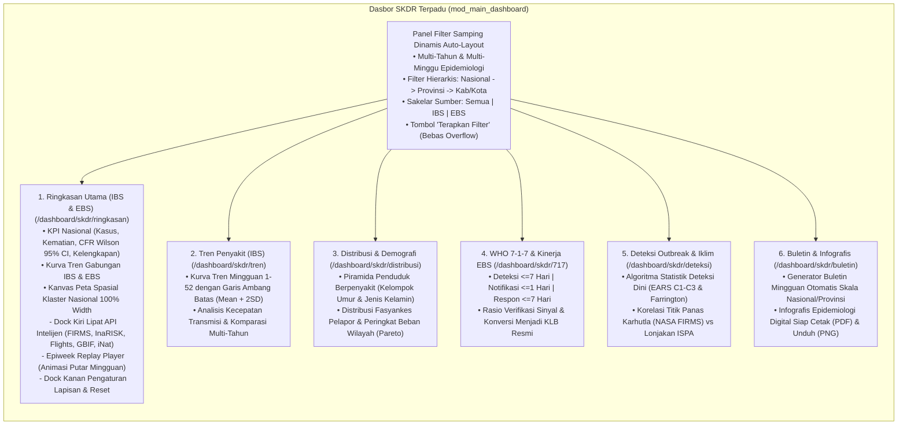
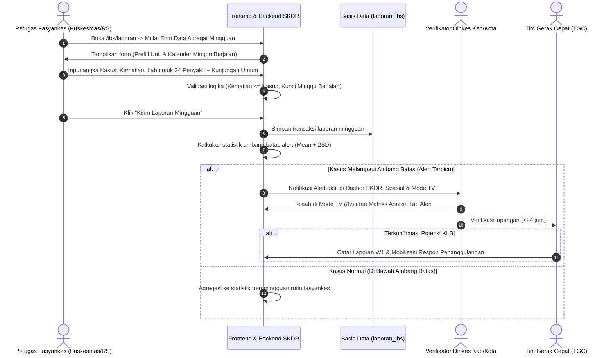
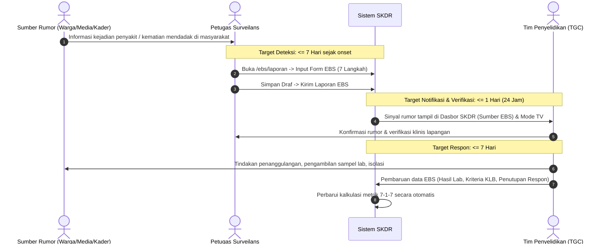
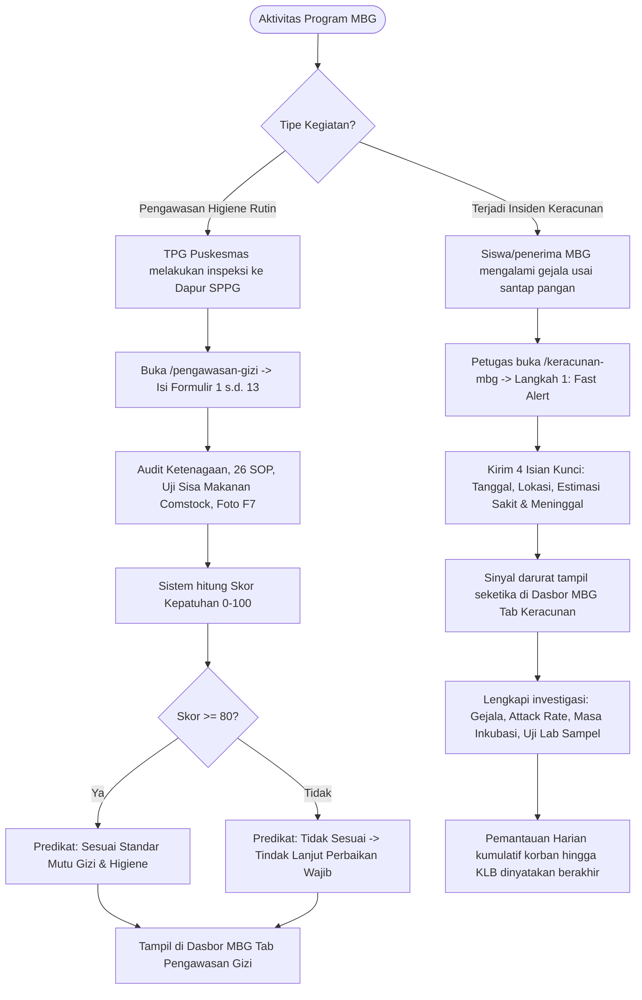
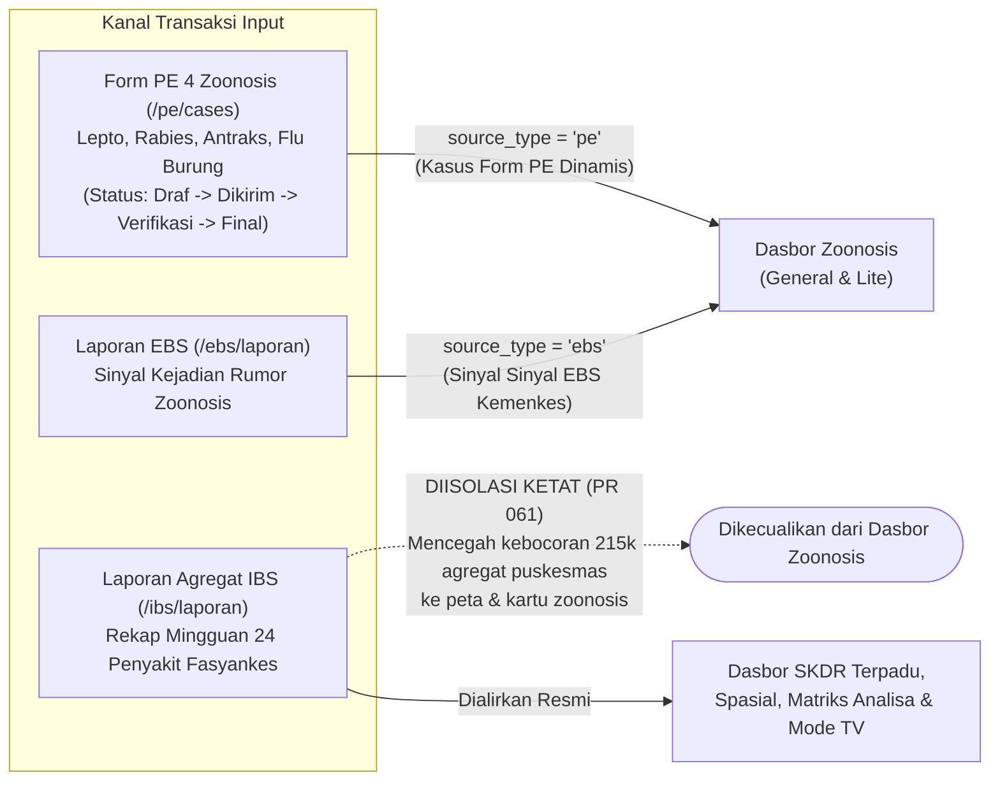
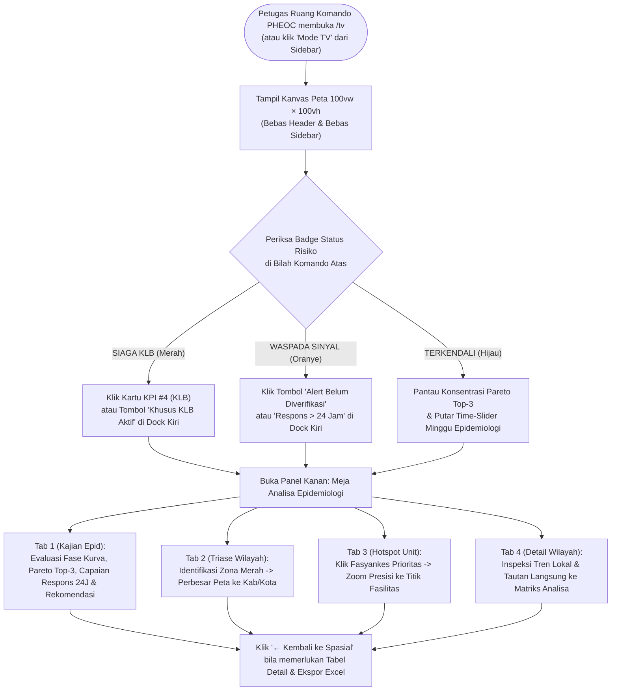

# DOKUMEN SPESIFIKASI KEBUTUHAN BISNIS & SISTEM (BRD / SRS)
## SISTEM KEWASPADAAN DINI DAN RESPON (SKDR) INDONESIA
**Versi Dokumen:** 2.0 (Pembaruan Komprehensif Arsitektur, Formulir & Seluruh Modul Dasbor — PR 061)  
**Tanggal Rilis:** 12 November 2026  
**Klasifikasi:** Dokumen Fungsional Teknis, Spesifikasi Arsitektur & Panduan Operasional  
**Target Pembaca:** Pemangku Kebijakan (Kemenkes RI, Badan Gizi Nasional / BGN, Dinas Kesehatan Provinsi & Kab/Kota), Tim Epidemiologi Lapangan (PHEOC), Tim Pengembang Perangkat Lunak, Verifikator Kasus, Petugas Fasyankes & Pengawas SPPG.

---

## DAFTAR ISI
1. [Ringkasan Eksekutif & Tujuan Sistem](#1-ringkasan-eksekutif--tujuan-sistem)
2. [Prinsip Arsitektur Data & Keamanan](#2-prinsip-arsitektur-data--keamanan)
3. [Manajemen Akses, Struktur Menu Sidebar & Matriks Peran (RBAC)](#3-manajemen-akses-struktur-menu-sidebar--matriks-peran-rbac)
4. [Spesifikasi Seluruh Formulir Transaksi (Input Data)](#4-spesifikasi-seluruh-formulir-transaksi-input-data)
   - 4.1. Laporan EBS (Surveilans Berbasis Kejadian / Rumor)
   - 4.2. Laporan Agregat IBS (Surveilans Berbasis Indikator Mingguan)
   - 4.3. Laporan Individu IBS (Pencatatan Pasien Perorangan)
   - 4.4. Pengawasan Gizi MBG (13 Formulir Standar Kemenkes RI)
   - 4.5. Keracunan Pangan MBG (Investigasi KLB Pangan & Pemantauan Harian)
   - 4.6. Penyelidikan Epidemiologi (Form PE 4 Penyakit Zoonosis One Health)
5. [Spesifikasi Seluruh Modul Dasbor (Output & Analitik Sistem Terkini)](#5-spesifikasi-seluruh-modul-dasbor-output--analitik-sistem-terkini)
   - 5.1. Dasbor SKDR Terpadu (`mod_main_dashboard` — 6 Sub-Menu Induk)
   - 5.2. Dasbor Zoonosis (`mod_dasbor_kategori` — Zoonosis General, Zoonosis Lite & Kategori)
   - 5.3. Dasbor MBG Terpadu (`mod_dasbor_mbg` — 3 Sub-Menu Analitis)
   - 5.4. Mode TV — Pusat Komando Spasial & Meja Analisa Epidemiologi (`/tv`)
   - 5.5. Dasbor Limited — Spasial (`/dashboard/spasial`)
   - 5.6. Dasbor Limited — Matriks Analisa (`/dashboard/matriks-analisa`)
   - 5.7. Direktori Penyakit (`/penyakit`) & Ringkasan Dasbor (`/dashboard`)
6. [Diagram Alur Pengguna (End-to-End User Flows)](#6-diagram-alur-pengguna-end-to-end-user-flows)
   - Alur 1: Pelaporan Mingguan Rutin IBS & Pemicuan Ambang Batas Alert
   - Alur 2: Deteksi Rumor EBS & Standar Kinerja WHO 7-1-7
   - Alur 3: Audit Higiene SPPG & Penanggulangan KLB Keracunan Pangan MBG
   - Alur 4: Alur Verifikasi Form PE & Isolasi Sumber Dasbor Zoonosis
   - Alur 5: Triase Spasial Nasional & Kajian Epidemiologi di Mode TV
7. [Matriks Hubungan Input Formulir ke Seluruh Tampilan Dasbor](#7-matriks-hubungan-input-formulir-ke-seluruh-tampilan-dasbor)
8. [Aturan Validasi Bisnis & Penjaminan Integritas Data](#8-aturan-validasi-bisnis--penjaminan-integritas-data)

---

## 1. RINGKASAN EKSEKUTIF & TUJUAN SISTEM

### 1.1. Latar Belakang
Sistem Kewaspadaan Dini dan Respon (SKDR) Indonesia adalah platform nasional terintegrasi untuk mendeteksi secara dini sinyal Kejadian Luar Biasa (KLB), wabah penyakit menular berpotensi wabah, kedaruratan kesehatan masyarakat (*Public Health Emergency of International Concern* - PHEIC), penyakit zoonosis prioritas lintas sektor *One Health*, serta insiden keamanan pangan pada Program Makan Bergizi Gratis (MBG).

### 1.2. Tujuan Strategis Sistem
1. **Deteksi Dini & Respon Cepat:** Menyediakan mekanisme pelaporan dan pengolahan data *real-time* yang memenuhi indikator standar global **WHO / Resolve to Save Lives (7-1-7)**:
   - **$\le 7$ Hari:** Deteksi dini sejak onset gejala klinis pertama.
   - **$\le 1$ Hari (24 Jam):** Notifikasi resmi dan verifikasi sinyal oleh tim surveilans dinas kesehatan.
   - **$\le 7$ Hari:** Respon penyelidikan lapangan, pengambilan spesimen, dan tindakan pengendalian awal.
2. **Penyatuan 12 Sub-Dasbor Kemenkes:** Menghilangkan fragmentasi antarmuka melalui perombakan menu induk **Dasbor SKDR Terpadu** yang mengonsolidasi seluruh analisis surveilans nasional ke dalam 6 sub-menu komprehensif.
3. **Pengawasan Mutu & Higiene Program MBG:** Mengakomodasi kebutuhan khusus Badan Gizi Nasional (BGN) dan Kemenkes RI melalui audit higiene dapur SPPG (13 formulir standar) serta pelaporan cepat investigasi insiden keracunan pangan.
4. **Kesiapsiagaan Pusat Komando PHEOC:** Menyediakan **Mode TV (`/tv`)** mandiri *full-viewport* ($100\text{vw} \times 100\text{vh}$) tanpa header/sidebar untuk ruang komando operasional.

---

## 2. PRINSIP ARSITEKTUR DATA & KEAMANAN

1. **100% Berbasis Transaksi & Sinkronisasi API Resmi (Anti-Scraping / Anti-NLP):**
   - Seluruh data yang mengalir ke dasbor bersumber murni dari transaksi formulir pelaporan fasyankes (`laporan_ibs`, `laporan_ibs_individu`, `pe_cases`, `mbg_kunjungan`, `mbg_keracunan`) serta sinkronisasi resmi API Kemenkes (`ebs_reports` $\rightarrow$ `laporan_ebs`, `skdr_alerts` $\rightarrow$ `laporan_ibs`).
   - Tidak ada proses crawling, web scraping, maupun ekstraksi teks NLP tanpa izin.
2. **Isolasi Sumber Data Sesuai Konteks Epidemiologi:**
   - **Dasbor SKDR, Spasial, Matriks Analisa, dan Mode TV:** Menyediakan filter sakelar eksplisit antara **Sumber EBS**, **Sumber IBS**, atau **Semua Sumber**.
   - **Dasbor Zoonosis (Lite & General):** Diisolasi secara ketat dari ribuan data agregat rutin mingguan IBS (`source_type = 'ibs'` dikecualikan pada view `surveillance_reports`). Data zoonosis murni membaca **Sinyal Kejadian EBS** dan **Kasus Penyelidikan Form PE (`pe_cases`)**.
3. **Data Alami Bebas Dummy & Hardcode:**
   - Bila suatu sumber (seperti Form PE) belum memiliki inputan transaksi, kartu metrik dan kurva menyajikan nilai nol/kosong alami secara dinamis tanpa data rekayasa atau nilai statis di kode program.
4. **Keamanan & Kedaulatan Data:**
   - Menggunakan *tile proxy* internal (`/osm-tiles/{z}/{x}/{y}.png`) untuk peta OpenLayers sehingga tidak bergantung pada layanan pihak ketiga eksternal seperti CartoCDN.
   - Manajemen konfigurasi terpusat pada `.env` dan migrasi basis data PostgreSQL (`database/init/`). Sesi terlindungi *cookie* `HttpOnly` (`skdr_session`).

---

## 3. MANAJEMEN AKSES, STRUKTUR MENU SIDEBAR & MATRIKS PERAN (RBAC)

Navigasi aplikasi mengadopsi pemisahan area utama di bilah navigasi atas: **`DASBOR`** ↔ **`TATA KELOLA`**.

```mermaid
flowchart TD
    User([Pengguna]) --> Login{Status Otentikasi?}
    Login -- Belum Masuk --> PublicPages["Halaman Publik:\n• Beranda (/)\n• Masuk Akun (/masuk)"]
    Login -- Berhasil Masuk --> RoleCheck{Evaluasi Matriks Peran (RBAC)}
    
    RoleCheck -- "viewer / Semua Peran" --> AreaDasbor["Area Navigasi DASBOR:\n• Ringkasan Dasbor (/dashboard)\n• Dasbor SKDR (6 Sub-Menu Induk)\n• Dasbor Zoonosis (General, Lite, Kategori)\n• Dasbor MBG (3 Sub-Menu Analitis)\n• Penyakit (/penyakit)\n• Mode TV Spasial (/tv)\n• Spasial & Matriks Analisa"]
    
    RoleCheck -- "petugas (pe_input)" --> AreaTransaksi["Area TATA KELOLA - Transaksi:\n• Entri Data Agregat IBS & Form Individu\n• Laporan EBS (Rumor & Verifikasi)\n• Form PE 4 Zoonosis (Lepto, Rabies, Antraks, AI)\n• Pengawasan Gizi MBG (13 Form) & Keracunan MBG"]
    
    RoleCheck -- "verifikator (pe_verify)" --> AreaVerifikasi["Area TATA KELOLA - Verifikasi:\n• Telaah & Verifikasi Laporan EBS\n• Validasi & Penguncian Status Final Form PE"]
    
    RoleCheck -- "pengelola (master_data, integrasi)" --> AreaPengelolaan["Area TATA KELOLA - Pengelolaan:\n• Master Wilayah, Penyakit, dan Fasyankes\n• Sinkronisasi Integrasi API Kemenkes"]
    
    RoleCheck -- "admin (*)" --> AreaAdmin["Area TATA KELOLA - Administrasi Sistem:\n• Manajemen Pengguna (/tatakelola/pengguna)\n• Manajemen Peran & Hak Akses (/tatakelola/peran)\n• Audit Trail Log Akses (/tatakelola/log-akses)"]
```

### 3.1. Matriks Peran Pengguna (*Role-Based Access Control*)
| Peran (*Role*) | Label Pengguna | Cakupan Hak Akses (*Permissions*) | Lingkup Fungsional |
|---|---|---|---|
| `admin` | Administrator | `*` (Akses Penuh Seluruh Sistem) | Seluruh modul dasbor, semua formulir input, tata kelola pengguna, peran, audit log, konfigurasi sistem, dan manajemen migrasi. |
| `pengelola` | Pengelola Data | `dashboard_limited`, `tatakelola`, `pe_input`, `pe_verify`, `master_data`, `integrasi` | Seluruh formulir transaksi, verifikasi kasus, pemeliharaan master fasyankes/wilayah/penyakit, dan sinkronisasi integrasi API. |
| `verifikator` | Verifikator PE | `dashboard_limited`, `tatakelola`, `pe_input`, `pe_verify` | Pengisian, koreksi, dan verifikasi status akhir Form PE (`Draf` $\rightarrow$ `Final`), verifikasi rumor EBS, dan seluruh dasbor analitik. |
| `petugas` | Petugas Input | `dashboard_limited`, `tatakelola`, `pe_input` | Entri data rutin fasyankes (Laporan Agregat & Individu IBS, Laporan EBS, Draf PE, Kunjungan Pengawasan Gizi MBG, Laporan Keracunan Pangan). |
| `viewer` | Pengguna Dasbor | `dashboard_limited` | Akses baca (*read-only*) ke seluruh grup **DASBOR** dan **DASBOR LIMITED** (termasuk Mode TV, Spasial, dan Matriks Analisa). |

### 3.2. Struktur Menu & Rute Navigasi Terkini

#### A. Sidebar Area **DASBOR** (`area: 'dashboard'`)
| Grup Sidebar | Menu Utama | Sub-Menu | Path URL | Deskripsi Fungsional |
|---|---|---|---|---|
| **Beranda** | **Beranda** | — | `/beranda` | Ringkasan navigasi terautentikasi dan pintasan lintas modul. |
| **Dasbor** | **Ringkasan Dasbor** | — | `/dashboard` | Hub katalog kartu akses cepat menuju modul-modul dasbor utama. |
| **Dasbor** | **Dasbor SKDR** *(Revamp PR 057)* | **Ringkasan Utama (IBS & EBS)** | `/dashboard/skdr/ringkasan` | KPI eksekutif nasional, kurva tren, dan kanvas peta spasial terintegrasi. |
| | | **Tren Penyakit (IBS)** | `/dashboard/skdr/tren` | Kurva epidemi mingguan 1–52 dengan garis batas ambang (Mean + 2SD). |
| | | **Distribusi & Demografi** | `/dashboard/skdr/distribusi` | Piramida umur & jenis kelamin, sebaran tipe unit fasyankes, ranking wilayah. |
| | | **WHO 7-1-7 & Kinerja EBS** | `/dashboard/skdr/717` | Pengukuran ketepatan respon 7-1-7, kualitas sinyal, dan konversi KLB. |
| | | **Deteksi Outbreak & Iklim** | `/dashboard/skdr/deteksi` | Algoritma EARS C1-C3/Farrington, korelasi titik api NASA FIRMS vs ISPA. |
| | | **Buletin & Infografis** | `/dashboard/skdr/buletin` | Generator buletin mingguan otomatis dan infografis epidemiologi siap unduh. |
| **Dasbor** | **Dasbor Zoonosis** *(PR 058/060)* | **Zoonosis General** | `/dasbor/zoonosis-general` | Sintesis beban kasus, CFR, kurva tren, alert, 7-1-7, lab, klaster, dan peta multi-mode. |
| | | **Zoonosis Lite** | `/dasbor/zoonosis-lite` | Dasbor 1-layar 4 penyakit One Health (Antraks, Rabies, Lepto, AI) murni EBS & PE. |
| | | *(Kategori Penyakit)* | `/dasbor/kategori/[slug]` | Analisis klaster penyakit per kategori (PD3I, Tular Vektor, dll.). |
| **Dasbor** | **Dasbor MBG** *(PR 052/054)* | **Ringkasan Eksekutif** | `/dashboard/mbg/ringkasan` | Kajian pimpinan, pengerahan TGC/Labkesda, korelasi pengawasan $\times$ kejadian, peta 2-kolom. |
| | | **Keracunan Pangan** | `/dashboard/mbg/keracunan` | Analisis KLB keracunan MBG, attack rate, masa inkubasi, 26 SOP, update harian. |
| | | **Pengawasan Gizi** | `/dashboard/mbg/pengawasan` | Analisis kepatuhan SPPG (Formulir 1–13), skor mutu higiene, ranking pembinaan. |
| **Dasbor** | **Penyakit** | — | `/penyakit` | Direktori referensi klinis, definisi kasus, dan ambang kewaspadaan. |
| **Dasbor** | **Mode TV** *(PR 050)* | — | `/tv` | Pusat Komando Spasial penuh layar ($100\text{vw} \times 100\text{vh}$) tanpa header/sidebar. |
| **Dasbor Limited** | **Spasial** | — | `/dashboard/spasial` | Peta analisa spasial fluid full-width, filter samping, kluster fasyankes, tabel ekspor. |
| **Dasbor Limited** | **Matriks Analisa** | — | `/dashboard/matriks-analisa` | Meja analitik kuantitatif 6 tab (48 jenis laporan resmi SKDR) + Ekspor Excel. |
| **Lainnya** | **Dokumentasi** | — | `/dokumentasi` | Panduan teknis dan referensi sistem SKDR. |

#### B. Sidebar Area **TATA KELOLA** (`area: 'tatakelola'`)
| Grup Sidebar | Menu Utama | Sub-Menu | Path URL | Izin (*Permission*) |
|---|---|---|---|---|
| **Tata Kelola** | **Ringkasan Tata Kelola** | — | `/tatakelola` | `tatakelola` |
| **Transaksi** | **Form PE (Zoonosis)** | Daftar PE | `/pe` | `pe_input` / `pe_verify` |
| | | Leptospirosis | `/pe/lepto` | `pe_input` / `pe_verify` |
| | | Rabies / GHPR | `/pe/rabies` | `pe_input` / `pe_verify` |
| | | Antraks | `/pe/antraks` | `pe_input` / `pe_verify` |
| | | Avian Influenza | `/pe/ai` | `pe_input` / `pe_verify` |
| **Transaksi** | **Laporan EBS** | — | `/ebs/laporan` | `pe_input` |
| **Transaksi** | **Laporan Agregat IBS** | — | `/ibs/laporan` | `pe_input` |
| **Transaksi** | **Laporan Individu IBS** | — | `/ibs/individu` | `pe_input` |
| **Transaksi** | **Program MBG** | Dasbor MBG | `/dashboard/mbg/ringkasan` | `dashboard_limited` |
| | | Pengawasan Gizi MBG | `/pengawasan-gizi` | `pe_input` |
| | | Keracunan Pangan MBG | `/keracunan-mbg` | `pe_input` |
| **Integrasi** | **Sinkronisasi EBS** | — | `/ebs` | `integrasi` |
| **Manajemen Akses** | **Pengguna** | — | `/tatakelola/pengguna` | `user_management` |
| | **Peran & Hak Akses** | — | `/tatakelola/peran` | `user_management` |
| | **Log Akses** | — | `/tatakelola/log-akses` | `user_management` |

---

## 4. SPESIFIKASI SELURUH FORMULIR TRANSAKSI (INPUT DATA)

### 4.1. Laporan EBS (Surveilans Berbasis Kejadian / Rumor)
- **Tujuan:** Pelaporan cepat sinyal rumor penyakit menular atau keracunan mendadak di masyarakat, verifikasi lapangan, pencatatan tatalaksana spesimen lab, pemenuhan kriteria KLB (Formulir W1), dan respon lintas program/sektor (SIZE).
- **Struktur Formulir (Wizard 7 Langkah):**
  1. *Pelapor & Wilayah:* No. laporan otomatis (`EBS-YYYY-XXXX`), tanggal lapor, jenis unit pelapor, wilayah hierarkis (Provinsi, Kab/Kota, Kecamatan, Unit Faskes), nama & no. HP petugas.
  2. *Informasi Rumor:* Dugaan penyakit, tanggal rumor diketahui, status kejadian (*Rumor Baru, Terverifikasi Kasus, Ditolak / Bukan Masalah Kesehatan*), penyakit terverifikasi, sumber informasi & pihak verifikasi.
  3. *Kasus & Klinis:* Jumlah kasus & kematian ($\text{Kematian} \le \text{Kasus}$), matriks silang 11 kelompok umur $\times$ 2 jenis kelamin, domisili kasus, tanggal onset gejala pertama, tanggal datang ke fasyankes, dan narasi kronologi.
  4. *Lab & Tata Laksana:* Pengambilan spesimen lab, tanggal ambil/kirim/hasil, jenis hasil lab (*Positif, Negatif, Menunggu Hasil, Inkonklusif*), jumlah positif, dan opsi tatalaksana medis.
  5. *Status KLB & Tindakan:* Kriteria KLB, dokumen W1, penetapan SK Kepala Daerah, mobilisasi TGC, status KLB (*Berlangsung, Terkendali, Berakhir*), PFR, dan komunikasi risiko.
  6. *Lampiran & Respon SIZE:* Unggah berkas dokumen/foto pendukung ($\le 5\text{MB}$) dan formulir koordinasi SIZE One Health.
  7. *Tinjau & Kirim:* Validasi konsistensi angka dan transmisi draf menjadi laporan resmi tersimpan.

### 4.2. Laporan Agregat IBS (Surveilans Berbasis Indikator Mingguan)
- **Tujuan:** Rekapitulasi mingguan angka morbiditas, mortalitas, dan konfirmasi lab dari seluruh unit fasyankes (Puskesmas dan Rumah Sakit) untuk 24 penyakit prioritas SKDR.
- **Struktur Formulir (Wizard 4 Langkah):**
  1. *Unit & Wilayah:* Unit pelapor, Provinsi, Kab/Kota, Kecamatan, nama petugas pengentri.
  2. *Periode Laporan:* Tahun laporan dan Minggu Epidemiologi (M1 s.d. M52/M53; minggu masa depan terkunci otomatis).
  3. *Data Kasus (Grid 24 Penyakit + Total Kunjungan):* Matriks isian baris 24 penyakit (Jumlah Kasus, Jumlah Kematian, Jumlah Konfirmasi Lab) + Total Kunjungan Umum Fasyankes + Opsi *Laporan Nihil* (Zero-Reporting).
  4. *Tinjau & Kirim:* Pengecekan duplikasi kunci unik (`Unit Pelapor + Tahun + Minggu Epid`) dan kalkulasi pemicuan alert (Mean + 2SD).

### 4.3. Laporan Individu IBS (Pencatatan Pasien Perorangan)
- **Tujuan:** Pencatatan *case-based surveillance* perorangan untuk pasien dengan diagnosis penyakit berpotensi wabah.
- **Struktur Formulir (5 Langkah):**
  1. *Unit & Periode:* Puskesmas, petugas pelapor, no. kontak, tahun dan minggu epidemiologi.
  2. *Identitas Pasien:* Nama pasien, No. Rekam Medis / No. Epid, NIK (opsional terenkripsi), domisili lengkap, kelompok usia rinci (tahun/bulan/hari), jenis kelamin, pekerjaan.
  3. *Penyakit & Diagnosis:* Pilihan 24 penyakit IBS, tanggal pemeriksaan klinis, status akhir pasien (*Sembuh, Masih Dirawat, Dirujuk, Meninggal* — wajib tanggal meninggal bila meninggal), keluhan utama, lama sakit, kode ICD-10, diagnosis dokter.
  4. *Pemeriksaan Fisik & SOAP:* Tanda vital (tekanan darah, suhu tubuh, denyut nadi), tinggi badan, berat badan, **Kalkulator IMT Otomatis** ($\text{IMT} = \frac{\text{BB}}{\text{TB}^2}$), dan ringkasan catatan medis SOAP.
  5. *Tinjau & Kirim:* Simpan ke tabel transaksi `laporan_ibs_individu`.

### 4.4. Pengawasan Gizi MBG (13 Formulir Standar Kemenkes RI)
- **Tujuan:** Standarisasi inspeksi mutu, keamanan pangan, dan higiene sanitasi dapur Satuan Pelayanan Program Gizi (SPPG) oleh Tenaga Pelaksana Gizi (TPG) Puskesmas.
- **Struktur Formulir (13 Formulir Kemenkes):**
  - *Identitas Kunjungan:* Wilayah, nama TPG, nama SPPG, nama pengawas dapur SPPG, tanggal kunjungan.
  - *F1:* Kebutuhan Bahan Pangan & Ketenagaan penjamah makanan.
  - *F2:* Standar Porsi & Pemenuhan Nilai Gizi sasaran.
  - *F3:* Penerapan SOP Perencanaan Menu.
  - *F4:* Penerapan SOP Pemesanan Bahan Pangan (13 butir spesifik).
  - *F5:* Penerapan SOP Penerimaan Bahan Pangan.
  - *F6:* Penerapan SOP Penyimpanan Bahan Pangan (FIFO/FEFO, kontrol suhu).
  - *F7:* Penerapan SOP Persiapan Bahan Pangan (5 butir + unggah foto dokumentasi per butir).
  - *F8:* Penerapan SOP Pengolahan Bahan Pangan.
  - *F9:* Penerapan SOP Pemorsian & Pengepakan Makanan.
  - *F10:* Penerapan SOP Distribusi Pangan ke Sekolah/Posyandu (uji 5 sampel sisa makanan).
  - *F11:* Pengawasan Penyajian & Konsumsi (evaluasi sisa makanan metode Comstock).
  - *F12:* Audit Mutu Higiene Sanitasi Lingkungan Dapur SPPG.
  - *F13:* Rekapitulasi Skor & Rekomendasi (Skor Kepatuhan $0-100$; predikat **Sesuai Standar bila Skor $\ge 80$**).

### 4.5. Keracunan Pangan MBG (Investigasi KLB Pangan & Pemantauan Harian)
- **Tujuan:** Pelaporan darurat saat terjadi dugaan insiden keracunan pangan penerima program MBG, pelacakan masa inkubasi dan attack rate, evaluasi 26 SOP dapur SPPG, pengujian sampel laboratorium, dan pemantauan kumulatif harian.
- **Struktur Formulir:**
  1. *Laporan Cepat (Fast Alert):* 4 kolom wajib untuk pemicuan sinyal instan (Tanggal kejadian, Wilayah/Provinsi, Estimasi Kasus Sakit, Estimasi Kematian).
  2. *Investigasi Rinci:* Karakteristik gejala klinis dominan, perhitungan otomatis *Attack Rate* ($\text{AR} = \frac{\text{Sakit}}{\text{Populasi Terpapar}} \times 100$) dan kurva masa inkubasi.
  3. *Menu & Penanganan Medis:* Komposisi sampel menu pangan yang dikonsumsi, fasilitas rujukan medis korban.
  4. *Audit Lingkungan SPPG:* Checklist pemenuhan 26 SOP higiene sanitasi dapur terkait insiden.
  5. *Pengujian Spesimen Laboratorium:* Pelacakan sampel pangan, air bersih, usap alat masak, dan spesimen muntahan/feses korban.
  6. *Modul Pemantauan Harian (Daily Updates):* Pencatatan perkembangan kasus kumulatif harian (kasus baru, sembuh, rawat inap, kematian) hingga KLB dinyatakan berakhir.

### 4.6. Penyelidikan Epidemiologi (Form PE 4 Penyakit Zoonosis One Health)
- **Tujuan:** Formulir investigasi perorangan mendalam untuk 4 penyakit zoonosis prioritas One Health: **Leptospirosis**, **Rabies / GHPR**, **Antraks**, dan **Flu Burung (Avian Influenza)**.
- **Siklus Status Transaksi:** `Draf` $\rightarrow$ `Dikirim` $\rightarrow$ `Terverifikasi` $\rightarrow$ `Final` (disimpan pada tabel `pe_cases`).
- **Fitur Kunci:** Validasi klasifikasi kasus otomatis (Konfirmasi, Probabel, Suspek), pencatatan riwayat gigitan/paparan hewan penular, riwayat vaksinasi VAR/SAR, dan pelacakan klaster kontak erat.

---

## 5. SPESIFIKASI SELURUH MODUL DASBOR (OUTPUT & ANALITIK SISTEM TERKINI)

### 5.1. Dasbor SKDR Terpadu (`mod_main_dashboard` — 6 Sub-Menu Induk)
*(Hasil Restrukturisasi Menyeluruh pada PR 057 yang menyatukan 12 sub-dasbor Kemenkes menjadi 1 modul induk navigasi terpadu).*



### 5.2. Dasbor Zoonosis (`mod_dasbor_kategori` — Zoonosis General, Lite & Kategori)
*(Diperbarui pada PR 058, PR 060, dan PR 061).*

1. **Sub-Menu 1: Zoonosis General (`/dasbor/zoonosis-general` — PR 060):**
   - Menghadirkan tampilan komprehensif untuk seluruh penyakit zoonosis.
   - Dilengkapi kartu ringkasan eksekutif KPI beban kasus dan CFR, tabel perbandingan penyakit, kurva tren mingguan, panel penelaahan alert SKDR, indikator 7-1-7, status pemeriksaan laboratorium, manajemen klaster, dan peta spasial OpenLayers multi-mode.
2. **Sub-Menu 2: Zoonosis Lite (`/dasbor/zoonosis-lite` — PR 049, PR 058, PR 061):**
   - **Fokus 4 Penyakit Prioritas One Health:** Antraks, Rabies/GHPR, Leptospirosis, dan Flu Burung (Avian Influenza).
   - **Fleksibilitas Sumber Zoonosis (PR 061):** Menyediakan selektor Sumber (`Semua Sumber`, `EBS`, `Form PE`).
   - **Isolasi Penuh dari Kebocoran Agregat IBS (PR 061):** Kasus Form PE murni membaca tabel transaksi `pe_cases` (`source_type = 'pe'`), dan sinyal EBS membaca `laporan_ebs` (`source_type = 'ebs'`). Titik agregat rutin mingguan IBS dari 12.000+ puskesmas disaring ketat dari peta dan kartu zoonosis.
   - **Pemetaan Diagnosa EBS Komprehensif (PR 061):** Menghubungkan alias diagnosa EBS riil Kemenkes (`gigitan hewan penular rabies (ghpr)`, `rabies konfirmasi`, `konfirmasi anthraks`, `suspek avian influenza`, `konfirmasi avian influenza`, `leptospirosis`) ke ID penyakit resmi.
   - **Penanganan Nilai Nol / Kosong Alami (PR 061):** Bila Form PE belum memiliki entri (setelah migrasi pembersihan `073_delete_form_pe_entries.sql`), kartu dan peta menampilkan nilai 0 secara dinamis dan bersih tanpa data dummy/hardcoded.
   - **Legenda & Penanda Peta:** Marker lingkaran oranye/merah (`bg-ebs`) untuk sinyal EBS dan marker wajik hijau (`bg-pe`) untuk kasus terverifikasi Form PE; legenda heatmap diselaraskan menjadi *Kasus Form PE*.
3. **Sub-Menu Kategori Lainnya (`/dasbor/kategori/[slug]`):**
   - Sub-menu dinamis untuk kelompok penyakit lainnya dari master (`PD3I`, `Tular Vektor`, `Water-borne Diseases`, dll.).

### 5.3. Dasbor MBG Terpadu (`mod_dasbor_mbg` — 3 Sub-Menu Analitis)
*(Diperbarui pada PR 052, PR 053, PR 054, dan PR 055).*

1. **Sub-Menu 1: Ringkasan Eksekutif (`/dashboard/mbg/ringkasan`):**
   - Kajian eksekutif pimpinan formal-analitis dan rekomendasi pengerahan sumber daya lapangan (TGC Puskesmas, Labkesda, dan Tenaga Pelaksana Gizi).
   - Matriks korelasi risiko: **Dapur SPPG Skor Rendah / Belum Diawasi $\times$ Kejadian Keracunan Pangan**.
   - Peta komparasi spasial 2-kolom: Lokasi insiden keracunan pangan di sisi kiri dan sebaran skor kepatuhan SPPG di sisi kanan.
2. **Sub-Menu 2: Keracunan Pangan (`/dashboard/mbg/keracunan`):**
   - Analisis epidemiologi insiden keracunan pangan pada penerima manfaat MBG.
   - Indikator utama: Jumlah Kejadian, Korban Sakit, Rawat Inap, Kematian, **CFR dengan Wilson 95% CI**, dan *Attack Rate*.
   - Kurva epidemi masa inkubasi, peringkat wilayah terdampak, evaluasi pemenuhan 26 SOP dapur SPPG, dan pelacakan hasil lab spesimen/pangan.
3. **Sub-Menu 3: Pengawasan Gizi (`/dashboard/mbg/pengawasan`):**
   - Analisis kepatuhan standar gizi dan mutu higiene dapur SPPG berdasarkan 13 formulir standar Kemenkes RI.
   - Indikator utama: Total Kunjungan Inspeksi, Rata-rata Skor Kepatuhan, Persentase SPPG Memenuhi Syarat ($\ge 80$).
   - Analisis butir ketidakpatuhan tersering F1–F13, matriks heatmap SPPG $\times$ Formulir, dan daftar prioritas SPPG yang memerlukan pembinaan intensif.

### 5.4. Mode TV — Pusat Komando Spasial & Meja Analisa Epidemiologi (`/tv`)
*(Diimplementasikan pada PR 050 untuk layar dinding ruang komando PHEOC).*

- **Kanvas Peta Penuh Layar ($100\text{vw} \times 100\text{vh}$):** Berjalan tanpa header aplikasi dan tanpa sidebar navigasi (`tvMode={true}`).
- **Bilah Komando Atas (Top Command Bar):**
  - Tombol **`← Kembali ke Spasial`** untuk navigasi balik ke `/dashboard/spasial` dengan mempertahankan parameter filter.
  - **Badge Status Risiko Otomatis:** Menghitung tingkat kedaruratan wilayah secara langsung:
    - **`SIAGA KLB`** (Merah): Terdapat KLB aktif ($\text{KLB} > 0$), $\text{CFR} \ge 2{,}0\%$, atau lonjakan mingguan $\ge +25\%$.
    - **`WASPADA SINYAL`** (Oranye): Terdapat sinyal alert ($\text{Alert} > 0$), kenaikan $\Delta > +5\%$, atau $\text{CFR} \ge 0{,}5\%$.
    - **`TERKENDALI`** (Hijau): Kondisi tenang di bawah ambang batas kewaspadaan.
- **6 Kartu KPI Epidemiologi HUD (1-Klik Mengubah Layer Peta):**
  1. *Kasus & Kecepatan Transmisi* $\rightarrow$ Choropleth Kasus.
  2. *Kematian & CFR (Wilson 95% CI)* $\rightarrow$ Choropleth CFR.
  3. *Alert / Sinyal & % Verifikasi* $\rightarrow$ Choropleth Alert.
  4. *KLB Aktif & Kinerja Respon $\le 24\text{ Jam}$* $\rightarrow$ Choropleth KLB.
  5. *Sebaran Wilayah & Indeks Konsentrasi Pareto Top-3* $\rightarrow$ Choropleth Perubahan Mingguan.
  6. *Unit Pelapor di Peta & Presisi Koordinat GPS* $\rightarrow$ Beralih mode Kluster/Titik.
- **Dock Kiri Triase Cepat Titik Unit (1-Klik):**
  - 5 Tombol filter instan: `Semua Unit Pelapor`, `Khusus KLB Aktif`, `Alert Belum Diverifikasi`, `Respons > 24 Jam`, dan `Terverifikasi`.
  - Kontrol mode visualisasi (*Choropleth*, *Heatmap*, *Titik/Kluster*, *Peta Dasar* OSM internal).
- **Panel Kanan — Meja Analisa Epidemiologi (4 Tab):**
  - *Tab 1 (Kajian Epid):* Sintesis otomatis fase kurva epidemi (Akselerasi/Plateau/Dekelerasi), Pareto Top-3 wilayah, evaluasi target respons 24 jam ($\ge 80\%$), dan rekomendasi teknis epidemiolog.
  - *Tab 2 (Triase Wilayah):* Pengelompokan komposit wilayah ke dalam Zona Merah, Waspada, dan Terkendali.
  - *Tab 3 (Hotspot Unit):* Daftar 25 fasyankes prioritas tinggi (klik untuk zoom langsung ke titik faskes di peta).
  - *Tab 4 (Detail Wilayah):* Profil epidemiologi wilayah terpilih, kurva lokal, daftar penyakit teratas, dan tautan ke Matriks Analisa.

### 5.5. Dasbor Limited — Spasial (`/dashboard/spasial`)
- Dasbor pemetaan analitik terpadu di dalam shell aplikasi standar.
- Fitur: Fluid auto-layout ($w\text{-full}$ saat sidebar/filter dilipat), 7 kartu KPI komprehensif, interpretasi otomatis, peta OpenLayers (kluster fasyankes, choropleth batas administrasi), serta **Daftar Laporan Spasial** di bawah peta lengkap dengan paginasi, pencarian, tombol fokus titik, dan **Ekspor Excel**.

### 5.6. Dasbor Limited — Matriks Analisa (`/dashboard/matriks-analisa`)
- Meja analitik kuantitatif data SKDR (IBS, EBS, dan Semua) dengan panel filter samping sticky, fluid layout, dan **6 Tab Analitik**:
  1. *Tab 1 (Ringkasan & Tren):* KPI eksekutif, kurva epidemi dengan garis ambang Mean + 2SD, komparasi tahunan.
  2. *Tab 2 (Matriks & Laporan):* Katalog **48 jenis laporan resmi SKDR**, tabel silang dinamis, drill-down berjenjang.
  3. *Tab 3 (Morbiditas):* Beban penyakit, distribusi umur/jenis kelamin, proporsi terhadap kunjungan umum.
  4. *Tab 4 (Kinerja Pelaporan):* Kelengkapan dan ketepatan laporan mingguan (garis target 80%), indikator 7-1-7.
  5. *Tab 5 (Alert & Sinyal):* Rasio konversi sinyal menjadi KLB, 20 kecamatan hotspot teratas, penyamaran PII otomatis.
  6. *Tab 6 (Profil Kasus):* Demografi umur/jenis kelamin, CFR Wilson 95% CI, rincian klinis.
  - Setiap tab dilengkapi tombol **Ekspor Excel (`.xlsx`)**.

### 5.7. Direktori Penyakit (`/penyakit`) & Ringkasan Dasbor (`/dashboard`)
- **Direktori Penyakit (`/penyakit`):** Ensiklopedia referensi klinis 24 penyakit IBS dan zoonosis prioritas (definisi kasus operasional, masa inkubasi, ambang batas sinyal, rekomendasi tatalaksana, dan tautan ke modul analitik).
- **Ringkasan Dasbor (`/dashboard`):** Hub katalog kartu eksekutif yang menghubungkan pengguna ke seluruh modul analitik sistem.

---

## 6. DIAGRAM ALUR PENGGUNA (END-TO-END USER FLOWS)

### Alur 1: Pelaporan Mingguan Rutin IBS & Pemicuan Ambang Batas Alert


---

### Alur 2: Deteksi Rumor EBS & Standar Kinerja WHO 7-1-7


---

### Alur 3: Audit Higiene SPPG & Penanggulangan KLB Keracunan Pangan MBG


---

### Alur 4: Alur Verifikasi Form PE & Isolasi Sumber Dasbor Zoonosis


---

### Alur 5: Triase Spasial Nasional & Kajian Epidemiologi di Mode TV


---

## 7. MATRIKS HUBUNGAN INPUT FORMULIR KE SELURUH TAMPILAN DASBOR

| Formulir Transaksi / Sumber Data | Data Isian Kunci | Modul Dasbor Penerima | Indikator & Visualisasi Terkait |
|---|---|---|---|
| **Laporan Agregat IBS** (`/ibs/laporan` & API Alert SKDR) | Kasus, Kematian, Lab, Alert (Mean+2SD), Total Kunjungan, Status Verifikasi & Respons 24J | **Dasbor SKDR Terpadu** (Sub 1, 2, 3), **Spasial**, **Matriks Analisa**, **Mode TV** | Beban kasus, CFR Wilson 95% CI, kurva epidemi mingguan 1–52, piramida usia/jenis kelamin, pemetaan choropleth & 12.000+ titik fasyankes, triase respons $>24\text{ jam}$, 48 jenis laporan resmi. *(Dikecualikan ketat dari Dasbor Zoonosis)*. |
| **Laporan Individu IBS** (`/ibs/individu`) | Diagnosis ICD-10, Umur, Jenis Kelamin, Antropometri, Tanda Vital, SOAP | **Dasbor SKDR Terpadu** (Sub 3), **Matriks Analisa** (Tab Profil Kasus & Morbiditas), **Spasial** | Analisis morbiditas demografi presisi, kalkulasi IMT, profil klinis pasien individual. |
| **Laporan EBS** (`/ebs/laporan` & API EBS Kemenkes) | Sinyal Rumor, Matriks Usia 11 Kelompok, Lab, W1, TGC, Capaian Respons 7-1-7 | **Dasbor SKDR Terpadu** (Sub 1 & 4), **Dasbor Zoonosis** (General & Lite), **Spasial**, **Matriks Analisa**, **Mode TV** | Sinyal kejadian EBS, marker lingkaran oranye/merah (`bg-ebs`), capaian indikator 7-1-7, rasio konversi KLB, kajian meja analisa Mode TV. |
| **Form PE 4 Zoonosis** (`/pe/cases`) | Investigasi Lepto, Rabies, Antraks, AI; Paparan Hewan; Vaksinasi VAR/SAR; Lab; Kematian | **Dasbor Zoonosis** (`/dasbor/zoonosis-lite` & `/dasbor/zoonosis-general`) | Titik wajik kasus investigasi PE (`bg-pe`), kartu beban kasus/kematian dinamis (nilai 0 alami jika belum ada entri), analisis One Health. |
| **Pengawasan Gizi MBG** (`/pengawasan-gizi`) | Kunjungan TPG, 13 Formulir Kemenkes, Audit 26 SOP Dapur, Foto Dokumentasi F7 | **Dasbor MBG** (`/dashboard/mbg/pengawasan` & `/dashboard/mbg/ringkasan`) | Skor kepatuhan SPPG ($0-100$, ambang $\ge 80$), peta sebaran skor SPPG, matriks heatmap kepatuhan F1–F13 $\times$ Minggu, korelasi risiko pengawasan $\times$ kejadian. |
| **Keracunan Pangan MBG** (`/keracunan-mbg`) | Fast Alert (Tanggal, Lokasi, Sakit, Kematian), Attack Rate, Inkubasi, SOP, Lab, Update Harian | **Dasbor MBG** (`/dashboard/mbg/keracunan` & `/dashboard/mbg/ringkasan`) | Sinyal KLB keracunan pangan, grafik perkembangan harian korban, attack rate, masa inkubasi, CFR Wilson 95% CI, peta insiden. |

---

## 8. ATURAN VALIDASI BISNIS & PENJAMINAN INTEGRITAS DATA

1. **Integritas Mortalitas terhadap Morbiditas:**
   - Jumlah Kematian secara mutlak tidak boleh melampaui Jumlah Kasus ($\text{Kematian} \le \text{Kasus}$).
   - Pada form individu atau kasus kematian $> 0$, tanggal meninggal wajib dicatat dan berada pada rentang waktu logis ($\text{Tgl Meninggal} \ge \text{Onset}$).
2. **Integritas Kronologi Epidemiologi:**
   - Tanggal timbul gejala (*onset*) tidak boleh berada di masa depan ($\text{Onset} \le \text{Hari Ini}$).
   - Tanggal kunjungan berobat ke fasyankes harus sama atau setelah tanggal timbul gejala ($\text{Tgl Faskes} \ge \text{Onset}$).
   - Minggu epidemiologi yang dipilih pada laporan mingguan dibatasi hingga minggu berjalan pada kalender operasional saat ini.
3. **Integritas Konsistensi Demografi EBS:**
   - Total penjumlahan kasus pada matriks demografi ($11\text{ kelompok umur} \times 2\text{ jenis kelamin}$) wajib identik dengan angka total Jumlah Kasus yang dilaporkan.
4. **Pencegahan Duplikasi Data Transaksi:**
   - Memvalidasi keunikan kombinasi `Unit Pelapor + Tahun + Minggu Epidemiologi` pada Laporan Agregat IBS (`HTTP 409 Conflict` jika terjadi duplikasi).
   - Memberikan konfirmasi peringatan duplikasi lunak pada Laporan EBS ($\pm 7\text{ hari}$ pada wilayah yang sama) dan Form Individu IBS (`Unit + Nama Pasien + Tanggal Periksa`).
5. **Autosave Draf & Keamanan Akses:**
   - Seluruh formulir multi-langkah (EBS, IBS, MBG, PE) menyimpan draf transaksi secara otomatis (*autosave*) pada penyimpanan lokal peramban.
   - Sesi terlindungi *cookie* `HttpOnly` (`skdr_session`) dengan evaluasi hak akses ketat di setiap *endpoint* API peladen backend Rust Axum.

---
*Dokumen ini merupakan spesifikasi bisnis dan teknis resmi Sistem Kewaspadaan Dini dan Respon (SKDR) Indonesia Versi 2.0 yang telah diselaraskan dengan seluruh implementasi dan arsitektur kode sumber mutakhir (hingga PR 061).*
