# DOKUMEN SPESIFIKASI KEBUTUHAN BISNIS & SISTEM (BRD / SRS)
## SISTEM KEWASPADAAN DINI DAN RESPON (SKDR) INDONESIA
**Versi Dokumen:** 1.1 (Diperbarui sesuai Tampilan & Arsitektur Halaman Terbaru — PR 050)  
**Tanggal Rilis:** 11 November 2026  
**Klasifikasi:** Dokumen Fungsional Teknis & Panduan Pengguna  
**Target Pembaca:** Pemangku Kebijakan (Kemenkes RI, BGN, Dinas Kesehatan Provinsi & Kab/Kota), Ahli Epidemiologi Lapangan (PHEOC), Tim Pengembang, Verifikator Epidemiologi, Petugas Fasyankes & Pengawas SPPG.

---

## DAFTAR ISI
1. [Ringkasan Eksekutif & Tujuan Sistem](#1-ringkasan-eksekutif--tujuan-sistem)
2. [Manajemen Akses, Struktur Menu Sidebar & Matriks Peran (RBAC)](#2-manajemen-akses-struktur-menu-sidebar--matriks-peran-rbac)
3. [Spesifikasi Seluruh Formulir Transaksi (Input Data)](#3-spesifikasi-seluruh-formulir-transaksi-input-data)
   - 3.1. Laporan EBS (Surveilans Berbasis Kejadian)
   - 3.2. Laporan Agregat IBS (Surveilans Berbasis Indikator Mingguan)
   - 3.3. Laporan Individu IBS (Pencatatan per Pasien)
   - 3.4. Pengawasan Gizi MBG (Makan Bergizi Gratis - 13 Formulir Kemenkes)
   - 3.5. Keracunan Pangan MBG (Investigasi Insiden KLB Pangan & Pemantauan Harian)
   - 3.6. Penyelidikan Epidemiologi (Form PE 4 Penyakit Zoonosis One Health)
4. [Spesifikasi Seluruh Modul Dasbor (Output & Analitik Saat Ini)](#4-spesifikasi-seluruh-modul-dasbor-output--analitik-saat-ini)
   - 4.1. Ringkasan Dasbor (`/dashboard`) & Beranda (`/`, `/beranda`)
   - 4.2. Dasbor SKDR (`/main-dashboard`)
   - 4.3. Dasbor Zoonosis Lite (`/dasbor/zoonosis-lite`)
   - 4.4. Dasbor MBG (`/dasbor/mbg`)
   - 4.5. Direktori Penyakit (`/penyakit`)
   - 4.6. Mode TV — Pusat Komando Spasial & Meja Analisa Epidemiologi (`/tv`)
   - 4.7. Dasbor Limited — Spasial (`/dashboard/spasial`)
   - 4.8. Dasbor Limited — Matriks Analisa (`/dashboard/matriks-analisa`)
   - 4.9. Dasbor Arsip Tersembunyi — Dasbor SKDR EBS & IBS (`/dasbor/ebs-ibs`)
5. [Diagram Alur Pengguna (User Flows)](#5-diagram-alur-pengguna-user-flows)
   - Alur 1: Pelaporan Mingguan Rutin IBS & Pemicuan Alert
   - Alur 2: Deteksi Rumor EBS & Respons Cepat 7-1-7
   - Alur 3: Pengawasan Higiene SPPG & Penanggulangan Keracunan Pangan MBG
   - Alur 4: Siklus Verifikasi Penyelidikan Epidemiologi (PE) & Isolasi Peta Zoonosis Lite
   - Alur 5: Triase Spasial & Kajian Epidemiologi di Ruang Komando Mode TV (`/tv`)
6. [Matriks Hubungan Input Formulir ke Dasbor (Data Mapping Matrix)](#6-matriks-hubungan-input-formulir-ke-dasbor-data-mapping-matrix)
7. [Aturan Validasi & Penjaminan Kualitas Data](#7-aturan-validasi--penjaminan-kualitas-data)

---

## 1. RINGKASAN EKSEKUTIF & TUJUAN SISTEM

### 1.1. Latar Belakang
Sistem Kewaspadaan Dini dan Respon (SKDR) Indonesia dirancang untuk mendeteksi secara dini adanya ancaman Kejadian Luar Biasa (KLB), wabah penyakit menular potensial, serta kedaruratan kesehatan masyarakat termasuk penyakit zoonosis One Health dan insiden keamanan pangan pada program Makan Bergizi Gratis (MBG).

### 1.2. Prinsip Arsitektur Data
1. **100% Berbasis Transaksi & Sinkronisasi Resmi:** Seluruh data yang disajikan di dasbor dan analitik bersumber dari formulir pelaporan resmi di lapangan (Puskesmas, Rumah Sakit, Klinik, Laboratorium, dan SPPG) serta sinkronisasi API resmi SKDR Kemenkes (`ebs_reports` $\rightarrow$ `laporan_ebs`, `skdr_alerts` $\rightarrow$ `laporan_ibs`). Sistem tidak menggunakan teknik web scraping, crawling, atau inferensi teks NLP yang tidak terverifikasi.
2. **Isolasi Sumber Data sesuai Konteks Klinis:**
   - **Dasbor SKDR (`/main-dashboard`)**, **Spasial (`/dashboard/spasial`)**, **Matriks Analisa (`/dashboard/matriks-analisa`)**, dan **Mode TV (`/tv`)** mendukung pemisahan dan penggabungan eksplisit antara **Sumber IBS** (Laporan Agregat & Individu IBS) dan **Sumber EBS** (Laporan Sinyal EBS).
   - **Dasbor Zoonosis Lite (`/dasbor/zoonosis-lite`)** secara khusus diisolasi dari data agregat mingguan IBS (`source_type: 'ibs'` dikecualikan) sehingga murni menampilkan **Sinyal EBS** dan **Kasus Investigasi Form PE (`pe_cases`)** untuk 4 penyakit zoonosis prioritas tanpa tertimbun ribuan titik agregat puskesmas rutin.
3. **Penyelarasan Standar Global (7-1-7 Target):** Mengadopsi tolok ukur respons kedaruratan kesehatan global (Resolve to Save Lives / WHO):
   - **7 Hari:** Deteksi dini sejak onset gejala.
   - **1 Hari (24 Jam):** Notifikasi resmi & verifikasi sinyal oleh dinas kesehatan.
   - **7 Hari:** Respon tindakan awal penyelidikan dan pengendalian di lapangan.

---

## 2. MANAJEMEN AKSES, STRUKTUR MENU SIDEBAR & MATRIKS PERAN (RBAC)

Sistem menerapkan kontrol akses berbasis peran (*Role-Based Access Control*) yang memisahkan halaman publik, area **Dasbor**, dan area **Tata Kelola**.

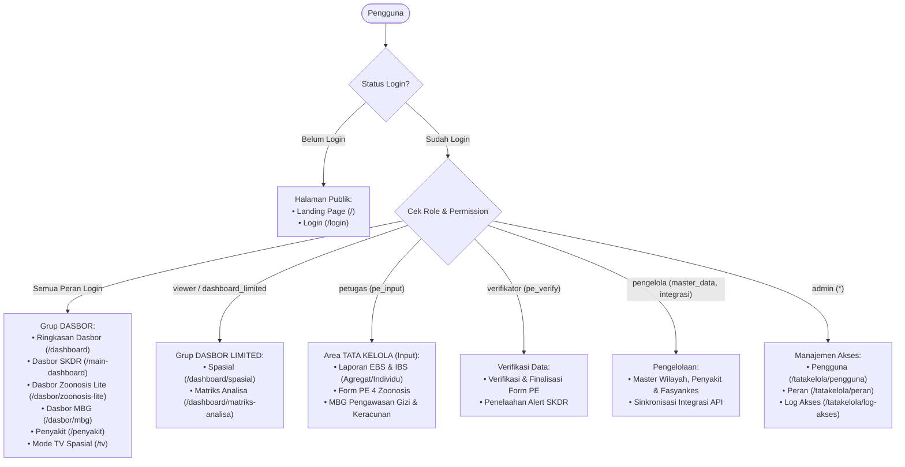

### 2.1. Matriks Peran Pengguna
| Peran (Role) | Nama Peran | Hak Akses Utama (*Permissions*) | Cakupan Modul |
|---|---|---|---|
| `admin` | Administrator | `*` (Akses Penuh) | Semua halaman dasbor, seluruh formulir transaksi, tata kelola pengguna, peran, master data, dan audit log. |
| `pengelola` | Pengelola Data | `dashboard_limited`, `tatakelola`, `pe_input`, `pe_verify`, `master_data`, `integrasi` | Seluruh formulir transaksi, verifikasi kasus, pemeliharaan master fasyankes/wilayah, dan dasbor analitik mendalam. |
| `verifikator` | Verifikator PE | `dashboard_limited`, `tatakelola`, `pe_input`, `pe_verify` | Pengisian dan penguncian status verifikasi form PE, EBS, IBS, serta akses ke seluruh dasbor. |
| `petugas` | Petugas Input | `dashboard_limited`, `tatakelola`, `pe_input` | Entri data harian/mingguan (EBS, IBS agregat & individu, Pengawasan MBG, Keracunan MBG, draf PE). |
| `viewer` | Pengguna Dasbor | `dashboard_limited` | Akses baca (*view only*) ke seluruh menu grup **DASBOR** dan **DASBOR LIMITED** (`Spasial` & `Matriks Analisa`). |

### 2.2. Struktur Menu Sidebar Saat Ini
Pada tampilan saat ini, navigasi aplikasi dibagi menjadi dua area melalui sakelar di header atas (**`DASBOR`** ↔ **`TATA KELOLA`**):

#### A. Sidebar Area **DASBOR**
| Grup Sidebar | Nama Menu di UI | Path URL | Tampilan Shell | Keterangan |
|---|---|---|---|---|
| **DASBOR** | **Ringkasan Dasbor** | `/dashboard` | Sidebar + Header | Hub kartu pintasan menuju seluruh modul dasbor. |
| **DASBOR** | **Dasbor SKDR** | `/main-dashboard` | Sidebar + Header | Dasbor eksekutif utama SKDR (sebelumnya bernama *Dasbor Utama*; mendukung sakelar Sumber `EBS` / `IBS`). |
| **DASBOR** | **Dasbor Zoonosis Lite** | `/dasbor/zoonosis-lite` | Sidebar + Header Ringkas | Dasbor satu layar 4 penyakit zoonosis (EBS + Form PE, terisolasi dari agregat IBS). |
| **DASBOR** | **Dasbor MBG** | `/dasbor/mbg` | Sidebar + Header | Dasbor 2 tab: *Pengawasan Gizi MBG* (Form 1–13) dan *Keracunan Pangan MBG*. |
| **DASBOR** | **Penyakit** | `/penyakit` | Sidebar + Header | Direktori referensi klinis & epidemiologi penyakit terpantau. |
| **DASBOR** | **Mode TV** | `/tv` | **Layar Penuh Mandiri (`100vw × 100vh`) Tanpa Header & Tanpa Sidebar** | Pusat Komando Spasial & Meja Analisa Epidemiologi penuh peta dengan tombol **`← Kembali ke Spasial`**. |
| **DASBOR LIMITED** | **Spasial** | `/dashboard/spasial` | Sidebar + Header (*Fluid Auto-Layout*) | Peta analisa SKDR IBS & EBS dengan *filter* samping, KPI, *choropleth*, kluster titik, *playback* mingguan, dan daftar laporan. |
| **DASBOR LIMITED** | **Matriks Analisa** | `/dashboard/matriks-analisa` | Sidebar + Header (*Fluid Auto-Layout*) | Meja analitik 6 tab (Ringkasan, Matriks 48 laporan, Morbiditas, Kinerja, Alert & Sinyal, Profil Kasus) + Ekspor Excel. |
| **LAINNYA** | **Dokumentasi** | `/dokumentasi` | Sidebar + Header | Dokumentasi penggunaan dan referensi teknis sistem. |
| *(Tersembunyi)* | *(Dasbor SKDR EBS & IBS)* | `/dasbor/ebs-ibs` | `enabled: false` | Disembunyikan dari sidebar sejak PR 048 karena fungsinya telah disatukan ke **Dasbor SKDR**, **Spasial**, dan **Matriks Analisa**. |

#### B. Sidebar Area **TATA KELOLA**
| Grup Sidebar | Nama Menu di UI | Path URL | Izin (*Permission*) |
|---|---|---|---|
| **TRANSAKSI** | **Laporan EBS** | `/ebs/laporan` | `tatakelola` (baca), `pe_input` (tulis) |
| **TRANSAKSI** | **Entri Data Agregat (IBS)** | `/ibs/laporan` | `tatakelola` (baca), `pe_input` (tulis) |
| **TRANSAKSI** | **Form Individu (IBS)** | `/ibs/individu` | `tatakelola` (baca), `pe_input` (tulis) |
| **TRANSAKSI** | **Form PE (4 Zoonosis)** | `/pe/cases` | `tatakelola` (baca), `pe_input` / `pe_verify` |
| **PROGRAM MBG** | **Pengawasan Gizi MBG** | `/pengawasan-gizi` | `tatakelola` (baca), `pe_input` (tulis) |
| **PROGRAM MBG** | **Keracunan Pangan MBG** | `/keracunan-mbg` | `tatakelola` (baca), `pe_input` (tulis) |
| **MASTER DATA** | **Provinsi, Kab/Kota, Penyakit, Fasyankes** | `/master/*` | `master_data` |
| **INTEGRASI** | **Sinkronisasi EBS, Alert SKDR, BNPB, dll.** | `/integrasi/*` | `integrasi` |
| **MANAJEMEN AKSES** | **Pengguna, Peran, Log Akses** | `/tatakelola/{pengguna,peran,log-akses}` | `user_management` |

---

## 3. SPESIFIKASI SELURUH FORMULIR TRANSAKSI (INPUT DATA)

---

### 3.1. Laporan EBS (Surveilans Berbasis Kejadian)
*Tujuan:* Melaporkan rumor atau kejadian penyakit menular / keracunan mendadak di masyarakat dalam bentuk agregat kelompok umur dan jenis kelamin, disertai tindakan penanggulangan awal.

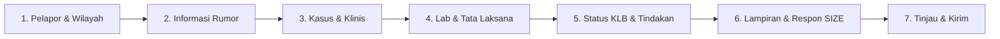

#### Struktur Langkah & Kolom Isian:
1. **Langkah 1: Pelapor & Wilayah**
   - Nomor Laporan: Diberikan otomatis oleh sistem saat draf pertama disimpan (`EBS-YYYY-XXXX`).
   - Tanggal Laporan: Terisi tanggal berjalan beserta label minggu epidemiologi.
   - Jenis Unit Pelapor: Puskesmas, Rumah Sakit, Laboratorium, SPPG, Dinkes Kab/Kota, Dinkes Provinsi, atau KKP.
   - Wilayah Administratif: Provinsi, Kabupaten/Kota, Kecamatan, dan Nama Unit Pelapor.
   - Identitas Petugas: Nama lengkap dan Nomor HP aktif (wajib untuk konfirmasi rumor).
2. **Langkah 2: Informasi Rumor**
   - Penyakit yang Diduga: Pilihan master daftar penyakit SKDR.
   - Tanggal Rumor Diketahui: Tanggal pertama kali informasi diterima petugas.
   - Status Kejadian: *Rumor Baru, Terverifikasi Kasus, Ditolak / Bukan Masalah Kesehatan*.
   - Penyakit Terverifikasi: Wajib dipilih jika status diubah menjadi "Terverifikasi".
   - Sumber Informasi: Masyarakat, Kader Kesehatan, Media Sosial, Media Massa, Fasyankes, Lintas Sektor, dll.
   - Sumber Verifikasi: Pihak yang dihubungi untuk memvalidasi kebenaran rumor.
3. **Langkah 3: Kasus & Klinis**
   - Jumlah Kasus (minimal 1) dan Jumlah Kematian (harus $\le$ Jumlah Kasus).
   - Matriks Usia & Jenis Kelamin: Matriks 11 kelompok umur ($0-7\text{ hr}$, $8-28\text{ hr}$, $<1\text{ th}$, $1-4\text{ th}$, $5-9\text{ th}$, $10-14\text{ th}$, $15-19\text{ th}$, $20-44\text{ th}$, $45-54\text{ th}$, $55-69\text{ th}$, $\ge 70\text{ th}$) dikalikan Laki-laki dan Perempuan. Total akumulasi harus sinkron dengan Jumlah Kasus.
   - Domisili Kasus: Apakah sama dengan wilayah unit pelapor atau berada di kabupaten/provinsi lain.
   - Klinis & Kronologi: Gejala dominan, tanggal onset gejala pertama, tanggal datang ke fasyankes, tanggal meninggal (bila ada kematian), dan kronologi naratif lengkap kejadian.
4. **Langkah 4: Lab & Tata Laksana**
   - Pengambilan Spesimen: Ya/Tidak. Jika Ya, lengkapi: jumlah orang diperiksa, tanggal ambil, tanggal kirim ke lab rujukan, tanggal keluar hasil, jenis hasil lab (*Positif, Negatif, Menunggu Hasil, Inkonklusif*), dan jumlah positif.
   - Tata Laksana Kasus: Ya/Tidak, tanggal tindakan, dan opsi tindakan (*Isolasi Mandiri, Rawat Inap RS, Rawat Jalan, Rujukan Kedaruratan, Pemberian Profilaksis*).
5. **Langkah 5: Status KLB & Tindakan**
   - Pemenuhan Kriteria KLB: Ya/Tidak.
   - Kelengkapan Dokumen KLB: Formulir W1 (Laporan Kewaspadaan 24 Jam), SK Penetapan KLB Kepala Daerah, dan Mobilisasi Tim Gerak Cepat (TGC).
   - Status KLB Saat Ini: *Berlangsung, Terkendali, atau Berakhir* (disertai tanggal berakhir).
   - Rincian Tindakan di Lapangan: Pengendalian Faktor Risiko (PFR), Komunikasi Risiko (edukasi masyarakat), dan Koordinasi Lintas Program / Lintas Sektor.
6. **Langkah 6: Lampiran & Respon SIZE**
   - Unggah berkas dokumen pendukung (surat tugas, foto lapangan, file PDF $\le 5\text{ MB}$).
   - Panel Respon SIZE (Sistem Informasi Zoonosis Terintegrasi One Health) untuk rujukan lintas kementerian.
7. **Langkah 7: Tinjau & Kirim**
   - Evaluasi validasi real-time. Jika semua langkah lengkap dan valid, status laporan beralih dari `Draf` menjadi `Dikirim`.

---

### 3.2. Laporan Agregat IBS (Surveilans Berbasis Indikator Mingguan)
*Tujuan:* Rekapitulasi mingguan angka kesakitan, kematian, dan konfirmasi laboratorium dari seluruh fasyankes (Puskesmas dan RS) untuk 24 penyakit terpantau SKDR.

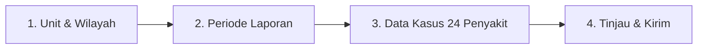

#### Struktur Langkah & Kolom Isian:
1. **Langkah 1: Unit & Wilayah**
   - Jenis Unit Pelapor, Provinsi, Kab/Kota, Kecamatan, Nama Unit Puskesmas/Klinik, dan Nama Petugas Pengentri.
2. **Langkah 2: Periode Laporan**
   - Tahun Laporan (misal: 2026) dan Minggu Epidemiologi (Minggu 1 s.d. Minggu 52/53). Sistem mengunci minggu yang belum berjalan agar tidak terjadi pelaporan masa depan.
3. **Langkah 3: Data Kasus (Grid 24 Penyakit + Total Kunjungan)**
   - Tabel matriks menampilkan kolom `No · Kode SMS · Kode Penyakit · Nama Penyakit` beserta 3 kolom input per penyakit:
     - **Jumlah Kasus:** Total kasus baru yang berkunjung pada minggu tersebut.
     - **Jumlah Kematian:** Kasus meninggal akibat penyakit tersebut (wajib $\le$ Jumlah Kasus).
     - **Jumlah Lab:** Kasus yang memiliki pemeriksaan laboratorium.
   - **Total Kunjungan Fasyankes:** Kartu input terpisah untuk jumlah seluruh pasien yang berkunjung ke fasyankes pada minggu tersebut.
   - **Fitur Laporan Nihil:** Deklarasi bahwa pada minggu tersebut fasyankes beroperasi aktif namun tidak ditemukan satu pun kasus dari 24 penyakit terpantau.
4. **Langkah 4: Tinjau & Kirim**
   - Validasi angka matematis, peringatan duplikat (`Unit + Tahun + Minggu Epid`), dan pengiriman laporan.

---

### 3.3. Laporan Individu IBS (Pencatatan per Pasien)
*Tujuan:* Mencatat data berbasis kasus perorangan (*case-based surveillance*) bagi pasien terdiagnosis salah satu dari 24 penyakit potensial KLB untuk melacak riwayat klinis, tanda vital, dan alamat domisili.

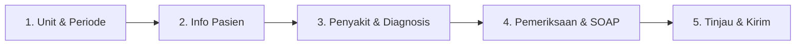

#### Rincian Isian Form Individu:
1. **Langkah 1: Unit & Periode:** Puskesmas, Petugas, No. HP, Tahun, dan Minggu Epidemiologi.
2. **Langkah 2: Info Pasien:** Nama Pasien, No. Rekam Medis / No. Epid, Alamat Lengkap Domisili, Kelompok Umur Rinci (Tahun, Bulan, Hari), Jenis Kelamin, dan Pekerjaan Pasien.
3. **Langkah 3: Penyakit & Diagnosis:** Penyakit Agregat (`A — Diare Akut` s.d. 24 penyakit IBS), Tanggal Pemeriksaan Klinis (dengan peringatan bila di luar rentang minggu epid terpilih), Status Akhir Pasien (*Sembuh, Masih Sakit / Dirawat, Dirujuk, atau Meninggal* — tanggal meninggal wajib bila Meninggal), Keluhan Utama, Lama Sakit, Kode ICD-10, dan Diagnosis Dokter.
4. **Langkah 4: Pemeriksaan & SOAP:** Antropometri & Tanda Vital (Tinggi Badan, Berat Badan, Suhu Tubuh, Tekanan Darah), **Kalkulator IMT Otomatis** ($\text{IMT} = \frac{\text{BB (kg)}}{\text{TB (m)}^2}$), dan Catatan Medis SOAP ($\le 500$ karakter).
5. **Langkah 5: Tinjau & Kirim:** Peringatan duplikat lunak (`unit + nama pasien + tanggal periksa`) dan penyimpanan ke basis data `laporan_ibs_individu`.

---

### 3.4. Pengawasan Gizi MBG (Program Makan Bergizi Gratis)
*Tujuan:* Standarisasi audit mutu dan higiene sanitasi dapur Satuan Pelayanan Program Gizi (SPPG) oleh Tenaga Pelaksana Gizi (TPG) Puskesmas menggunakan 13 formulir standar Kemenkes RI.

#### Struktur Modul & 13 Formulir:
- **Identitas Kunjungan (Sekali per Kunjungan):** Nama TPG, Puskesmas, Wilayah, Nama SPPG, Nama Pengawas Dapur SPPG, dan Hari/Tanggal Pengawasan.
- **Formulir 1 (F1):** Identifikasi Kebutuhan Bahan Pangan & Ketenagaan (ambang penjamah 47/3T, kepatuhan $\ge 50\%$).
- **Formulir 2 (F2):** Standar Porsi & Nilai Gizi (disertai saran otomatis sosialisasi + bukti).
- **Formulir 3 (F3):** Penerapan SOP Perencanaan Menu.
- **Formulir 4 (F4):** Penerapan SOP Pemesanan Bahan Pangan (13 butir unik).
- **Formulir 5 (F5):** Penerapan SOP Penerimaan Bahan Pangan.
- **Formulir 6 (F6):** Penerapan SOP Penyimpanan Bahan Pangan (FIFO/FEFO, suhu gudang & pendingin).
- **Formulir 7 (F7):** Penerapan SOP Persiapan Bahan Pangan (5 butir + unggah foto dokumentasi per butir).
- **Formulir 8 (F8):** Penerapan SOP Pengolahan Bahan Pangan.
- **Formulir 9 (F9):** Penerapan SOP Pemorsian & Pengepakan (kelompok sasaran dinamis + tabel SP).
- **Formulir 10 (F10):** Penerapan SOP Distribusi Bahan Pangan (termasuk uji 5 sampel sisa makanan, $\ge 3$ sampel $< 20\%$).
- **Formulir 11 (F11):** Pengawasan Penyajian & Konsumsi di Sekolah / Posyandu / Kader (5 sampel sisa makanan metode Comstock).
- **Formulir 12 (F12):** Pengawasan Mutu & Higiene Sanitasi (rekap otomatis `BAIK` / `BELUM BAIK`).
- **Formulir 13 (F13):** Rekapitulasi Skor & Rekomendasi (Skor Kepatuhan $\text{Sesuai}/N \times 100$; predikat **Sesuai bila Skor $\ge 80$**).

---

### 3.5. Keracunan Pangan MBG (Investigasi Insiden KLB Pangan)
*Tujuan:* Pelaporan cepat saat terjadi insiden keracunan pangan pada penerima program MBG, investigasi rantai pangan, pelacakan masa inkubasi, dan pemantauan perkembangan kasus harian.

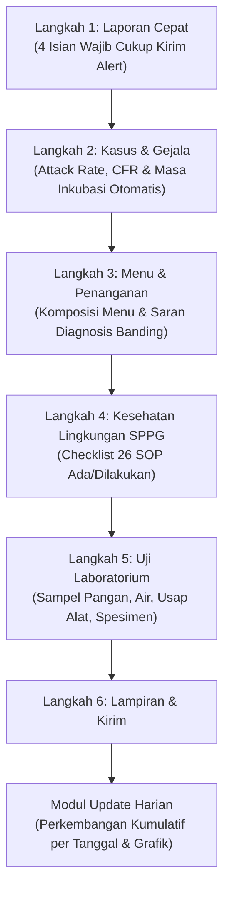

---

### 3.6. Penyelidikan Epidemiologi (Form PE 4 Penyakit Zoonosis One Health)
*Tujuan:* Formulir investigasi mendalam kasus perorangan untuk 4 penyakit zoonosis prioritas One Health di Indonesia (**Leptospirosis, Rabies/GHPR, Antraks, dan Flu Burung/Avian Influenza**) dengan siklus status `Draf` $\rightarrow$ `Dikirim` $\rightarrow$ `Terverifikasi` $\rightarrow$ `Final` (disimpan pada tabel `pe_cases`).

---

## 4. SPESIFIKASI SELURUH MODUL DASBOR (OUTPUT & ANALITIK SAAT INI)

---

### 4.1. Ringkasan Dasbor (`/dashboard`) & Beranda (`/`, `/beranda`)
- **Landing Page Publik (`/`):** Gerbang informasi publik SKDR dengan ringkasan kewaspadaan dini nasional dan tombol masuk portal (**Akses SKDR** $\rightarrow$ `/login`).
- **Beranda Terautentikasi (`/beranda`):** Halaman sambutan bagi pengguna yang telah masuk, menampilkan seluruh grup navigasi lintas area.
- **Ringkasan Dasbor (`/dashboard`):** Katalog kartu pintasan cepat menuju seluruh modul dasbor (**Dasbor SKDR**, **Dasbor Zoonosis Lite**, **Dasbor MBG**, **Penyakit**, **Mode TV**, **Spasial**, dan **Matriks Analisa**).

---

### 4.2. Dasbor SKDR (`/main-dashboard`)
*(Sebelumnya bernama **Dasbor Utama**, diperbarui menjadi **Dasbor SKDR** pada PR 048).*  
Dasbor eksekutif tingkat nasional dan daerah yang membaca langsung dari matriks **Laporan EBS (`laporan_ebs`)** dan **Laporan Agregat/Individu IBS (`laporan_ibs`, `laporan_ibs_individu`)**.

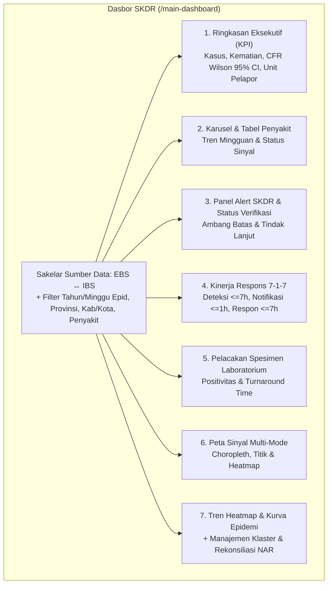

#### Karakteristik Kunci Dasbor SKDR:
- **Dinamis Mengikuti Sakelar Sumber (`EBS` vs `IBS`):** Seluruh seksi (Ringkasan KPI, CFR, Alert, 7-1-7, Laboratorium, Peta, Tren Heatmap, Kurva Epidemi, Klaster, dan NAR) berubah mengikuti sumber yang dipilih pengguna pada bilah filter atas.
- **Paritas Data Sinkronisasi Kemenkes:** Job inkremental di *backend* (`impor_lama.rs`) secara otomatis menyinkronkan data dari tabel API lama (`ebs_reports` dan `skdr_alerts`) ke dalam tabel `laporan_ebs` dan `laporan_ibs`.

---

### 4.3. Dasbor Zoonosis Lite (`/dasbor/zoonosis-lite`)
Dasbor satu layar (*one-screen dashboard*) untuk pemantauan 4 penyakit zoonosis prioritas One Health (**Antraks, Rabies/GHPR, Leptospirosis, dan Flu Burung**).

#### Karakteristik Kunci & Isolasi Data (PR 027, PR 028, PR 049):
1. **Isolasi Murni dari Agregat Mingguan IBS (PR 049):**
   - Peta sebaran sinyal pada Dasbor Zoonosis Lite secara ketat **mengecualikan titik agregat mingguan IBS (`source_type = 'ibs'`)**.
   - Peta dan daftar sinyal hanya menampilkan **Sinyal Kejadian EBS (`source_type = 'ebs'`)** dan **Kasus Investigasi Form PE (`source_type = 'pe'` dari `pe_cases`)** melalui *view* `surveillance_reports` (migrasi `066`). Hal ini memastikan peta Zoonosis Lite tetap fokus pada lokasi kejadian zoonosis yang sesungguhnya dan tidak tertimbun oleh 12.528 titik fasyankes agregat IBS.
2. **Kartu 4 Zoonosis + CFR Wilson 95% CI + Sparkline Mingguan:** Menampilkan beban kasus, kematian, dan CFR lengkap dengan interval kepercayaan Wilson 95% serta perbandingan CFR antar penyakit.
3. **Lapisan Konteks Ekologis One Health di Peta:**
   - **Lapisan Burung Migran (GBIF):** Titik pengamatan burung liar/migran sebagai konteks risiko Flu Burung (Avian Influenza).
   - **Lapisan Vektor Nyamuk (iNaturalist):** Konteks pengamatan vektor di sekitar wilayah sinyal.
4. **Modal Analisis Laboratorium & Detail Lainnya:** Tombol pembuka modal multi-tab yang mewarisi filter aktif halaman:
   - *Tab Laboratorium* (Matriks Penyakit $\times$ Hasil, Matriks Provinsi $\times$ Penyakit)
   - *Tab 7-1-7*
   - *Tab Alert & Verifikasi*
   - *Tab Klaster & Kurva Epidemi*
   - *Tab Kematian Form PE*

---

### 4.4. Dasbor MBG (`/dasbor/mbg`)
Dasbor khusus program Makan Bergizi Gratis dengan 2 halaman (*pagination tabs*) yang membaca langsung dari transaksi database tanpa data *dummy*:
1. **Halaman 1 — Pengawasan Gizi MBG (`mbg_kunjungan` & `mbg_form` F1–F13):**
   - 6 kartu KPI eksekutif (Total Kunjungan SPPG, Rata-rata Skor Kepatuhan, % SPPG Memenuhi Syarat $\ge 80$, dll.).
   - Peta Spasial Multi-Layer OpenLayers 10 (*Choropleth* Provinsi $\rightarrow$ *drill-down* Kab/Kota + *Spatial Density Heatmap* + Titik SPPG).
   - Matriks Heatmap Mingguan (Provinsi $\times$ Minggu & Formulir F1–F13 $\times$ Minggu), profil ketenagaan, dan kepatuhan 8 SOP utama.
2. **Halaman 2 — Keracunan Pangan MBG (`mbg_keracunan` & `mbg_keracunan_update`):**
   - 6 kartu KPI insiden (Total Kejadian, Total Kasus Sakit, Rawat Inap, Kematian, Attack Rate rata-rata, dan CFR).
   - Peta titik insiden keracunan, tren perkembangan harian, distribusi gejala/demografi, evaluasi gap 26 SOP dapur, hasil sampel laboratorium, serta **Korelasi Silang SPPG Keracunan $\times$ Skor Pengawasan Gizi**.

---

### 4.5. Direktori Penyakit (`/penyakit`)
Halaman referensi penyakit menular berpotensi KLB yang menyajikan profil klinis, definisi operasional kasus, ambang batas kewaspadaan dini, dan tautan cepat menuju analisis penyakit terkait.

---

### 4.6. Mode TV — Pusat Komando Spasial & Meja Analisa Epidemiologi (`/tv`)
*(Diimplementasikan pada PR 050 sebagai kanvas penuh layar ruang komando PHEOC / layar TV dinding).*

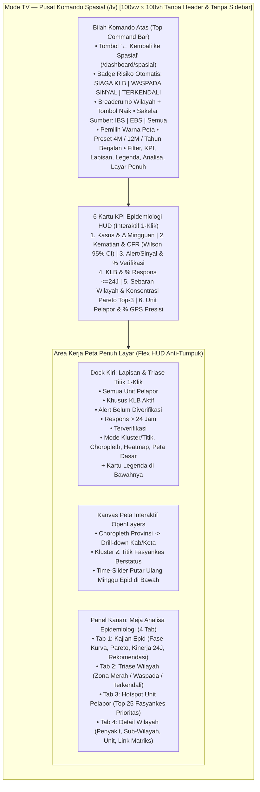

#### Spesifikasi Lengkap Fitur Mode TV (`/tv`):
1. **Tampilan Mandiri Penuh Layar (`100vw × 100vh`) & Desain Konsisten:**
   - Berjalan dengan `tvMode={true}` tanpa header aplikasi dan tanpa sidebar kiri agar 100% ruang layar digunakan oleh peta spasial.
   - Menggunakan palet warna putih bersih dan *Kemenkes Teal* (`bg-white/95`, `border-slate-200`, `bg-teal-50 text-teal-800`, `bg-teal-700 text-white`) yang 100% konsisten dengan halaman **Spasial (`/dashboard/spasial`)**.
   - Dilengkapi tombol **`← Kembali ke Spasial`** di pojok kiri atas yang membawa pengguna kembali ke `/dashboard/spasial` dengan mempertahankan seluruh parameter filter di URL.
2. **Tata Letak Flex HUD Anti-Tumpuk (*Zero-Overlap Layout*):**
   - Bilah komando atas, baris 6 kartu KPI, kolom kiri (`Dock Lapisan & Triase` + `Legenda`), pemutar minggu epidemiologi di tengah bawah, dan kolom kanan (`Meja Analisa Epidemiologi`) disusun menggunakan struktur *flex column/row* di dalam kontainer peta, sehingga **tidak pernah saling menabrak atau menutupi** baik pada monitor laptop maupun layar TV dinding (termasuk saat tombol **Layar Penuh** diaktifkan).
3. **Indikator Status Kesiapsiagaan Epidemiologi Otomatis:**
   - Menghitung tingkat risiko secara *real-time* dari data wilayah terpilih:
     - **`SIAGA KLB`** (Merah): Bila terdapat kejadian KLB aktif ($\text{KLB} > 0$), atau $\text{CFR} \ge 2{,}0\%$, atau lonjakan mingguan $\Delta \ge +25\%$ dengan beban $\ge 50$ kasus.
     - **`WASPADA SINYAL`** (Oranye): Bila terdapat sinyal alert ($\text{Alert} > 0$), kenaikan mingguan $\Delta > +5\%$, atau $\text{CFR} \ge 0{,}5\%$.
     - **`TERKENDALI`** (Hijau): Bila tidak ada KLB maupun lonjakan sinyal.
4. **6 Kartu KPI Epidemiologi Interaktif (1-Klik Mengubah Lapisan Peta):**
   - **Kartu 1 — Kasus:** Total kasus periode terpilih, $\Delta\%$ terhadap periode sebelumnya, serta perbandingan kasus minggu ini vs minggu lalu ($\Delta\%$ kecepatan transmisi). *(Klik $\rightarrow$ Choropleth Kasus)*.
   - **Kartu 2 — Kematian & CFR:** CFR (`%`), jumlah kematian absolut, rentang kepercayaan **Wilson 95% CI**, dan badge tingkat keparahan (`Tinggi` / `Waspada` / `Rendah`). *(Klik $\rightarrow$ Choropleth CFR)*.
   - **Kartu 3 — Alert / Sinyal:** Total sinyal kewaspadaan dini, persentase sinyal terverifikasi (`%`), dan jumlah unit fasyankes dengan alert belum diverifikasi. *(Klik $\rightarrow$ Choropleth Alert)*.
   - **Kartu 4 — KLB & Respons $\le 24\text{J}$:** Jumlah KLB aktif, persentase sinyal yang direspons dalam $\le 24\text{ jam}$, dan jumlah fasyankes dengan respons terlambat ($>24\text{ jam}$). *(Klik $\rightarrow$ Choropleth KLB)*.
   - **Kartu 5 — Sebaran & Pareto:** Rasio wilayah terdampak (`X / Y` Provinsi atau Kab/Kota beserta `%` cakupan) dan **Indeks Konsentrasi Pareto** (`%` beban kasus yang terkonsentrasi pada 3 wilayah tertinggi). *(Klik $\rightarrow$ Choropleth Perubahan Mingguan)*.
   - **Kartu 6 — Unit Pelapor di Peta:** Jumlah fasyankes bertitik di peta, total laporan, serta persentase koordinat presisi GPS unit vs perkiraan pusat kab/kota. *(Klik $\rightarrow$ Beralih mode Kluster / Titik)*.
5. **Dock Kiri — Lapisan & Triase Cepat Titik Unit (1-Klik):**
   - Menyediakan 5 tombol triase cepat beserta jumlah unitnya: **`Semua Unit Pelapor`**, **`Khusus KLB Aktif`**, **`Alert Belum Diverifikasi`**, **`Respons > 24 Jam`**, dan **`Terverifikasi`**.
   - Kontrol mode titik (`Kluster` / `Titik` / `Sembunyi`), toggle `Choropleth` + slider transparansi, toggle `Heatmap`, pilihan `Peta Dasar` (`Terang`, `OSM`, `Satelit`, `Polos`), dan filter kasus minimal per unit.
6. **Panel Kanan — Meja Analisa Epidemiologi (4 Tab):**
   - **Tab 1 (`Kajian Epid`):** Sintesis otomatis ahli epidemiologi mencakup: (1) *Dinamika & Fase Kurva Epidemi* (*Fase Akselerasi*, *Fase Plateau*, atau *Fase Dekelerasi* + identifikasi Minggu Puncak & grafik batang kurva epidemi), (2) *Sebaran Spasial & Pareto Top-3 Wilayah*, (3) *Evaluasi Kinerja Verifikasi & Respons 24 Jam* terhadap target Kemenkes $\ge 80\%$ lengkap dengan tombol pintas untuk mengisolasi titik belum verifikasi / respons $>24\text{ jam}$ di peta, serta (4) *Rekomendasi Tindak Lanjut Epidemiologi*.
   - **Tab 2 (`Triase`):** Peringkat risiko komposit seluruh Provinsi/Kab-Kota ke dalam **Zona Merah**, **Waspada**, dan **Terkendali** dengan tombol *Perbesar ke Kab/Kota*.
   - **Tab 3 (`Hotspot`):** Daftar 25 fasyankes prioritas investigasi diurutkan menurut status KLB dan jumlah kasus; klik baris untuk langsung memperbesar peta ke titik fasyankes tersebut.
   - **Tab 4 (`Detail wilayah`):** Inspeksi mendalam wilayah terpilih (`/api/v1/analisa/spasial/wilayah`) menampilkan metrik wilayah, kurva epidemi wilayah, tabel **Penyakit Teratas**, **Kab/Kota atau Kecamatan Teratas**, **Unit Pelapor Teratas**, dan tautan langsung ke **Matriks Analisa**.

---

### 4.7. Dasbor Limited — Spasial (`/dashboard/spasial`)
Dasbor pemetaan analitik di dalam shell aplikasi standar (dilengkapi panel filter samping *sticky*, baris 7 kartu KPI, kotak interpretasi otomatis, peta interaktif OpenLayers, serta **Daftar Laporan Spasial** di bagian bawah halaman lengkap dengan pencarian, paginasi, tombol fokus peta per baris, dan **Ekspor Excel**).
- Menggunakan **Fluid Auto-Layout (`w-full`)** (PR 046) sehingga area peta dan tabel otomatis melebar penuh saat sidebar kiri maupun panel filter samping disembunyikan.

---

### 4.8. Dasbor Limited — Matriks Analisa (`/dashboard/matriks-analisa`)
Pusat analitik kuantitatif data SKDR (`IBS`, `EBS`, dan `Semua`) dengan panel filter samping *sticky* (PR 043), *fluid full-width auto-layout* (PR 046), dan **6 Tab Analitik** (PR 042):
1. **Tab 1 — `Ringkasan & Tren`:** Kartu KPI eksekutif, kurva epidemi dengan garis ambang **Rerata + 2 SD**, perbandingan dengan tahun lalu, dan interpretasi otomatis.
2. **Tab 2 — `Matriks & Laporan`:** Katalog **48 jenis laporan/grafik/diagram resmi SKDR (IBS + EBS)**, tabel silang (*pivot*) kustom, dan *drill-down* berjenjang (Nasional $\rightarrow$ Provinsi $\rightarrow$ Kab/Kota $\rightarrow$ Kecamatan $\rightarrow$ Puskesmas).
3. **Tab 3 — `Morbiditas`:** Analisis beban penyakit, distribusi kelompok umur & jenis kelamin, serta proporsi penyakit terhadap kunjungan.
4. **Tab 4 — `Kinerja Pelaporan`:** Kelengkapan & ketepatan laporan mingguan (maksimal 100%, garis target 80%, legenda 3 warna) serta cakupan EBS dan indikator 7-1-7.
5. **Tab 5 — `Alert & Sinyal`:** Kualitas sinyal, rasio konversi menjadi KLB, 20 kecamatan hotspot teratas, dan *line list* sinyal dengan penyamaran PII otomatis.
6. **Tab 6 — `Profil Kasus`:** Demografi umur/jenis kelamin, CFR beserta interval kepercayaan Wilson 95% CI, dan rincian klinis.
- Setiap tab dilengkapi tombol **Ekspor Excel (`.xlsx`)**.

---

### 4.9. Dasbor Arsip Tersembunyi — Dasbor SKDR EBS & IBS (`/dasbor/ebs-ibs`)
Halaman dasbor transaksi awal untuk Laporan EBS dan Laporan IBS (PR 035). Sejak **PR 048**, item menu ini disembunyikan dari sidebar (`enabled: false` pada `app_settings.navigation_menu`) agar navigasi pengguna lebih ringkas karena seluruh kapabilitas analitik dan pemetaannya telah tercakup di **Dasbor SKDR (`/main-dashboard`)**, **Spasial (`/dashboard/spasial`)**, **Matriks Analisa (`/dashboard/matriks-analisa`)**, dan **Mode TV (`/tv`)**.

---

## 5. DIAGRAM ALUR PENGGUNA (USER FLOWS)

### Alur 1: Pelaporan Mingguan Rutin IBS & Pemicuan Alert
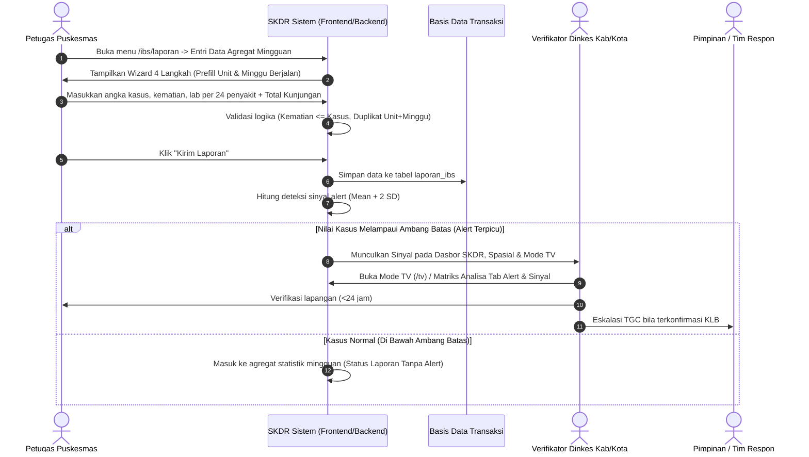

---

### Alur 2: Deteksi Rumor EBS & Respons Cepat 7-1-7
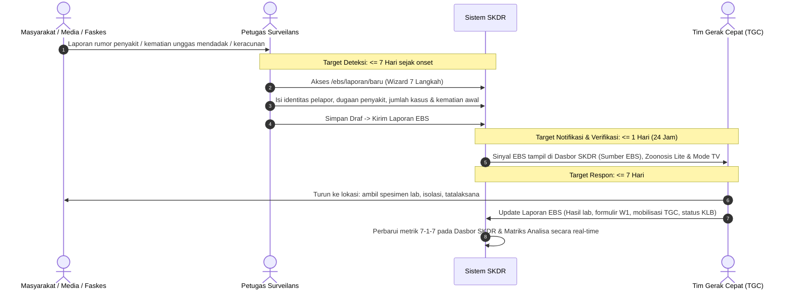

---

### Alur 3: Pengawasan Higiene SPPG & Penanggulangan Keracunan Pangan MBG
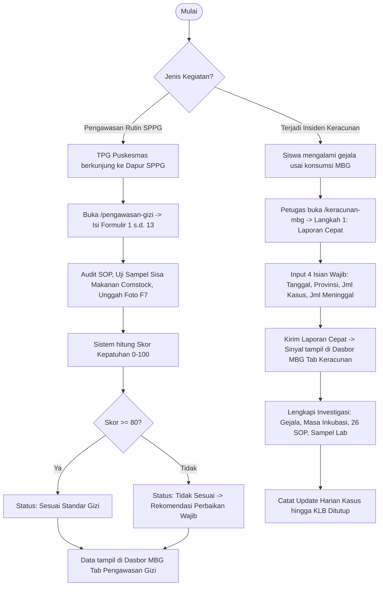

---

### Alur 4: Siklus Verifikasi Form PE & Isolasi Peta Zoonosis Lite
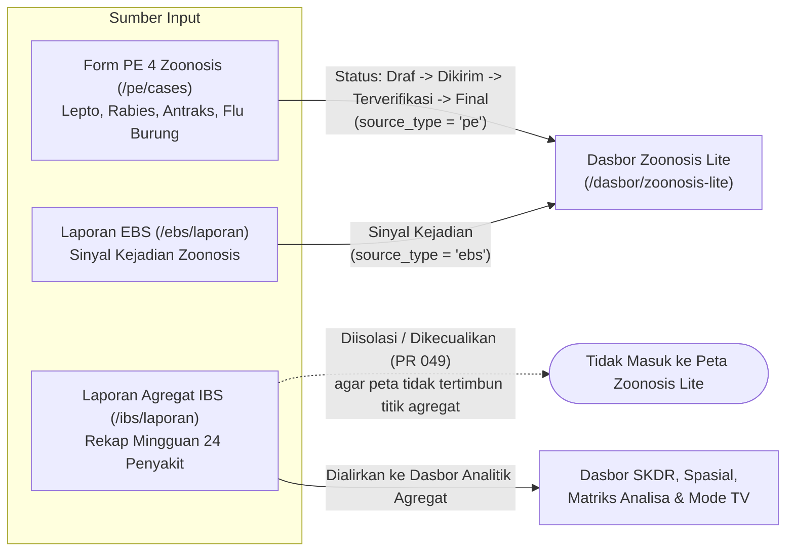

---

### Alur 5: Triase Spasial & Kajian Epidemiologi di Ruang Komando Mode TV (`/tv`)
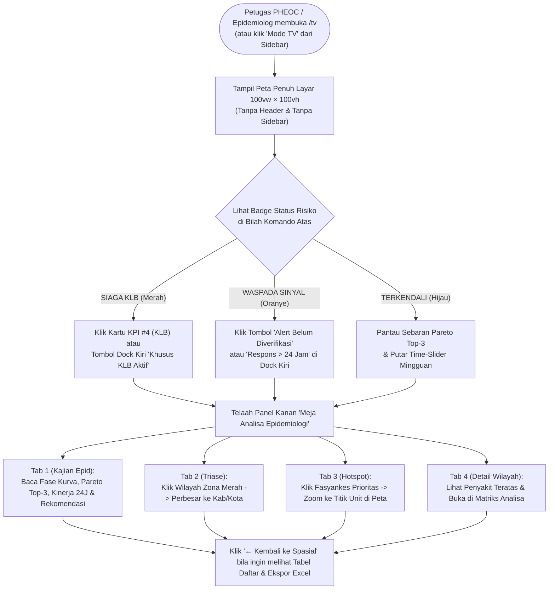

---

## 6. MATRIKS HUBUNGAN INPUT FORMULIR KE DASBOR (DATA MAPPING MATRIX)

Tabel berikut memetakan aliran setiap formulir transaksi ke halaman-halaman dasbor aktif saat ini:

| Formulir Transaksi / Sumber | Data / Isian Kunci | Halaman Dasbor Penerima Saat Ini | Indikator & Visualisasi yang Terpengaruh |
|---|---|---|---|
| **Laporan Agregat IBS** (`/ibs/laporan` & Sinkronisasi Alert SKDR) | Kasus, Kematian, Lab, Alert, KLB, Status Verifikasi & Respons $<24\text{J}$ | **Dasbor SKDR** (`/main-dashboard`), **Spasial** (`/dashboard/spasial`), **Matriks Analisa** (`/dashboard/matriks-analisa`), **Mode TV** (`/tv`) | KPI Kasus/Kematian/CFR Wilson 95% CI, Choropleth Provinsi & Kab/Kota, 12.800+ titik fasyankes, triase titik belum verifikasi / respons $>24\text{ jam}$, kurva epidemi, dan 48 laporan matriks. *(Dikecualikan dari peta Zoonosis Lite)*. |
| **Laporan Individu IBS** (`/ibs/individu`) | Diagnosis, ICD-10, Umur/JK, Tanda Vital, IMT, SOAP | **Dasbor SKDR**, **Matriks Analisa** (Tab Profil Kasus & Morbiditas), **Spasial** | Distribusi demografi umur/jenis kelamin, profil klinis pasien, dan rincian kasus individu. |
| **Laporan EBS** (`/ebs/laporan` & Sinkronisasi API EBS) | Rumor/Sinyal, Matriks Usia 11 Kelompok, Lab, KLB, W1, TGC, Respons 24J | **Dasbor SKDR** (Sumber `EBS`), **Dasbor Zoonosis Lite**, **Spasial**, **Matriks Analisa**, **Mode TV** (`/tv`) | Sinyal kewaspadaan dini EBS, capaian indikator 7-1-7, peta titik sinyal EBS, konversi rumor menjadi KLB, dan kajian epidemiologi Mode TV. |
| **Form PE 4 Zoonosis** (`/pe/cases`) | Kasus Investigasi Lepto, Rabies, Antraks, Flu Burung; Paparan Hewan; Lab; Kematian | **Dasbor Zoonosis Lite** (`/dasbor/zoonosis-lite`) | Titik peta kasus investigasi PE (`source_type = 'pe'`), tab Kematian Form PE, dan analisis klaster zoonosis One Health. |
| **Pengawasan Gizi MBG** (`/pengawasan-gizi`) | Skor & Checklist Formulir 1 s.d. 13, Sampel Comstock, Foto F7 | **Dasbor MBG** (`/dasbor/mbg` — Tab Pengawasan Gizi) | KPI kepatuhan SPPG ($\ge 80$), peta multi-layer SPPG, matriks heatmap F1–F13 $\times$ Minggu, dan korelasi silang keracunan. |
| **Keracunan Pangan MBG** (`/keracunan-mbg`) | Laporan Cepat, Attack Rate, Masa Inkubasi, 26 SOP, Lab, Update Harian | **Dasbor MBG** (`/dasbor/mbg` — Tab Keracunan Pangan) | KPI insiden keracunan pangan, grafik perkembangan harian, distribusi gejala & patogen, serta peta titik insiden. |

---

## 7. ATURAN VALIDASI & PENJAMINAN KUALITAS DATA

Untuk menjamin integritas data surveilans nasional, sistem menerapkan aturan validasi berlapis di tingkat peramban (*client-side*) maupun peladen (*backend server-side*):

1. **Integritas Kematian terhadap Kasus:**
   - Jumlah Kematian tidak boleh melebihi Jumlah Kasus ($\text{Kematian} \le \text{Kasus}$).
   - Bila status pasien meninggal atau jumlah kematian $> 0$, pengisian Tanggal Meninggal bersifat wajib.
2. **Integritas Waktu Epidemiologi:**
   - Tanggal timbul gejala (*onset*) tidak boleh berada di masa depan ($\text{Onset} \le \text{Hari Ini}$).
   - Tanggal kedatangan ke fasyankes harus sama dengan atau setelah tanggal onset ($\text{Tgl Faskes} \ge \text{Onset}$).
   - Minggu epidemiologi yang dipilih tidak boleh melampaui minggu berjalan pada kalender saat ini.
3. **Integritas Matriks Demografi EBS:**
   - Penjumlahan kasus pada matriks usia ($11\text{ kelompok umur} \times 2\text{ jenis kelamin}$) diverifikasi terhadap angka total Jumlah Kasus.
4. **Pencegahan Redundansi & Duplikasi:**
   - Mencegah entri ganda untuk laporan agregat IBS pada kombinasi unik `Unit Pelapor + Tahun + Minggu Epidemiologi` (`HTTP 409 Conflict`), serta memberi peringatan duplikat pada laporan EBS ($\pm 7\text{ hari}$) dan Form Individu IBS (`Unit + Nama Pasien + Tanggal Periksa`).
5. **Autosave Draf & Keamanan Sesi:**
   - Seluruh formulir wizard menyimpan draf otomatis (*autosave* + cadangan lokal peramban) serta dilindungi sesi *cookie* `HttpOnly` (`skdr_session`) dengan *guard* hak akses per endpoint di *backend*.

---
*Dokumen ini merupakan panduan fungsional resmi dan acuan pengujian (User Acceptance Testing - UAT) yang telah diselaraskan dengan tampilan dan arsitektur halaman SKDR Indonesia saat ini (hingga PR 050).*
