# DOKUMEN SPESIFIKASI KEBUTUHAN BISNIS & SISTEM (BRD / SRS)
## SISTEM KEWASPADAAN DINI DAN RESPON (SKDR) INDONESIA
**Versi Dokumen:** 1.0  
**Tanggal Rilis:** 11 November 2026  
**Klasifikasi:** Dokumen Fungsional Teknis & Panduan Pengguna  
**Target Pembaca:** Pemangku Kebijakan (Kemenkes RI, BGN, Dinas Kesehatan Provinsi & Kab/Kota), Tim Pengembang, Verifikator Epidemiologi, Petugas Fasyankes & Pengawas SPPG.

---

## DAFTAR ISI
1. [Ringkasan Eksekutif & Tujuan Sistem](#1-ringkasan-eksekutif--tujuan-sistem)
2. [Manajemen Akses & Matriks Peran Pengguna (RBAC)](#2-manajemen-akses--matriks-peran-pengguna-rbac)
3. [Spesifikasi Seluruh Formulir Transaksi (Input Data)](#3-spesifikasi-seluruh-formulir-transaksi-input-data)
   - 3.1. Laporan EBS (Surveilans Berbasis Kejadian)
   - 3.2. Laporan Agregat IBS (Surveilans Berbasis Indikator Mingguan)
   - 3.3. Laporan Individu IBS (Pencatatan per Pasien)
   - 3.4. Pengawasan Gizi MBG (Makan Bergizi Gratis - 13 Formulir Kemenkes)
   - 3.5. Keracunan Pangan MBG (Investigasi Insiden KLB Pangan & Pemantauan Harian)
   - 3.6. Penyelidikan Epidemiologi (Form PE 4 Penyakit Zoonosis One Health)
4. [Spesifikasi Seluruh Modul Dasbor (Output & Analitik)](#4-spesifikasi-seluruh-modul-dasbor-output--analitik)
   - 4.1. Dasbor Utama (`/main-dashboard`)
   - 4.2. Dasbor Zoonosis Lite (`/dasbor/zoonosis-lite`)
   - 4.3. Dasbor EBS & IBS (`/dasbor/ebs-ibs`)
   - 4.4. Dasbor MBG (`/dasbor/mbg`)
   - 4.5. Dasbor Limited - Spasial (`/dashboard/spasial`)
   - 4.6. Dasbor Limited - Matriks Analisa (`/dashboard/matriks-analisa`)
   - 4.7. Beranda & Portal Publik (`/` dan `/beranda`)
5. [Diagram Alur Pengguna (User Flows)](#5-diagram-alur-pengguna-user-flows)
   - Alur 1: Pelaporan Mingguan Rutin IBS & Pemicuan Alert
   - Alur 2: Deteksi Rumor EBS & Respons Cepat 7-1-7
   - Alur 3: Pengawasan Higiene SPPG & Penanggulangan Keracunan Pangan MBG
   - Alur 4: Siklus Verifikasi Penyelidikan Epidemiologi (PE)
6. [Matriks Hubungan Input Formulir ke Dasbor (Data Mapping Matrix)](#6-matriks-hubungan-input-formulir-ke-dasbor-data-mapping-matrix)
7. [Aturan Validasi & Penjaminan Kualitas Data](#7-aturan-validasi--penjaminan-kualitas-data)

---

## 1. RINGKASAN EKSEKUTIF & TUJUAN SISTEM

### 1.1. Latar Belakang
Sistem Kewaspadaan Dini dan Respon (SKDR) Indonesia dirancang untuk mendeteksi secara dini adanya ancaman Kejadian Luar Biasa (KLB), wabah penyakit menular potensial, serta kedaruratan kesehatan masyarakat termasuk penyakit zoonosis One Health dan insiden keamanan pangan pada program Makan Bergizi Gratis (MBG).

### 1.2. Prinsip Arsitektur Data
1. **100% Berbasis Transaksi Terverifikasi:** Seluruh data yang disajikan di dasbor dan analitik bersumber dari formulir pelaporan resmi di lapangan (Puskesmas, Rumah Sakit, Klinik, Laboratorium, dan SPPG). Sistem tidak menggunakan teknik web scraping, crawling, atau inferensi teks NLP yang tidak terverifikasi.
2. **Kewaspadaan Dini Otomatis:** Perhitungan ambang batas alert (*threshold*) berjalan secara deterministik matematis (membandingkan tren minggu berjalan dengan rata-rata periode acuan sebelumnya).
3. **Penyelarasan Standar Global (7-1-7 Target):** Mengadopsi tolok ukur respons kedaruratan kesehatan global (Resolve to Save Lives / WHO):
   - **7 Hari:** Deteksi dini sejak onset gejala.
   - **1 Hari (24 Jam):** Notifikasi resmi ke dinas kesehatan / otoritas surveilans.
   - **7 Hari:** Respon tindakan awal penyelidikan dan pengendalian di lapangan.

---

## 2. MANAJEMEN AKSES & MATRIKS PERAN PENGGUNA (RBAC)

Sistem menerapkan kontrol akses berbasis peran (*Role-Based Access Control*) yang memisahkan modul publik, dasbor analitik, tata kelola data transaksi, dan administrasi sistem.

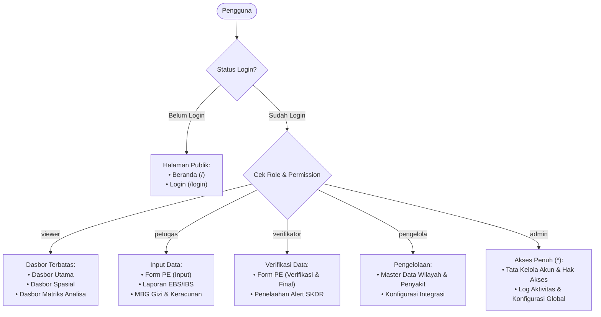

### 2.1. Matriks Peran Pengguna
| Peran (Role) | Nama Peran | Hak Akses Utama (*Permissions*) | Cakupan Modul |
|---|---|---|---|
| `admin` | Administrator | `*` (Akses Penuh) | Semua halaman dasbor, seluruh formulir transaksi, tata kelola pengguna, peran, master data, dan audit log. |
| `pengelola` | Pengelola Data | `dashboard_limited`, `tatakelola`, `pe_input`, `pe_verify`, `master_data`, `integrasi` | Seluruh formulir transaksi, verifikasi kasus, pemeliharaan master fasyankes/wilayah, dan dasbor analitik mendalam. |
| `verifikator` | Verifikator PE | `dashboard_limited`, `tatakelola`, `pe_input`, `pe_verify` | Pengisian dan penguncian status verifikasi form PE, EBS, IBS, serta akses ke seluruh dasbor. |
| `petugas` | Petugas Input | `dashboard_limited`, `tatakelola`, `pe_input` | Entri data harian/mingguan (EBS, IBS agregat & individu, Pengawasan MBG, Keracunan MBG, draf PE). |
| `viewer` | Pengguna Dasbor | `dashboard_limited` | Akses baca (*view only*) ke Dasbor Utama, Dasbor Spasial, dan Dasbor Matriks Analisa. |

### 2.2. Pembagian Area URL
- **Area Beranda (`/`, `/beranda`):** Informasi publik, ringkasan capaian nasional, dan portal masuk.
- **Area Dasbor (`/dashboard`, `/main-dashboard`, `/dasbor/*`):** Visualisasi indikator kinerja, tren mingguan, kurva epidemiologi, dan pemetaan interaktif.
- **Area Tata Kelola (`/tatakelola`, `/ebs`, `/ibs`, `/pe`, `/pengawasan-gizi`, `/keracunan-mbg`, `/master`):** Seluruh formulir transaksi pengisian, verifikasi laporan, dan manajemen sistem.

---

## 3. SPESIFIKASI SELURUH FORMULIR TRANSAKSI (INPUT DATA)

---

### 3.1. Laporan EBS (Surveilans Berbasis Kejadian)
*Tujuan:* Melaporkan rumor atau kejadian penyakit menular / keracunan mendadak di masyarakat dalam bentuk agregat kelompok umur dan jenis kelamin, disertai tindakan penanggulangan awal.

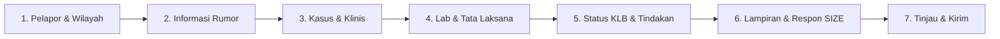

#### Struktur Langkah & Kolom Isian:
1. **Langkah 1: Pelapor & Wilayah**
   - Nomor Laporan: Diberikan otomatis oleh sistem saat draf pertama disimpan (`EBS-YYYY-XXXX`).
   - Tanggal Laporan: Terisi tanggal berjalan beserta label minggu epidemiologi.
   - Jenis Unit Pelapor: Puskesmas, Rumah Sakit, Laboratorium, SPPG, Dinkes Kab/Kota, Dinkes Provinsi, atau KKP.
   - Wilayah Administratif: Provinsi, Kabupaten/Kota, Kecamatan, dan Nama Unit Pelapor.
   - Identitas Petugas: Nama lengkap dan Nomor HP aktif (wajib untuk konfirmasi rumor).
2. **Langkah 2: Informasi Rumor**
   - Penyakit yang Diduga: Pilihan master daftar penyakit SKDR.
   - Tanggal Rumor Diketahui: Tanggal pertama kali informasi diterima petugas.
   - Status Kejadian: *Rumor Baru, Terverifikasi Kasus, Ditolak / Bukan Masalah Kesehatan*.
   - Penyakit Terverifikasi: Wajib dipilih jika status diubah menjadi "Terverifikasi".
   - Sumber Informasi: Masyarakat, Kader Kesehatan, Media Sosial, Media Massa, Fasyankes, Lintas Sektor, dll.
   - Sumber Verifikasi: Pihak yang dihubungi untuk memvalidasi kebenaran rumor.
3. **Langkah 3: Kasus & Klinis**
   - Jumlah Kasus (minimal 1) dan Jumlah Kematian (harus $\le$ Jumlah Kasus).
   - Matriks Usia & Jenis Kelamin: Matriks 11 kelompok umur ($0-7\text{ hr}$, $8-28\text{ hr}$, $<1\text{ th}$, $1-4\text{ th}$, $5-9\text{ th}$, $10-14\text{ th}$, $15-19\text{ th}$, $20-44\text{ th}$, $45-54\text{ th}$, $55-69\text{ th}$, $\ge 70\text{ th}$) dikalikan Laki-laki dan Perempuan. Total akumulasi harus sinkron dengan Jumlah Kasus.
   - Domisili Kasus: Apakah sama dengan wilayah unit pelapor atau berada di kabupaten/provinsi lain.
   - Klinis & Kronologi: Gejala dominan, tanggal onset gejala pertama, tanggal datang ke fasyankes, tanggal meninggal (bila ada kematian), dan kronologi naratif lengkap kejadian.
4. **Langkah 4: Lab & Tata Laksana**
   - Pengambilan Spesimen: Ya/Tidak. Jika Ya, lengkapi: jumlah orang diperiksa, tanggal ambil, tanggal kirim ke lab rujukan, tanggal keluar hasil, jenis hasil lab (*Positif, Negatif, Menunggu Hasil, Inkonklusif*), dan jumlah positif.
   - Tata Laksana Kasus: Ya/Tidak, tanggal tindakan, dan opsi tindakan (*Isolasi Mandiri, Rawat Inap RS, Rawat Jalan, Rujukan Kedaruratan, Pemberian Profilaksis*).
5. **Langkah 5: Status KLB & Tindakan**
   - Pemenuhan Kriteria KLB: Ya/Tidak.
   - Kelengkapan Dokumen KLB: Formulir W1 (Laporan Kewaspadaan 24 Jam), SK Penetapan KLB Kepala Daerah, dan Mobilisasi Tim Gerak Cepat (TGC).
   - Status KLB Saat Ini: *Berlangsung, Terkendali, atau Berakhir* (disertai tanggal berakhir).
   - Rincian Tindakan di Lapangan: Pengendalian Faktor Risiko (PFR), Komunikasi Risiko (edukasi masyarakat), dan Koordinasi Lintas Program / Lintas Sektor.
6. **Langkah 6: Lampiran & Respon SIZE**
   - Unggah berkas dokumen pendukung (surat tugas, foto lapangan, file PDF).
   - Panel Respon SIZE (Sistem Informasi Zoonosis Terintegrasi One Health) untuk rujukan lintas kementerian.
7. **Langkah 7: Tinjau & Kirim**
   - Evaluasi validasi real-time. Jika semua langkah lengkap dan valid, status laporan beralih dari `Draf` menjadi `Dikirim`.

---

### 3.2. Laporan Agregat IBS (Surveilans Berbasis Indikator Mingguan)
*Tujuan:* Rekapitulasi mingguan angka kesakitan, kematian, dan konfirmasi laboratorium dari seluruh fasyankes (Puskesmas dan RS) untuk 24 penyakit terpantau SKDR.

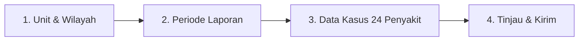

#### Struktur Langkah & Kolom Isian:
1. **Langkah 1: Unit & Wilayah**
   - Jenis Unit Pelapor, Provinsi, Kab/Kota, Kecamatan, Nama Unit Puskesmas/Klinik, dan Nama Petugas Pengentri.
2. **Langkah 2: Periode Laporan**
   - Tahun Laporan (misal: 2026).
   - Minggu Epidemiologi (Minggu 1 s.d. Minggu 52/53). Sistem mengunci minggu yang belum berjalan agar tidak terjadi pelaporan masa depan.
3. **Langkah 3: Data Kasus (Grid 24 Penyakit + Total Kunjungan)**
   - Mengisi 3 kolom per penyakit:
     - **Jumlah Kasus:** Total kasus baru yang berkunjung pada minggu tersebut.
     - **Jumlah Kematian:** Kasus meninggal akibat penyakit tersebut (wajib $\le$ Jumlah Kasus).
     - **Jumlah Lab:** Kasus yang memiliki konfirmasi uji laboratorium.
   - **Total Kunjungan Fasyankes:** Jumlah seluruh pasien yang berkunjung ke fasyankes pada minggu tersebut (berfungsi sebagai penyebut untuk menghitung proporsi morbiditas).
   - **Fitur Laporan Nihil:** Checkbox deklarasi bahwa pada minggu tersebut fasyankes beroperasi aktif namun tidak ditemukan satu pun kasus penyakit terpantau.
4. **Langkah 4: Tinjau & Kirim**
   - Validasi angka matematis, ringkasan perbandingan total kasus terhadap rata-rata 3 minggu sebelumnya, dan submit laporan.

---

### 3.3. Laporan Individu IBS (Pencatatan per Pasien)
*Tujuan:* Mencatat data berbasis kasus perorangan (*case-based surveillance*) bagi pasien terdiagnosis salah satu dari 24 penyakit potensial KLB untuk melacak riwayat klinis, tanda vital, dan alamat domisili.

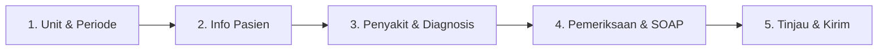

#### Rincian Isian Form Individu:
1. **Langkah 1: Unit & Periode**
   - Puskesmas, Petugas, No. HP, Tahun, dan Minggu Epidemiologi.
2. **Langkah 2: Info Pasien**
   - Nama Pasien, No. Rekam Medis / No. Epid, Alamat Lengkap Domisili.
   - Kelompok Umur Rinci: Tahun, Bulan, dan Hari (memungkinkan pencatatan akurat untuk bayi baru lahir/balita).
   - Jenis Kelamin dan Pekerjaan Pasien.
3. **Langkah 3: Penyakit & Diagnosis**
   - Penyakit Agregat: Terkoneksi ke 24 penyakit IBS SKDR.
   - Tanggal Pemeriksaan Klinis.
   - Status Akhir Pasien: *Sembuh, Masih Sakit / Dirawat, Dirujuk, atau Meninggal* (wajib mengisi tanggal meninggal jika status meninggal).
   - Keluhan Utama, Lama Sakit, Kode ICD-10, dan Catatan Diagnosis Dokter.
4. **Langkah 4: Pemeriksaan & SOAP**
   - Antropometri & Tanda Vital: Tinggi Badan (cm), Berat Badan (kg), Suhu Tubuh (°C), Tekanan Darah Sistole/Diastole (mmHg).
   - **Kalkulator IMT Otomatis:** Sistem secara otomatis menghitung Indeks Massa Tubuh ($\text{IMT} = \frac{\text{BB (kg)}}{\text{TB (m)}^2}$) dan mengklasifikasikan status gizi (*Gizi Kurang, Normal, Gizi Lebih, Obesitas*).
   - Catatan Medis SOAP (Subjective, Objective, Assessment, Planning).
5. **Langkah 5: Tinjau & Kirim**
   - Validasi kelengkapan, verifikasi rekam medis, dan penyimpanan ke basis data individu.

---

### 3.4. Pengawasan Gizi MBG (Program Makan Bergizi Gratis)
*Tujuan:* Standarisasi audit mutu dan higiene sanitasi dapur Satuan Pelayanan Program Gizi (SPPG) oleh Tenaga Pelaksana Gizi (TPG) Puskesmas menggunakan 13 formulir standar Kemenkes RI.

#### Struktur Modul & 13 Formulir:
- **Identitas Kunjungan (Kop Formulir):** Nama TPG, Puskesmas, Nama SPPG, Nama Pengawas Dapur SPPG, dan Hari/Tanggal Pengawasan.
- **Formulir 1 (F1):** Identifikasi Kebutuhan Bahan Pangan (Kesesuaian volume bahan terhadap target sasaran siswa & balita).
- **Formulir 2 (F2):** Standar Porsi & Nilai Gizi (Kecukupan kalori, protein, vitamin, dan mineral sesuai kelompok usia).
- **Formulir 3 (F3):** Penerapan SOP Perencanaan Menu (Master menu bersiklus, diversifikasi pangan, tanpa Ultra-Processed Foods [UPF], skrining alergi makanan).
- **Formulir 4 (F4):** Penerapan SOP Pemesanan Bahan Pangan (Validasi faktur, spesifikasi bahan segar dan kering).
- **Formulir 5 (F5):** Penerapan SOP Penerimaan Bahan Pangan (Pemeriksaan suhu bahan saat tiba, keutuhan kemasan, tanggal kedaluwarsa).
- **Formulir 6 (F6):** Penerapan SOP Penyimpanan Bahan Pangan (Gudang kering, cold storage/freezer, rotasi stok FIFO/FEFO).
- **Formulir 7 (F7):** Penerapan SOP Persiapan Bahan Pangan (Pemisahan talenan daging mentah dan sayur, pencucian air mengalir, **disertai unggah foto dokumentasi langsung per butir audit**).
- **Formulir 8 (F8):** Penerapan SOP Pengolahan Bahan Pangan (Kecukupan suhu pemasakan inti makanan $\ge 70^\circ\text{C}$, sanitasi peralatan masak, kebersihan juru masak).
- **Formulir 9 (F9):** Penerapan SOP Pemorsian & Pengepakan (Pencatatan suhu makanan saat pemorsian, waktu jeda maksimal sebelum dikemas, kepatuhan masker/sarung tangan).
- **Formulir 10 (F10):** Penerapan SOP Distribusi Bahan Pangan (Sanitasi armada kendaraan box tertutup, ketepatan waktu pengiriman ke sekolah penerima).
- **Formulir 11 (F11):** Pengawasan Penyajian & Konsumsi di Sekolah / Posyandu (Penerapan cuci tangan pakai sabun [CTPS], uji organoleptik sebelum disajikan, audit sisa makanan piring siswa metode Comstock dari 5 sampel acak).
- **Formulir 12 (F12):** Pengawasan Mutu & Higiene Sanitasi (Sertifikat Laik Higiene Sanitasi [SLHS], pengujian sampel air minum dan usap alat makan).
- **Formulir 13 (F13):** Rekapitulasi Skor & Rekomendasi (Skor Kepatuhan Gabungan $0-100$; predikat **Sesuai Standar Gizi jika Skor $\ge 80$**, serta formulasi poin tindakan perbaikan wajib).

---

### 3.5. Keracunan Pangan MBG (Investigasi Insiden KLB Pangan)
*Tujuan:* Pelaporan cepat saat terjadi insiden keracunan pangan pada siswa penerima program MBG, investigasi rantai pangan, pelacakan masa inkubasi, dan pemantauan perkembangan kasus harian.

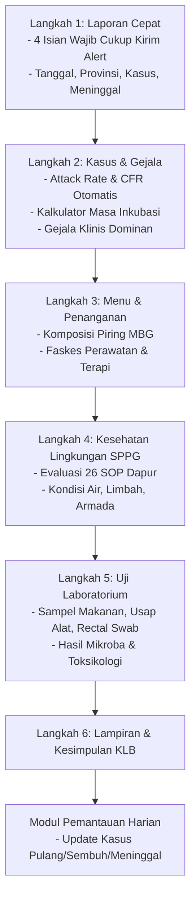

#### Fitur & Logika Perhitungan Penting:
1. **Mode Laporan Cepat (*Fast Reporting*):** Cukup mengisi 4 isian wajib (Tanggal/Jam Kejadian, Provinsi, Jumlah Kasus, Jumlah Meninggal) agar laporan segera masuk ke radar dinas kesehatan dan Kementerian tanpa menunggu hasil investigasi lengkap.
2. **Kalkulator Epidemiologi Otomatis:**
   - **Attack Rate (AR):**  
     $$\text{AR} = \frac{\text{Jumlah Kasus (Sakit)}}{\text{Jumlah Siswa Terpapar (Makan)}} \times 100\%$$
   - **Case Fatality Rate (CFR):**  
     $$\text{CFR} = \frac{\text{Jumlah Meninggal}}{\text{Jumlah Kasus}} \times 100\%$$
   - **Kalkulator Masa Inkubasi Otomatis:** Menghitung selisih jam konsumsi menu MBG terhadap jam timbulnya gejala pertama untuk memunculkan estimasi masa inkubasi (terpendek, terpanjang, median, dan rata-rata).
3. **Audit 26 SOP Sanitasi Dapur SPPG:** Checklist kepatuhan operasional dapur mulai dari ketersediaan bank sampel makanan, kepemilikan sertifikat SLHS, pemeriksaan penjamah makanan, hingga metode pembuangan limbah sisa makanan.
4. **Logistik Sampel Laboratorium:** Melacak sampel makanan tersisa, sampel bahan mentah, air minum, dan sampel biologis pasien (muntahan / usap dubur) yang dikirim ke BBLKM / Labkesda.
5. **Pemantauan Harian Pasca Insiden:** Fitur catatan harian untuk memantau status pemulihan pasien (berapa yang sudah sembuh, berapa yang masih dirawat di RS) sampai KLB dinyatakan berakhir.

---

### 3.6. Penyelidikan Epidemiologi (Form PE 4 Penyakit Zoonosis One Health)
*Tujuan:* Formulir investigasi mendalam kasus perorangan untuk 4 penyakit zoonosis prioritas One Health di Indonesia sesuai pedoman teknis surveilans Kemenkes RI.

#### 4 Penyakit Zoonosis yang Dikelola:
1. **Leptospirosis:** Investigasi riwayat kontak banjir, genangan air kotor, pekerjaan berisiko (petani, petugas kebersihan selokan), keberadaan hewan pengerat (tikus) di pemukiman, dan pemeriksaan MAT (*Microscopic Agglutination Test*) / RDT Leptospira.
2. **Rabies / GHPR (Gigitan Hewan Penular Rabies):** Investigasi riwayat gigitan anjing/kera/kucing, lokasi luka gigitan (risiko tinggi: leher/wajah/ujung jari), pencucian luka dengan sabun & air mengalir 15 menit, pemberian Vaksin Anti Rabies (VAR) & Serum Anti Rabies (SAR), serta status hewan penular (mati/diobservasi 14 hari).
3. **Antraks:** Investigasi bentuk klinis (Antraks Kulit/eschar kehitaman, Antraks Saluran Pencernaan, Antraks Pernapasan), riwayat kontak pemotongan hewan ternak sakit/mati mendadak, konsumsi daging tiren (*bangkai*), dan uji lab PCR / kultur *Bacillus anthracis*.
4. **Avian Influenza (Flu Burung - H5N1 / H5N6):** Investigasi riwayat kontak unggas sakit/mati mendadak di peternakan atau pasar burung, kontak dengan kotoran unggas, gejala ISPA berat / pneumonia akut, riwayat konsumsi unggas yang tidak matang, dan pemeriksaan RT-PCR swab nasofaring.

#### Alur Status Formulir PE:
- **Draf:** Pengisian awal oleh petugas fasyankes di lapangan.
- **Dikirim:** Berkas selesai diisi dan diteruskan ke verifikator dinas kesehatan.
- **Terverifikasi:** Verifikator memeriksa kecocokan gejala klinis, riwayat epidemiologi, dan dokumen pendukung.
- **Final:** Status dikunci dengan penetapan klasifikasi kasus resmi (*Suspek, Probable, Konfirmasi Laboratorium, atau Discarded/Bukan Kasus*).

---

## 4. SPESIFIKASI SELURUH MODUL DASBOR (OUTPUT & ANALITIK)

---

### 4.1. Dasbor Utama (`/main-dashboard`)
Dasbor eksekutif tingkat nasional dan daerah untuk memantau situasi epidemiologi secara menyeluruh.

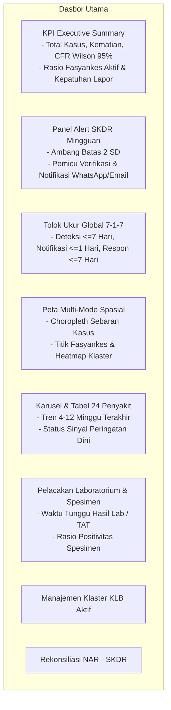

#### Modul-Modul di Dasbor Utama:
1. **KPI Executive Summary:**
   - Total Kasus Kumulatif & Total Kematian.
   - **CFR Wilson Score Interval (95% CI):** Menghitung Case Fatality Rate menggunakan formula statistik Wilson Score untuk memberikan rentang estimasi kematian yang akurat pada sampel kecil/besar.
   - Kelengkapan Laporan (%) dan Ketepatan Laporan (%) fasyankes terhadap batas waktu mingguan.
2. **Panel Alert SKDR Mingguan:**
   - Menampilkan daftar sinyal bahaya penyakit yang melampaui nilai ambang batas (*mean* 3–5 minggu sebelumnya ditambah 2 Standar Deviasi).
   - Menampilkan status penanganan: *Alert Baru, Sedang Diverifikasi, Terkonfirmasi KLB, atau Bukan Masalah Kesehatan*.
3. **Indikator Kinerja 7-1-7:**
   - Grafik pencapaian target global (Target $\le 7$ hari deteksi, $\le 1$ hari notifikasi, $\le 7$ hari tindakan awal). Mengidentifikasi titik hambatan (*bottleneck*) penanggulangan wabah.
4. **Peta Sebaran Kasus Multi-Mode:**
   - Peta interaktif berbasis OpenLayers dengan opsi layer Choropleth wilayah, Titik Fasyankes Pelapor, dan Heatmap intensitas kejadian.
5. **Karusel Penyakit & Kurva Epidemiologi:**
   - Kartu visualisasi 24 penyakit terpantau dengan kurva batang kasus mingguan serta indikator status hijau (aman), kuning (waspada), atau merah (alert).
6. **Integrasi Laboratorium & Klaster KLB:**
   - Memantau jumlah spesimen terkirim, waktu tunggu hasil (*Turnaround Time*), dan daftar klaster KLB aktif yang membutuhkan penyelidikan bersama lintas sektor.
7. **Rekonsiliasi Data NAR - SKDR:**
   - Membandingkan data pengujian laboratorium pada sistem New All Record (NAR) dengan pencatatan kasus pada SKDR untuk mengidentifikasi selisih kasus (*gap analysis*).

---

### 4.2. Dasbor Zoonosis Lite (`/dasbor/zoonosis-lite`)
Dasbor terfokus untuk pemantauan spesifik 4 penyakit zoonosis prioritas One Health (Leptospirosis, Rabies/GHPR, Antraks, Flu Burung).
- Menampilkan metrik CFR masing-masing penyakit dengan perbandingan antar wilayah.
- Heatmap tren musiman mingguan (misal: lonjakan Leptospirosis pada musim hujan/banjir).
- Modal rincian konfirmasi spesimen hewan ke manusia.

---

### 4.3. Dasbor EBS & IBS (`/dasbor/ebs-ibs`)
Dasbor yang terhubung langsung secara real-time dengan transaksi pengisian formulir lapangan (Laporan EBS dan Laporan IBS).
- **Tab Dasbor EBS:** Memantau seluruh rumor kejadian luar biasa yang masuk, kecepatan verifikasi rumor oleh petugas, persentase rumor yang berkembang menjadi KLB, dan peta titik rumor berbasis GPS fasyankes.
- **Tab Dasbor IBS:** Memantau agregat mingguan 24 penyakit, tren proporsi morbiditas terhadap total kunjungan puskesmas, dan matriks kelengkapan unit pelapor per kabupaten/kota.
- **Fitur Peta Spasial Multi-Layer:** Memungkinkan penggabungan tampilan layer titik rumor EBS dan layer agregat wilayah IBS dalam satu kanvas peta.

---

### 4.4. Dasbor MBG (`/dasbor/mbg`)
Dasbor khusus program Makan Bergizi Gratis yang mengintegrasikan pengawasan gizi preventif dan respon insiden keracunan pangan kuratif.
- **Tab Pengawasan Gizi SPPG:**
  - Skor rata-rata kepatuhan standar gizi SPPG per kabupaten/kota.
  - Distribusi status: *Memenuhi Syarat (Skor $\ge 80$)* vs *Belum Memenuhi Syarat (Skor $< 80$)*.
  - Peta sebaran dapur SPPG dan analisis butir SOP yang paling sering gagal dipenuhi (misal: pemisahan talenan, pencucian alat, suhu pemorsian).
- **Tab Keracunan Pangan MBG:**
  - Statistik insiden keracunan pangan aktif, total siswa terdampak, rasio rawat inap vs rawat jalan, dan angka kematian (CFR).
  - Distribusi dugaan menu pangan penyebab keracunan dan agen patogen hasil uji lab (misal: *Staphylococcus aureus, Bacillus cereus, Salmonella, E. coli*).
  - Peta titik sekolah dan SPPG terdampak.
- **Analisis Korelasi Silang (*Cross-Correlation*):** Menghubungkan skor audit SPPG di Formulir 1–13 dengan riwayat terjadinya kasus keracunan makanan untuk pembinaan terarah.

---

### 4.5. Dasbor Limited - Spasial (`/dashboard/spasial`)
Dasbor pemetaan tingkat lanjut yang dirancang untuk analisis geografis mendalam bagi verifikator dan pimpinan dinas kesehatan.

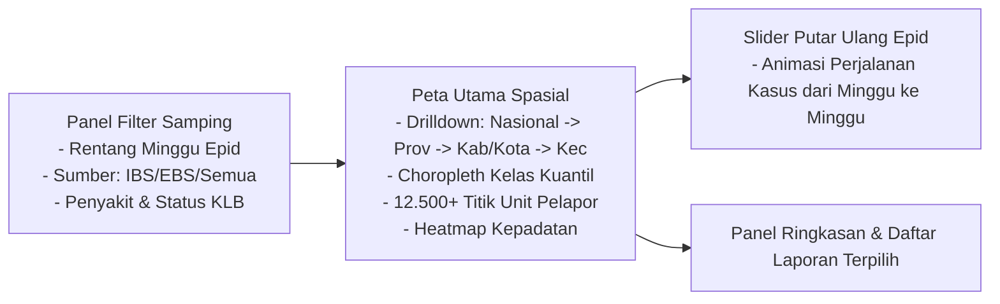

#### Fitur Utama Dasbor Spasial:
1. **Hierarki Drilldown Wilayah 4 Tingkat:** Kemampuan menjelajah peta mulai dari peta Nasional $\rightarrow$ Provinsi $\rightarrow$ Kabupaten/Kota $\rightarrow$ Kecamatan dengan penyesuaian batas wilayah dinamis (*GeoJSON TopoJSON boundaries*).
2. **Kuantil Choropleth Dinamis:** Pewarnaan gradasi wilayah berdasarkan rentang kuantil jumlah kasus atau laju insidensi (*Incidence Rate* per 100.000 penduduk).
3. **Sebaran Titik Unit Pelapor:** Visualisasi lebih dari 12.500 unit fasyankes (Puskesmas dan Rumah Sakit) lengkap dengan status alert pada masing-masing unit (Pin Merah: Berstatus KLB, Pin Kuning: Alert belum diverifikasi, Pin Hijau: Normal / Terverifikasi).
4. **Playback Mode (Putar Ulang Mingguan):** Tombol *Play/Pause* dengan time-slider yang memutar animasi perkembangan transmisi penyakit dari minggu epidemiologi awal hingga minggu terakhir secara visual.
5. **Fluid Auto-Layout:** Tata letak fleksibel lebar penuh (*fluid 100% width*) tanpa batas margin kaku, yang otomatis menyesuaikan saat panel filter samping dibuka atau ditutup.

---

### 4.6. Dasbor Limited - Matriks Analisa (`/dashboard/matriks-analisa`)
Pusat analitik kuantitatif data SKDR yang menyediakan 6 tab analisis mendalam dan fitur ekspor data.

#### 6 Tab Analitik:
1. **Tab 1: Ringkasan (Executive Metrics):** Ringkasan kartu metrik utama, perbandingan kasus antar periode (minggu ini vs minggu lalu vs tahun lalu), dan interpretasi otomatis situasi epidemiologi.
2. **Tab 2: Matriks & Laporan (Cross-Tabular Grid):** Grid tabel silang interaktif yang memetakan baris wilayah/penyakit terhadap kolom minggu-minggu epidemiologi. Dilengkapi fitur pencarian, sortir, dan penyaringan instan.
3. **Tab 3: Morbiditas:** Analisis angka kesakitan, piramida distribusi usia dan jenis kelamin, rasio insidensi, serta proporsi penyakit terbanyak.
4. **Tab 4: Kinerja Pelaporan:** Mengukur kepatuhan unit pelapor dalam mengirimkan laporan mingguan:
   - **Kelengkapan Laporan:** Persentase fasyankes yang mengirim laporan (Target nasional $\ge 80\%$).
   - **Ketepatan Laporan:** Persentase laporan yang masuk sebelum batas waktu Selasa pukul 12.00 WIB (Target nasional $\ge 80\%$).
   - **Tabel Peringkat Kinerja Unit:** Menampilkan daftar fasyankes paling patuh dan fasyankes yang sering terlambat/absen melapor.
5. **Tab 5: Alert & Sinyal:** Menampilkan seluruh log pemicuan sinyal kewaspadaan dini, deviasi standar dari baseline, dan status verifikasi lapangan oleh dinas kesehatan.
6. **Tab 6: Profil Kasus:** Penelusuran data mikro individual dan kronologi detail kasus EBS yang membutuhkan pengawasan khusus.
7. **Ekspor Data Excel (XLSX):** Fitur ekspor satu klik seluruh data matriks dan laporan ke format spreadsheet Excel resmi untuk kebutuhan penyusunan laporan berkala ke pimpinan daerah.

---

### 4.7. Beranda & Portal Publik (`/` dan `/beranda`)
Halaman gerbang yang menyajikan ringkasan situasi kesehatan nasional kepada publik tanpa membuka data sensitif pasien:
- Peta sebaran umum situasi penyakit menular.
- Rangkuman kewaspadaan dini penyakit potensial KLB berjalan.
- Panduan teknis dan pintu masuk (*Single Sign-On login*) bagi petugas kesehatan berwenang.

---

## 5. DIAGRAM ALUR PENGGUNA (USER FLOWS)

### Alur 1: Pelaporan Mingguan Rutin IBS & Pemicuan Alert
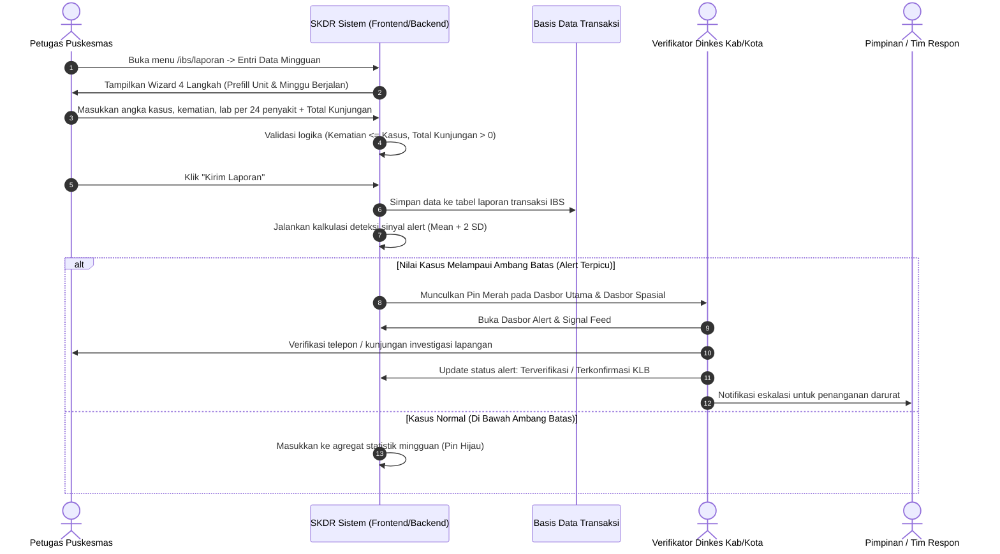

---

### Alur 2: Deteksi Rumor EBS & Respons Cepat 7-1-7
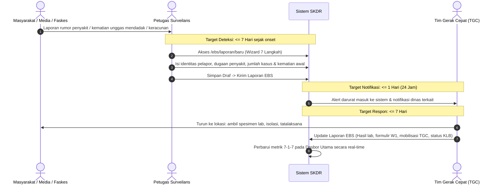

---

### Alur 3: Pengawasan Higiene SPPG & Penanggulangan Keracunan Pangan MBG
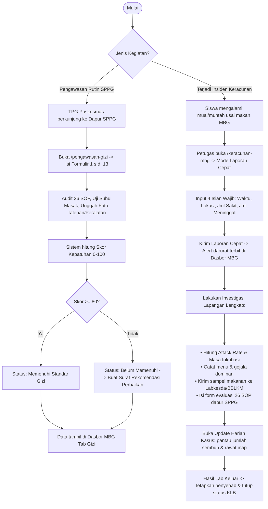

---

### Alur 4: Siklus Verifikasi Penyelidikan Epidemiologi (PE)
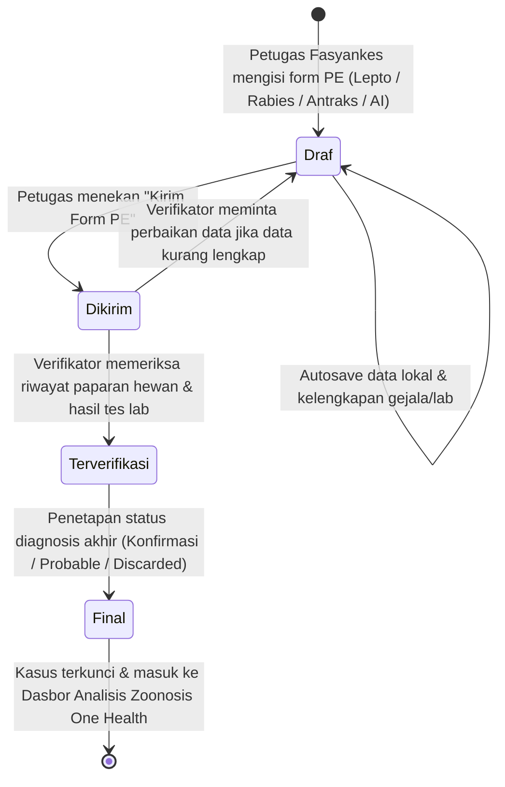

---

## 6. MATRIKS HUBUNGAN INPUT FORMULIR KE DASBOR (DATA MAPPING MATRIX)

Tabel berikut menunjukkan bagaimana setiap data yang diinput oleh pengguna di formulir transaksi mengalir dan mempengaruhi tampilan modul dasbor:

| Formulir Transaksi | Data / Isian Kunci | Modul Dasbor Penerima | Indikator / Visualisasi yang Terpengaruh |
|---|---|---|---|
| **Laporan Agregat IBS** | Jumlah Kasus per Penyakit | Dasbor Utama, Dasbor Spasial, Matriks Analisa | Tren kurva epidemiologi, total kasus nasional/wilayah, pewarnaan kuantil choropleth, grid data silang mingguan. |
| **Laporan Agregat IBS** | Jumlah Kematian | Dasbor Utama, Dasbor Spasial, Matriks Morbiditas | Angka total kematian dan perhitungan Case Fatality Rate (CFR Wilson Score 95% CI). |
| **Laporan Agregat IBS** | Kasus Melampaui Ambang Batas | Dasbor Utama, Dasbor Spasial (Pin Merah), Tab Sinyal | Pemicuan Alert SKDR mingguan, notifikasi verifikasi fasyankes, pendaftaran log sinyal. |
| **Laporan Agregat IBS** | Total Kunjungan Fasyankes | Matriks Analisa (Tab Morbiditas) | Penyebut proporsi insidensi penyakit terhadap seluruh beban layanan fasyankes. |
| **Laporan Agregat IBS** | Waktu Kirim & Status Laporan | Matriks Analisa (Tab Kinerja Pelaporan) | Metrik Kelengkapan Laporan (%) dan Ketepatan Laporan (%) Puskesmas (sebelum Selasa 12.00). |
| **Laporan Individu IBS** | Diagnosis, ICD-10, SOAP | Dasbor Utama, Matriks Profil Kasus | Sebaran diagnosis spesifik, data mikro rekam medis, verifikasi kasus individual. |
| **Laporan Individu IBS** | Tinggi & Berat Badan, Umur | Matriks Analisa (Tab Morbiditas) | Status IMT gizi pasien, piramida kelompok usia balita vs dewasa. |
| **Laporan EBS** | Rumor & Status Kejadian | Dasbor EBS & IBS (Tab EBS), Dasbor Utama | Jumlah rumor masuk, peta sebaran rumor, rasio rumor terverifikasi kasus. |
| **Laporan EBS** | Matriks Usia (11 Kelompok) & Jenis Kelamin | Dasbor EBS, Matriks Analisa (Tab Morbiditas) | Distribusi demografi kasus terdampak kejadian luar biasa. |
| **Laporan EBS** | Status KLB, W1, TGC, Respon | Dasbor Utama (Indikator 7-1-7), Modul Klaster | Pencapaian target respon kedaruratan 7-1-7, daftar klaster wabah aktif. |
| **Pengawasan Gizi MBG** | Butir Audit F1–F12 & Skor F13 | Dasbor MBG (Tab Pengawasan Gizi) | Rata-rata skor kepatuhan SPPG, persentase SPPG memenuhi syarat, ranking butir SOP kritis. |
| **Pengawasan Gizi MBG** | Foto Bukti Persiapan F7 | Dasbor MBG (Detail Audit SPPG) | Galeri visual kepatuhan higiene dapur untuk tim pembina dinas kesehatan. |
| **Keracunan Pangan MBG** | Jumlah Sakit & Meninggal | Dasbor MBG (Tab Keracunan Pangan) | Total kasus keracunan pangan MBG, rasio kematian (CFR), status kedaruratan pangan. |
| **Keracunan Pangan MBG** | Jam Makan & Jam Onset Gejala | Dasbor MBG (Tab Keracunan Pangan) | Grafik distribusi kurva masa inkubasi dan penentuan dugaan agen patogen. |
| **Keracunan Pangan MBG** | Hasil Uji Lab Sampel Pangan | Dasbor MBG, Dasbor Utama (Lab) | Konfirmasi cemaran mikrobiologi / toksin kimia pada makanan program MBG. |
| **Form PE (4 Zoonosis)** | Data Klinis, Lab, Hewan Penular | Dasbor Zoonosis Lite, Dasbor Spasial | Peta titik transmisi zoonosis One Health, pemantauan masa observasi hewan rabies, uji MAT Leptospira. |

---

## 7. ATURAN VALIDASI & PENJAMINAN KUALITAS DATA

Untuk menjamin integritas data surveilans nasional, sistem menerapkan aturan validasi ketat (*data integrity rules*) di tingkat peramban (*client-side*) maupun peladen (*backend server-side*):

1. **Integritas Kematian terhadap Kasus:**
   - Jumlah Kematian tidak boleh lebih besar dari Jumlah Kasus ($Kematian \le Kasus$).
   - Jika Jumlah Kematian $> 0$, sistem mewajibkan pengisian Tanggal Meninggal.
2. **Integritas Waktu Epidemiologi:**
   - Tanggal timbul gejala (*onset*) tidak boleh berada di masa depan ($Onset \le Hari Ini$).
   - Tanggal kedatangan ke faskes harus sama dengan atau setelah tanggal onset ($Tgl Faskes \ge Onset$).
   - Minggu epidemiologi yang dipilih tidak boleh melampaui minggu berjalan pada kalender saat ini.
3. **Integritas Matriks Demografi EBS:**
   - Jumlah total penjumlahan kasus pada seluruh sel usia dan jenis kelamin ($11 \text{ baris} \times 2 \text{ kolom}$) wajib sama dengan angka total Jumlah Kasus yang diisikan.
4. **Pencegahan Redundansi & Duplikasi:**
   - Sistem mencegah entri ganda untuk laporan agregat IBS pada kombinasi unik: `Unit Pelapor + Tahun + Minggu Epidemiologi`. Bila data sudah ada, sistem membuka mode pembaruan (*edit existing*), bukan membuat baris baru.
5. **Autosave & Keamanan Sesi:**
   - Seluruh formulir wizard secara berkala menyimpan draf di sisi klien/server sehingga petugas di daerah dengan koneksi internet tidak stabil tidak kehilangan data yang sedang diinput saat terjadi gangguan jaringan.

---
*Dokumen ini merupakan panduan fungsional resmi dan acuan pengujian (User Acceptance Testing - UAT) untuk seluruh pemangku kepentingan sistem SKDR Indonesia.*
