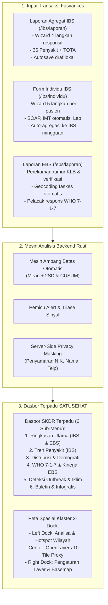
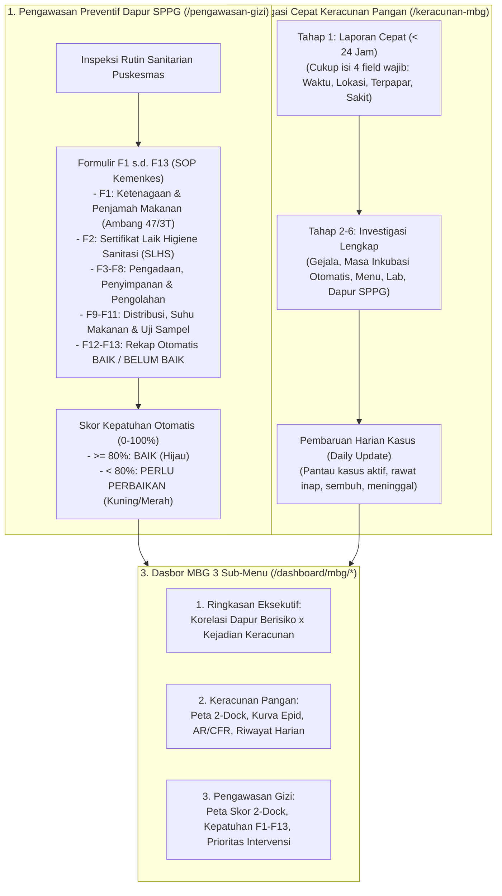
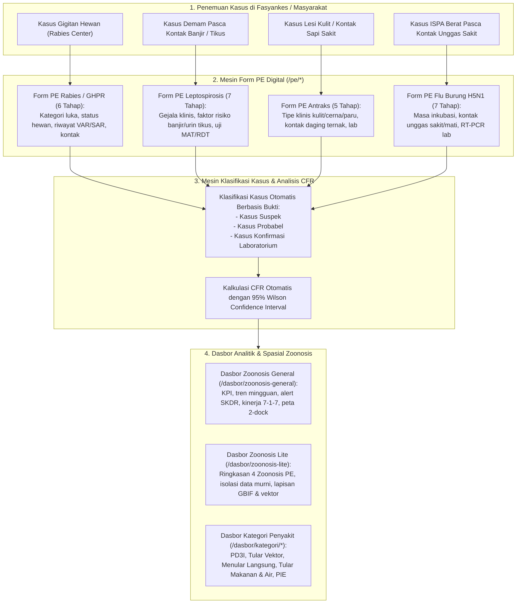

# Dokumentasi Sistem SKDR Indonesia: Komparasi Sistem Eksisting (Lama) vs Sistem Baru (SKDR, MBG, dan Zoonosis)

Dokumen ini disusun sebagai dokumentasi teknis dan fungsional resmi yang membedah arsitektur, modul transaksi, alur kerja (*system flow*), serta kapabilitas analitik dari:
1. **Bidang SKDR (IBS & EBS)**: Sistem Eksisting (Lama) vs Sistem Baru.
2. **Bidang Program MBG (Makan Bergizi Gratis)**: Sistem Eksisting (Lama) vs Sistem Baru.
3. **Bidang Zoonosis & One Health**: Sistem Baru (arsitektur investigasi digital komprehensif).

---

## 1. Ikhtisar Arsitektur Lintas Generasi

```
+---------------------------------------------------------------------------------------------------------+
| SISTEM EKSISTING (LAMA) KEMENKES RI (https://skdr.kemkes.go.id)                                          |
| Stack: PHP CodeIgniter 3, MySQL, AdminLTE v2 / Bootstrap 3, Google Maps API v3 + MarkerClusterer        |
| Karakteristik: Monolitik, form statis tanpa autosave, dependensi API berbayar, minim validasi silang    |
+---------------------------------------------------------------------------------------------------------+
                                                     ▼
+---------------------------------------------------------------------------------------------------------+
| SISTEM BARU SKDR INDONESIA                                                                              |
| Stack: Backend Rust (Axum, SQLx, Tokio) + Frontend Next.js 15 (React 19, Tailwind CSS, OpenLayers 10)  |
| Standar Desain: SATUSEHAT v4 DTO Kemenkes RI (Font Manrope, Kanvas Pure White #FFFFFF, 2-Dock Map Layout)|
| Karakteristik: Kinerja tinggi, zero-PII masking, offline tile proxy, validasi silang & autosave lokal   |
+---------------------------------------------------------------------------------------------------------+
```

---

## 2. Bidang 1: SKDR Terpadu (IBS & EBS)

### 2.1 Sistem Eksisting (Lama) — `skdr.kemkes.go.id`

#### A. Komponen & Alur Pelaporan Lama
1. **Surveilans Berbasis Indikator / IBS (`/agregate-puskesmas`)**:
   - Puskesmas atau rumah sakit memasukkan laporan rutin mingguan (Senin s.d. Minggu) untuk 36 penyakit potensi wabah.
   - Format input berupa formulir tabel masal dengan kode SMS: `A` (Diare Akut), `B` (Kolera), ..., `Z` (COVID-19), `AA` (Chikungunya), `AB` (Campak), `AC` (Difteri), dan `TOTA` (Total Kunjungan).
   - Pengguna menginput 3 angka per penyakit: Jumlah Kasus, Jumlah Kematian, dan Jumlah Lab Positif.
   - Tenggat pengiriman mingguan dipatok setiap hari Selasa pukul 12.00 WIB (cut-off ketepatan).
2. **Surveilans Berbasis Kejadian / EBS (`/form-ebs-new`)**:
   - Pendaftaran rumor atau sinyal kejadian tidak lazim (KLB, klaster kematian mendadak, gigitan hewan).
   - Formulir terbagi dalam 4 tab: Informasi Awal, Penyakit & Respon, Upload Dokumen Penyelidikan, dan Integrasi SIZE (Sistem Informasi Zoonosis & Emerging Infectious Diseases).
3. **Visualisasi Dasbor Utama (`/dashboard`)**:
   - *Top Ribbon KPI*: Menampilkan jumlah wilayah (38 provinsi, 514 kab/kota, 7.415 kecamatan, 13.000+ faskes) dan total alert tahun berjalan.
   - *Grafik Batang Peringatan Dini*: Grafik interaktif provinsi dengan status alert (Belum Terverifikasi vs Sudah Terverifikasi).
   - *Peta Google Maps*: Peta sebaran titik fasyankes berpenanda merah/kuning dengan plugin `MarkerClusterer`.
   - *Indikator Mutu*: Grafik persentase Kelengkapan Laporan ($\ge 80\%$) dan Ketepatan Laporan.
4. **Analitik Lanjutan ("Dashboard 2")**:
   - Memuat 12 sub-menu terpisah: Tren Kasus (`/dashboard-tren`), Distribusi Demografi (`/dashboard-distribusi`), Tren IBS Tahunan (`/buletin/tren`), Korelasi Iklim CDS (`/buletin/trencds`), Deteksi EARS/Farrington (`/buletin/analisa`), WHO 7-1-7 (`/ebs717`), Analitik EBS (`/ebs-analytics`), After Action Review (`/aar`), JEE/IHR (`/ihr`), Generator Buletin (`/buletin`), Infografis (`/buletin/infografis`), dan Hotspot Karhutla (`/hotspot`).

#### B. Keterbatasan & Isu pada Sistem Lama
- **Ketergantungan Eksternal**: Membutuhkan lisensi Google Maps JavaScript API komersial; peta menjadi blank bila kuota API habis atau faskes berada di jaringan tertutup/intranet.
- **Formulir Tanpa Autosave**: Sesi login berbasis cookie PHP native sering kedaluwarsa saat petugas sedang mengisi 36 baris tabel IBS, menyebabkan seluruh isian hilang dan harus diulang.
- **Pemisahan Data Pasien & Agregat**: Petugas harus mengagregasi kartu rawat jalan secara manual di buku register faskes sebelum menginput totalnya ke sistem; tidak ada integrasi riwayat pasien per individu.
- **UI Tidak Mobile-Friendly**: Desain AdminLTE v2 dengan tabel lebar sulit diakses melalui smartphone atau tablet lapangan.

---

### 2.2 Sistem Baru — SKDR Indonesia

#### A. Komponen & Alur Pelaporan Baru


1. **Laporan Agregat IBS Modern (`/ibs/laporan`)**:
   - Wizard 4 tahap terstruktur (Unit & Periode, Matriks 36 Penyakit, Rekapitulasi Kunjungan, Tinjau & Kirim).
   - Stepper kompak relatif anti-overflow, bar kemajuan gradien SATUSEHAT, tombol "Lompat ke isian belum valid".
   - *Autosave* otomatis ke penyimpanan lokal peramban (*LocalStorage*) mencegah kehilangan data saat jaringan terputus.
2. **Form Individu IBS (`/ibs/individu`)**:
   - Modul inovatif pencatatan per pasien (Unit & Periode, Identitas Pasien dengan penyamaran NIK, Diagnosis Penyakit Agregat A–Z, Pemeriksaan & SOAP, Tinjau).
   - Mendukung agregasi otomatis ke dalam laporan mingguan fasyankes.
3. **Laporan EBS Terpadu (`/ebs/laporan`)**:
   - Wizard 7 langkah dengan validasi cerdas, estimasi waktu penemuan hingga verifikasi, pelacakan respon berstandar WHO 7-1-7 (Deteksi $\le 7$ hari, Notifikasi $\le 1$ hari, Respon $\le 7$ hari).
4. **Dasbor SKDR Terpadu (Penyatuan 12 Sub-Dasbor ke 6 Menu Utama)**:
   - Menu induk `Dasbor SKDR` di sidebar memuat 6 sub-menu bersih:
     - *Ringkasan Utama (IBS & EBS)* (`/dashboard/skdr/ringkasan`)
     - *Tren Penyakit (IBS)* (`/dashboard/skdr/tren`)
     - *Distribusi & Demografi* (`/dashboard/skdr/distribusi`)
     - *WHO 7-1-7 & Kinerja EBS* (`/dashboard/skdr/717`)
     - *Deteksi Outbreak & Iklim* (`/dashboard/skdr/deteksi`)
     - *Buletin & Infografis* (`/dashboard/skdr/buletin`)
5. **Peta Spasial 2-Dock Auto-Layout**:
   - Kanvas OpenLayers 10 dengan *tile proxy* internal (`/osm-tiles/{z}/{x}/{y}.png`), Left Dock lipat (340px) untuk peringkat wilayah & hotspot, Center Map (640px) dengan *drilldown* Provinsi $\to$ Kab/Kota, dan Right Dock lipat (320px) untuk pengaturan visualisasi.

---

### 2.3 Matriks Komparasi Sistem SKDR: Lama vs Baru

| Fitur / Parameter | Sistem Eksisting (Lama) | Sistem Baru (SKDR Indonesia) | Peningkatan / Keunggulan |
|---|---|---|---|
| **Teknologi Backend** | PHP CodeIgniter 3 (Monolitik) | Rust (Axum, Tokio, SQLx) | Waktu respons kueri agregat nasional terpangkas dari $\approx 15$ detik menjadi $< 300$ ms. |
| **Teknologi Frontend** | jQuery + Bootstrap 3 / AdminLTE v2 | Next.js 15 + React 19 + Tailwind CSS | Antarmuka reaktif, render SSR/SSG instan, ramah perangkat seluler. |
| **Mesin Peta Spasial** | Google Maps JS API v3 + MarkerClusterer | OpenLayers 10 + Tile Proxy Internal | Kedaulatan data penuh tanpa biaya lisensi komersial dan dapat beroperasi di jaringan tertutup. |
| **Arsitektur Layout Peta** | Kolom tunggal kaku diapit tabel | **2-Dock Auto-Layout** (Left Dock Analisa, Center Canvas, Right Dock Layer) | Visualisasi data luas, fokus analitis, legenda interaktif, dan navigasi level bertingkat. |
| **Input Data Pasien** | Hanya data agregat total mingguan | Agregat Mingguan + **Form Individu Pasien** | Penelusuran data hingga tingkat kasus individu (*line list*) tanpa kehilangan ringkasan agregat. |
| **Pencegahan Kehilangan Data** | Tidak ada (risiko session timeout) | Autosave berkala ke LocalStorage + Validasi inline | Data input aman meskipun browser tertutup tidak sengaja atau koneksi terputus. |
| **Perlindungan Privasi** | Data pribadi terlihat di level database | Server-Side Privacy Masking | NIK, nama lengkap, dan nomor kontak disamarkan secara otomatis di sisi server. |
| **Struktur Dasbor** | 12 sub-menu terfragmentasi | 6 Sub-Menu Terpadu di Sidebar | Navigasi rapi, terpusat, dan menyatu dalam alur kerja surveilans PHEOC. |

---

## 3. Bidang 2: Program MBG (Makan Bergizi Gratis)

### 3.1 Sistem Eksisting (Lama) — `skdr.kemkes.go.id/form-mbg` & `/dashboard-mbg`

#### A. Komponen & Alur Pelaporan Lama
1. **Formulir MBG (`/form-mbg/add`)**:
   - Formulir monolitik 6 tab (memuat total 113 field isian):
     - *Tab 1: Informasi Kejadian*: Tanggal/jam kejadian, tanggal/jam makan, jumlah terpapar, sakit, meninggal, dirawat.
     - *Tab 2: Lokasi & Sanitasi*: Nama sekolah/pesantren, ketersediaan air bersih, fasilitas cuci tangan, tempat pembuangan sampah.
     - *Tab 3: Pengolahan & Penyajian*: Dapur penyedia makanan (SPPG), penjamah makanan, alat masak, wadah saji.
     - *Tab 4: Menu Makanan & Gejala*: Menu paket MBG yang dikonsumsi, gejala dominan siswa sakit (mual, muntah, diare, demam).
     - *Tab 5: Pemeriksaan Laboratorium*: Sampel sisa makanan, rectal swab, muntahan, status pengiriman ke Balai Labkesmas.
     - *Tab 6: Dokumen & Kronologi*: Kronologi naratif insiden dan unggahan dokumen laporan awal.
2. **Dasbor MBG Lama (`/dashboard-mbg`)**:
   - Peta sebaran titik insiden berbasis Google Maps.
   - Tabel ringkasan kejadian keracunan pangan per kab/kota.
   - Grafik batang jumlah kasus keracunan bulanan.

#### B. Keterbatasan & Isu pada Sistem Lama
- **Beban Pengisian Tinggi**: Mengisi 113 field secara sekaligus sangat menyulitkan petugas surveilans puskesmas di lapangan yang sedang menangani situasi gawat darurat KLB.
- **Ketiadaan Pengawasan Pra-Insiden**: Sistem lama hanya bersifat reaktif (mencatat setelah ada korban keracunan); belum ada instrumen digital untuk mengawasi dan menilai kepatuhan dapur SPPG sebelum insiden terjadi.
- **Tidak Ada Pelacakan Harian**: Pasca pelaporan pertama, sistem lama tidak menyediakan pencatatan perkembangan harian (*daily follow-up*) untuk memantau kapan pasien sembuh, pulang dari RS, atau status akhir KLB.

---

### 3.2 Sistem Baru — SKDR Indonesia (Program MBG Terpadu)

#### A. Komponen & Alur Kerja Baru


1. **Modul Pengawasan Gizi SPPG (`/pengawasan-gizi`)**:
   - Digitalisasi lengkap **Formulir 1–13** standar Direktorat Gizi dan KIA Kemenkes RI.
   - Evaluasi menyeluruh: kelaikan higiene sanitasi (SLHS), sertifikasi penjamah makanan, rantai dingin penyimpanan bahan, suhu penyajian ($\ge 60^\circ\text{C}$), hingga uji organoleptik dan retensi sampel sisa makanan ($\ge 48$ jam).
   - Penilaian skor kepatuhan otomatis per aspek dan rekapitulasi akhir: **BAIK** ($\ge 80\%$) atau **BELUM BAIK** ($< 80\%$).
2. **Modul Keracunan Pangan MBG (`/keracunan-mbg`)**:
   - Mengadopsi prinsip *Two-Tier Reporting*:
     - **Tingkat 1 — Laporan Cepat (< 24 Jam)**: Petugas cukup mengisi waktu kejadian, sekolah terdampak, perkiraan jumlah korban, dan mengirim laporan seketika agar status darurat teraktivasi di dinas kesehatan.
     - **Tingkat 2 — Investigasi Lengkap (Tahap 2 s.d. 6)**: Dilengkapi saat kondisi lapangan telah stabil (detail gejala, makanan dicurigai, masa inkubasi yang dihitung otomatis oleh sistem, kelaikan dapur SPPG, dan pelacakan sampel laboratorium).
   - **Fitur Pembaruan Harian (Daily Update)**: Log kumulatif harian perkembangan pasien untuk melacak pergerakan angka kesembuhan dan penghentian KLB.
3. **Dasbor MBG Terpadu 3 Sub-Menu**:
   - *Ringkasan Eksekutif* (`/dashboard/mbg/ringkasan`): Tab komparasi sebaris peta kejadian keracunan vs sebaran skor dapur SPPG.
   - *Keracunan Pangan* (`/dashboard/mbg/keracunan`): Peta 2-dock sebaran insiden keracunan pangan, kurva epidemiologi waktu konsumsi ke gejala, peringkat kab/kota, attack rate, CFR 95% Wilson.
   - *Pengawasan Gizi* (`/dashboard/mbg/pengawasan`): Peta 2-dock sebaran kepatuhan dapur SPPG, matriks skor F1–F13, dan daftar SPPG prioritas pembinaan.

---

### 3.3 Matriks Komparasi Sistem MBG: Lama vs Baru

| Fitur / Dimensi | Sistem Eksisting (Lama) | Sistem Baru (SKDR Indonesia) | Peningkatan / Keunggulan |
|---|---|---|---|
| **Alur Pelaporan Keracunan** | 1 formulir tunggal panjang 113 field | Wizard 6 Tahap dengan **Laporan Cepat** | Notifikasi darurat dapat terkirim dalam waktu $< 5$ menit tanpa menunggu seluruh data lengkap. |
| **Pemantauan Pasca-Lapor** | Statis (data tidak diupdate harian) | **Fitur Pembaruan Harian (Daily Update)** | Riwayat perkembangan harian pasien aktif, rawat inap, sembuh, dan meninggal terpantau akurat. |
| **Pengawasan Preventif Dapur** | Belum tersedia instrumen digital | **Modul Pengawasan Gizi (Form 1–13)** | Pencegahan dini kontaminasi makanan di dapur SPPG sebelum timbul kejadian keracunan. |
| **Korelasi Risiko** | Terpisah | Analisis Silang Dapur SPPG $\times$ Insiden | Mendeteksi korelasi antara dapur ber-skor rendah ($< 80\%$) dengan kejadian keracunan di sekolah mitra. |
| **Perhitungan Epidemiologi** | Input manual | Kalkulasi Otomatis Sistem | Attack Rate (AR %), Case Fatality Rate (CFR %), dan Masa Inkubasi otomatis dihitung dari selisih jam. |
| **Tata Letak Peta Spasial** | Peta sempit bersanding dengan tabel | **Peta 2-Dock Auto-Layout** lebar penuh | Navigasi ranking wilayah di Left Dock, titik sebaran dapur & sekolah di Center, legenda status di Right Dock. |

---

## 4. Bidang 3: Zoonosis & One Health (Sistem Baru)

*Catatan: Sistem lama Kemenkes belum memiliki modul investigasi digital terintegrasi untuk formulir Penyelidikan Epidemiologi (PE) Zoonosis. Seluruh kapabilitas berikut dibangun sebagai inovasi sistem baru SKDR Indonesia.*

### 4.1 Arsitektur Zoonosis One Health
Sistem baru mengintegrasikan pendekatan **One Health** yang menghubungkan surveilans kesehatan manusia (kasus fasyankes), kesehatan hewan (hewan penular/ternak), dan lingkungan (vektor & satwa liar).



### 4.2 Spesifikasi 4 Formulir PE Zoonosis Digital

1. **Form PE Leptospirosis (`/pe/lepto`)**:
   - Memuat 127 baris variabel spesifikasi medis (7 langkah wizard).
   - Menelusuri faktor risiko lingkungan (pekerjaan pembersih selokan/petani, riwayat kontak genangan air banjir, keberadaan tikus di permukiman).
   - Klasifikasi otomatis: Suspek $\to$ Probabel (gejala khas + RDT Lepto positif) $\to$ Konfirmasi (kultur *Leptospira* positif / titer Microscopic Agglutination Test / MAT $\ge 1:400$).
2. **Form PE Rabies / GHPR (`/pe/rabies`)**:
   - Memuat 95 baris variabel spesifikasi medis (6 langkah wizard).
   - Algoritma penentuan kategori luka gigitan (Risiko Tinggi pada leher/muka/ujung jari vs Risiko Sedang pada badan/ekstremitas).
   - Penilaian status hewan penular (anjing/kucing/kera: mati, dibunuh, lari, atau diobservasi 14 hari).
   - Riwayat tata laksana: pencucian luka dengan sabun 15 menit, pemberian VAR (Vaksin Anti Rabies), dan SAR (Serum Anti Rabies).
   - Tabel kontak berulang untuk mencatat seluruh korban gigitan dari hewan yang sama.
3. **Form PE Antraks (`/pe/antraks`)**:
   - Memuat 86 baris variabel spesifikasi medis (5 langkah wizard).
   - Diferensiasi tipe klinis: Antraks Kulit (*eschar* kehitaman tidak nyeri), Antraks Pencernaan (pasca konsumsi daging sapi sakit), dan Antraks Paru.
   - Penelusuran riwayat paparan ternak: menyembelih, menguliti, mencincang, atau membagi-bagikan daging ternak mati mendadak.
4. **Form PE Flu Burung / Avian Influenza H5N1 (`/pe/ai`)**:
   - Memuat 107 baris variabel spesifikasi medis (7 langkah wizard).
   - Menghitung masa inkubasi (1–7 hari pasca paparan unggas sakit/mati mendadak atau pasar unggas hidup).
   - Pencatatan hasil swab nasofaring/orofaring melalui uji RT-PCR spesifik H5N1 / H5N6.

### 4.3 Fitur Dasbor Zoonosis Terintegrasi

1. **Dasbor Zoonosis General (`/dasbor/zoonosis-general`)**:
   - Sintesis menyeluruh seluruh penyakit zoonotik: total kasus, kematian, kurva epidemiologi, sinyal alert SKDR, dan evaluasi respon tim gerak cepat (TGC) 7-1-7.
   - Peta spasial 2-dock dengan integrasi titik penanganan Rabies Center dan sebaran kasus terkonfirmasi.
2. **Dasbor Zoonosis Lite (`/dasbor/zoonosis-lite`)**:
   - Halaman eksekutif terisolasi khusus 4 zoonosis ber-Form PE (Antraks, Rabies, Lepto, Flu Burung).
   - Menjamin isolasi data murni dari tabel `pe_cases` dan `laporan_ebs` tanpa tercampur dengan data surveilans agregat mingguan IBS.
   - Dilengkapi kartu komparasi CFR dengan rentang estimasi interval kepercayaan 95% Wilson (*Wilson 95% Confidence Interval*).
3. **Integrasi Lapisan Lingkungan & Satwa Liar (One Health)**:
   - Lapisan jalur migrasi burung liar dari data global GBIF (*Global Biodiversity Information Facility*) untuk memantau risiko impor virus Flu Burung.
   - Lapisan pengamatan vektor nyamuk dari iNaturalist untuk konteks arbovirus dan penyakit tular vektor.

---

## 5. Ringkasan Evaluasi & Nilai Tambah Sistem Baru

| Aspek Evaluasi | Sistem Eksisting (Lama) | Sistem Baru (SKDR Indonesia) |
|---|---|---|
| **Kedaulatan & Keamanan Data** | Bergantung pada Google Cloud / Google Maps | Mandiri dengan *internal tile server*, bebas pelacakan pihak ketiga. |
| **Respon KLB MBG** | Reaktif setelah timbul keracunan (113 field) | Preventif (Pengawasan Dapur F1–F13) + Reaktif (Laporan Cepat $<24$ jam & Update Harian). |
| **Investigasi Zoonosis** | Formulir manual / belum terdigitalisasi penuh | Digitalisasi 4 Form PE (Lepto, Rabies, Antraks, AI) + Klasifikasi otomatis One Health. |
| **User Experience (UX)** | Menu terfragmentasi, scroll panjang, rawan hilang data | Navigasi terpadu, autosave lokal, PageHeader 2-Grid, Peta 2-Dock Auto-Layout berstandar SATUSEHAT v4 DTO Kemenkes RI. |
