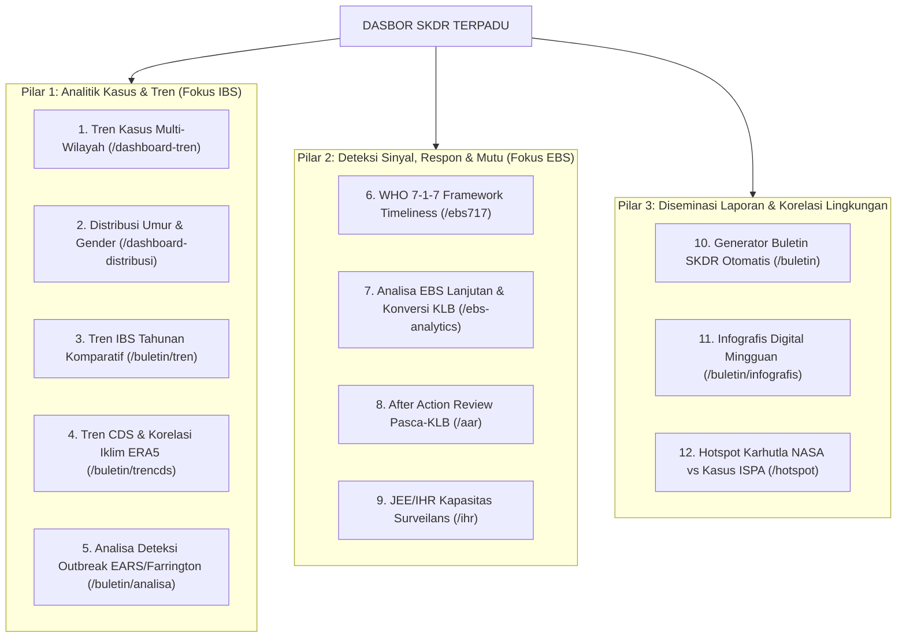

# Katalog Lengkap 12 Sub-Dasbor "Dashboard 2" SKDR Kemenkes RI
**Dokumen Spesifikasi Fitur, Filter, Visualisasi & Endpoints untuk Revamp SKDR Indonesia**

---

## Ringkasan Eksekutif Eksplorasi
Seluruh 12 sub-menu di bawah payung **"Dashboard 2"** telah dikunjungi, diuji coba, dan dibedah secara mendalam pada sistem aktif (`https://skdr.kemkes.go.id`). Modul-modul ini mewakili spektrum analitik epidemiologi lengkap: mulai dari kurva tren dan demografi dasar, analitik prediktif berbasis korelasi iklim/satelit, algoritma deteksi wabah statistik (EARS & Farrington), evaluasi respon berstandar global WHO (7-1-7 & AAR), hingga generator buletin/infografis otomatis.

---

## Pengelompokan Logis 12 Sub-Dasbor dalam Sistem Terpadu

---

## Rincian Spesifikasi Teknis 12 Sub-Dasbor

### 1. Tren (`/dashboard-tren`)
* **Fungsi Analitis**: Kurva tren kasus penyakit IBS mingguan (Minggu 1–52) dengan komparasi multi-tahun dan komparasi spasial hingga 3 wilayah sekaligus.
* **Filter**:
  - Penyakit (multi-select / Select2)
  - Kelompok Pelapor (Pemerintah, TNI, Polri, Swasta) & Unit Pelapor (Puskesmas, Klinik, RS)
  - Hierarki Wilayah 1 (Prov $\to$ Kab/Kota $\to$ Kec $\to$ Faskes)
  - Tombol Komparasi Wilayah 2 & 3: `[ (+) Tambah Perbandingan Wilayah ]`
  - Tipe Waktu (Perbandingan Tahun vs Rentang Minggu) & Jenis Grafik (Line / Bar)
* **Visualisasi**: Time-Series Chart interaktif (rotasi label 90°) + Tabel Agregat Kasus Mingguan per Wilayah.
* **Endpoints**: `POST /dashboard_tren/grafik-detail`, `POST /ajax/get_kota`, `POST /ajax/get_distrik`.

### 2. Distribusi (`/dashboard-distribusi`)
* **Fungsi Analitis**: Distribusi epidemiologi klasik menurut orang (kelompok umur & gender), waktu, dan tempat.
* **Filter**: Penyakit, Unit Pelapor, Wilayah Administratif, Dimensi (Kelompok Umur, Gender, Sebaran Wilayah), Periode Tahun & Minggu.
* **Visualisasi**: Horizontal/Vertical Bar Chart per Kategori, Donut/Pie Chart Gender, Tabel Proporsi Persentase.
* **Endpoints**: `POST /dashboard_distribusi/grafik-detail`, `POST /ajax/get_kota`.

### 3. Buletin SKDR (`/buletin`)
* **Fungsi Analitis**: Generator buletin surveilans epidemiologi mingguan otomatis berskala nasional hingga kab/kota dengan ekspor Word & PDF.
* **Filter**: Minggu (1–53, opsi range), Tahun, Level Wilayah (Nasional, Provinsi, Kab/Kota).
* **Visualisasi**: Peta Spasial Klaster Sinyal EBS (Leaflet), Chart Kinerja Kepatuhan Mingguan, Top 10 Alert Penyakit, Narasi AI Llama, Tombol "📄 Download Word" & "🖶 Cetak PDF".
* **Endpoints**: `GET /buletin/get_data`, `GET /buletin/get_kinerja_per_minggu`, `POST /buletin/export_word_charts`.

### 4. Tren Penyakit IBS SKDR (`/buletin/tren`)
* **Fungsi Analitis**: Komparasi kurva penyakit mingguan tahun berjalan vs tahun sebelumnya dilengkapi interpretasi narasi AI otomatis.
* **Filter**: Minggu, Tahun, Level Wilayah, Pilihan "Top 10" vs "Semua Penyakit".
* **Visualisasi**: Dual-Line Chart (Tahun Berjalan vs Tahun Lalu) + Kotak Analisis AI (tren kenaikan, lonjakan minggu, rekomendasi).
* **Endpoints**: `GET /buletin/get_rekap`, `POST /buletin/cloudflare_analyze`, `POST /buletin/groq_analyze`.

### 5. Tren CDS Penyakit IBS SKDR (`/buletin/trencds`)
* **Fungsi Analitis**: Mengintegrasikan data surveilans penyakit berbasis vektor/air (Dengue, Malaria, Diare) dengan observasi iklim global **Copernicus ERA5-Land** (suhu, curah hujan, kelembapan, El Niño / La Niña).
* **Filter**: Wilayah, Tahun, Penyakit Vektor, Layer Data Iklim ERA5 & Dampak El Niño.
* **Visualisasi**: Multi-Axis Mixed Chart (Batang kasus penyakit ditumpuk kurva suhu °C, curah hujan mm, dan kelembapan %) + Box Parameter Ambang Suhu Vektor Optimum (*Aedes* 25–30°C).
* **Endpoints**: `POST /buletin/ai_analyze`, `POST /buletin/export_trencds_word`.

### 6. Analisa Deteksi Outbreak (`/buletin/analisa`)
* **Fungsi Analitis**: Engine deteksi dini sinyal KLB berbasis model statistik canggih:
  1. **EARS C1** (Mild sensitivity, 7 hari baseline)
  2. **EARS C2** (Standar CDC / WHO, baseline 7 hari dengan lag 2 hari)
  3. **EARS C3** (Konservatif, akumulasi deviasi 3 hari)
  4. **Farrington Algorithm** (Quasi-Poisson model dengan penyesuaian musiman)
  5. **CUSUM** (Cumulative Sum)
* **Filter**: Minggu, Tahun, Wilayah, Pilihan Algoritma EARS/Farrington, Toggle "Hanya Tampilkan ALERT".
* **Visualisasi**: KPI Anomali Terdeteksi, Kurva Tren Frekuensi Alert, Peta Choropleth Sebaran Alert per Kab/Kota (GeoJSON), Tabel Matriks Deviasi Kasus vs Baseline Mean & C-Score.
* **Endpoints**: `POST /buletin/get_ears_data`, `POST /buletin/run_ears`, `POST /buletin/get_ears_choropleth`.

### 7. After Action Review (AAR) (`/aar`)
* **Fungsi Analitis**: Evaluasi pascakejadian KLB untuk mendokumentasikan pembelajaran, ketepatan respon, hambatan, dan *best practices* sesuai instrumen WHO AAR.
* **Filter**: Tahun Kejadian, Wilayah, Tombol `+ Buat AAR Baru`.
* **Visualisasi**: Kartu Metrik (% Sesuai 7-1-7, Rata-rata Hari Respon), Tabel Rekap Kepatuhan per Kab/Kota, Line Chart Penyelesaian, Tabel Log Review Kejadian.
* **Endpoints**: `GET /aar/get_dashboard`, `GET /aar/get_kabkota`.

### 8. JEE/IHR Kapasitas Surveilans (`/ihr`)
* **Fungsi Analitis**: Benchmarking kapasitas surveilans nasional terhadap instrumen **WHO Joint External Evaluation (JEE)** dan **International Health Regulations (IHR 2005)**.
* **Filter**: Tahun, Minggu, Wilayah, Tab Switcher: "SKDR Otomatis" vs "Indikator Mandiri JEE (D.2.1 / D.2.2)".
* **Visualisasi**: 6 KPI Kesiapan, Radar Chart / Spider Plot Kematangan Kapasitas (Skor 1–5), Bar Chart Tren Kinerja.
* **Endpoints**: `GET /ihr/get_dashboard`, `GET /ihr/get_indikator`.

### 9. Infografis SKDR (`/buletin/infografis`)
* **Fungsi Analitis**: Generator poster infografis digital ringkas satu halaman per minggu epidemiologi untuk diseminasi ke publik dan pimpinan.
* **Filter**: Minggu, Tahun, Wilayah, Tombol "▶ Generate" & "Simpan Gambar (PNG)".
* **Visualisasi**: Poster Grid Responsif (Header status minggu, Kartu KPI kelengkapan/ketepatan, Mini peta sebaran sinyal Leaflet, Grafik Top 5 Penyakit, Rekomendasi Teknis).
* **Endpoints**: `GET /buletin/get_rekap`.

### 10. WHO 7-1-7 Framework (`/ebs717`)
* **Fungsi Analitis**: Pengukuran ketepatan waktu respon KLB berbasis standar internasional:
  - $\le 7$ Hari Deteksi (Onset $\to$ Rumor diketahui)
  - $\le 1$ Hari Notifikasi (Rumor diketahui $\to$ Laporan diinput)
  - $\le 7$ Hari Respon (Notifikasi $\to$ Tindakan awal PE/TGC di lapangan)
* **Filter**: Mode Per Minggu vs Range Tanggal, Definisi Komponen Respon T3, Kategori Penyakit (Semua, Zoonosis, PIB), Level Wilayah.
* **Visualisasi**: Kartu Capaian 7-1-7 Timeliness, Bar Chart Durasi Hari Respon, Tabel Drill-Down Performa Fasyankes, Ekspor CSV.
* **Endpoints**: `GET /ebs717/get_data`, modal detail `/ebs717-modal`.

### 11. Analisa EBS Lanjutan (`/ebs-analytics`)
* **Fungsi Analitis**: Portal 7 instrumen analitik epidemiologi mendalam untuk Event-Based Surveillance:
  1. *Signal Quality Analysis* (Rasio verifikasi vs false alarm vs discarded)
  2. *KLB Conversion Rate* (Tingkat konversi rumor menjadi KLB terkonfirmasi)
  3. *Tren EBS* (Time-series jumlah sinyal per minggu)
  4. *Source Analysis* (Kontribusi media, hotline, warga, faskes)
  5. *Spatial Clustering* (Top 20 kecamatan hotspot sinyal EBS)
  6. *Completeness & Coverage* (Cakupan deteksi faskes aktif)
  7. *STROBE Checklist* (Standar pelaporan studi observasional)
* **Visualisasi**: Donut Chart Komposisi Sumber, Peta Klaster Hotspot Kecamatan, Tabel Konversi KLB.

### 12. SKDR - Hotspot - ISPA (`/hotspot`)
* **Fungsi Analitis**: Korelasi satelit titik panas kebakaran hutan dan lahan (**FIRMS NASA**) dengan lonjakan kasus Infeksi Saluran Pernapasan Akut (ISPA) dan indeks kualitas udara (PM2.5 / ISPU).
* **Filter**: Tahun (2019–2026), Wilayah, Selector Time-Lag (+0, +1, +2 minggu setelah paparan asap), Sub-Tab (Sebaran Hotspot, Korelasi ISPA, Kualitas Udara AQI, Dampak Asap, Analisa AI).
* **Visualisasi**: Peta Spasial Sebaran Hotspot Bergradasi Panas, Dual-Axis Time Series Chart (Titik Hotspot vs Kasus ISPA), Scatter Plot Regresi Korelasi $R^2$, Tabel Top 20 Wilayah Terpapar.
* **Endpoints**: `GET /hotspot/get_korelasi`, `GET /hotspot/get_karhutla_summary`.

