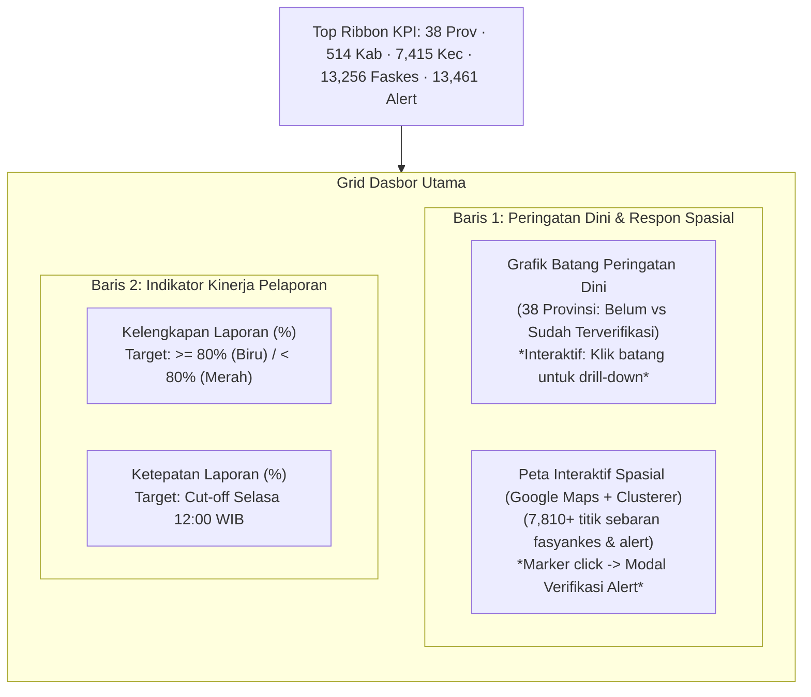
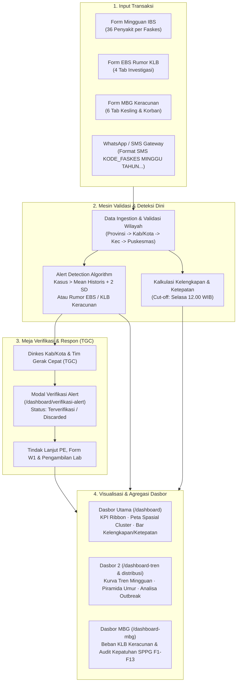

# Laporan Analisis Sistem Dasbor & Alur Data SKDR Kemenkes RI
**Dokumen Acuan Revamp Sistem SKDR Indonesia (Media Cipta Informasi / Tim Pengembang)**

---

## 1. Ringkasan Eksekutif & Stack Sistem Asli
Sistem **SKDR (Sistem Kewaspadaan Dini dan Respon)** resmi Kemenkes RI (`https://skdr.kemkes.go.id`) menggunakan arsitektur monolitik:
* **Backend**: PHP CodeIgniter (v3) dengan proteksi `ci_csrf_token`.
* **Frontend**: AdminLTE v2, Bootstrap 3 grid, jQuery 2.1.4, DataTables, Select2.
* **Grafik**: Chart.js v2 (Bar chart, Stacked bar).
* **Peta Spasial**: Google Maps JavaScript API v3 dipadukan dengan `MarkerClusterer`.
* **Kanal Komunikasi**: WhatsApp / SMS Gateway untuk laporan darurat fasyankes.

Sistem ini menjalankan 3 pilar utama surveilans kesehatan masyarakat:
1. **IBS (Indicator-Based Surveillance)**: Pemantauan mingguan rutin 36 penyakit potensial wabah dari 13.000+ unit pelapor (Puskesmas, Klinik, RS).
2. **EBS (Event-Based Surveillance)**: Deteksi rumor, sinyal kejadian tidak lazim, dan investigasi awal KLB.
3. **Program MBG (Makanan Bergizi Gratis)**: Pengawasan kepatuhan dapur SPPG (Formulir 1–13) dan investigasi epidemiologi keracunan pangan sekolah.

---

## 2. Struktur Modul & Navigasi
Berdasarkan pembacaan *live* pohon menu aplikasi:

| Modul Menu | Rute URL | Fungsi & Cakupan |
|---|---|---|
| **Dashboard Utama** | `/dashboard` | Executive overview nasional: KPI pita atas, Bar Peringatan Dini, Peta Kluster Verifikasi, Kelengkapan & Ketepatan. |
| **Dashboard 2** | `/dashboard-tren` `/dashboard-distribusi` `/buletin` `/buletin/tren` `/buletin/trencds` `/buletin/analisa` `/aar` `/ihr` `/buletin/infografis` `/ebs717` `/ebs-analytics` `/hotspot` | Analitik lanjutan: • **Tren**: Kurva mingguan multi-wilayah. • **Distribusi**: Demografi umur, jenis kelamin, spasial. • **Deteksi Outbreak**: Analisa sinyal kenaikan kasus. • **WHO 7-1-7 Framework**: Target deteksi (7 hari), notifikasi (1 hari), respon (7 hari). • **Hotspot ISPA**: Klaster spasial penyakit pernapasan. |
| **SKDR - IBS** | `/agregate-puskesmas` `/agregate-puskesmas/add` `/analisa-puskesmas` | • Monitoring pengiriman laporan mingguan. • Form entri agregat mingguan 36 penyakit. • Matriks analitik data penyakit per tempat/waktu. |
| **SKDR - EBS** | `/form-ebs-new` `/form-ebs-new/add` `/laporan-hewan` | • Register rumor dan sinyal KLB. • Wizard form 4-tab pelaporan & PE sinyal. • Integrasi SIZE (Sistem Informasi Zoonosis & EID). |
| **Program MBG** | `/form-mbg` `/form-mbg/add` `/dashboard-mbg` `/sppg` | • Form investigasi KLB keracunan pangan 6-tab. • Dasbor pengawasan SPPG & keamanan pangan. |
| **Whatsapp Gateway** | `/wa-inbox` `/wa-outbox` `/wa-send` | Kanal pelaporan otomatis via SMS/WhatsApp format teks standar. |
| **Parameter & Master** | `/alert-type` `/penyakit` `/sumber-data` `/diagnosa` | Pengaturan ambang batas (*threshold*), jenis penyakit, hierarki wilayah (Provinsi $\to$ Kab/Kota $\to$ Kecamatan $\to$ Puskesmas). |

---

## 3. Komponen Dasbor Utama (`/dashboard`)

1. **Pita KPI Atas**:
   - Surveilans Nasional: Provinsi (38), Kab/Kota (514), Kecamatan (7.415), Unit Pelapor (13.256), Alert (13.461), Laporan Minggu Berjalan (12.759 faskes).
   - Program MBG: Provinsi Terdampak (35), Kab/Kota (261), Kejadian (680), Kasus Keracunan (66.657), Meninggal (0).
2. **Grafik Peringatan Dini**:
   - *Stacked bar chart* per 38 provinsi.
   - Merah (`#DD4B39`) = Belum Terverifikasi; Biru (`#3C8DBC`) = Sudah Terverifikasi.
   - Setiap bar mendukung aksi klik untuk membuka detail alert per provinsi (`/dashboard/detail/puskesmas/alert/{PROVINSI}`).
3. **Peta Spasial Alert (Google Maps v3 + Clusterer)**:
   - 7.810+ titik sebaran alert fasyankes di seluruh Indonesia.
   - Klik pin memunculkan InfoWindow dengan tombol `.editalert`.
   - Mengirim request AJAX ke `/dashboard/verifikasi-alert` untuk menampilkan formulir tindak lanjut penyelidikan epidemiologi, lalu disimpan ke `/dashboard/simpan-verifikasi-alert`.
4. **Kelengkapan & Ketepatan**:
   - Kelengkapan = $\frac{\text{Puskesmas Melapor}}{\text{Total Puskesmas Terdaftar}} \times 100\%$.
   - Ketepatan = $\frac{\text{Lapor Sebelum Cut-Off (Selasa 12.00 WIB)}}{\text{Total Puskesmas Terdaftar}} \times 100\%$.
   - Ambang batas kepatuhan standar adalah $80\%$. Batang di bawah 80% otomatis berubah warna menjadi merah peringatan.

---

## 4. Rincian Modul Input Data (Form Transaksi)

### A. Form IBS (Laporan Mingguan Agregat Fasyankes)
* **Akses**: `/agregate-puskesmas/add`
* **Identitas Header**: Unit Fasyankes, Wilayah, Nama Petugas, Tahun, dan **Minggu Epidemiologi (1–52)**.
* **Tabel 36 Penyakit Potensial Wabah**:
  - Kolom: Kode SMS (A–Z, AA–AC), Kode ICD/SKDR (`01AWD`, `12MAL`, `04ARI`, `05BDR`, `21STF`, `03AFP`, `18MEA`, dll.), Nama Penyakit.
  - Setiap baris memiliki 3 input angka:
    1. `nilai[]` (Jumlah Kasus)
    2. `kematian[]` (Jumlah Kematian)
    3. `lab[]` (Jumlah Konfirmasi Laboratorium)
  - Baris penutup: Total Kunjungan Sakit Fasyankes (`TOTA` - Kode SMS `X`).

### B. Form EBS (Deteksi Rumor Kejadian Luar Biasa)
* **Akses**: `/form-ebs-new/add` (Struktur 4 Tab):
  - **Tab 1 (Informasi Dasar)**: No. Registrasi EBS, Tanggal Rumor, Sumber Informasi (Media, BBLK, Laporan Warga, EIOS), Unit Pelapor, Status Kejadian (*Dalam Investigasi, Discarded, Terverifikasi, PIE*).
  - **Tab 2 (Penyakit & Respon)**:
    - Nama dugaan penyakit vs diagnosis terverifikasi.
    - Jumlah kasus & kematian.
    - Matriks 11 kelompok umur $\times$ Jenis kelamin (Pria / Wanita).
    - Tanggal onset gejala, masuk faskes, kronologi kejadian, dan pengambilan spesimen lab.
    - Status kriteria KLB: Form W1, SK KLB, Penyelidikan Epidemiologi (PE), Mobilisasi TGC, Pengendalian Faktor Risiko.
  - **Tab 3 (Upload Dokumen)**: Bukti foto lapangan, hasil laboratorium, dokumen form PE.
  - **Tab 4 (Integrasi SIZE Zoonosis)**: Sinkronisasi nomor referensi lintas sektor Zoonosis (Kementan & KLHK).

### C. Form Program MBG (Keracunan Pangan Sekolah)
* **Akses**: `/form-mbg/add` (Struktur 6 Tab):
  - **Tab 1 (Kejadian)**: Tanggal & jam makan, jam timbul gejala, data SPPG pemasok, tabel dinamis daftar sekolah terdampak, jumlah korban sakit/rawat inap/sembuh, checklist gejala keracunan makanan.
  - **Tab 2 (Sanitasi & Lingkungan SPPG)**: Sertifikasi SLHS (Sertifikat Laik Higiene Sanitasi), IKL (Inspeksi Kesehatan Lingkungan), kelayakan sertifikasi tim penjamah makanan (tenaga gizi, koki, tim cuci, tim distribusi).
  - **Tab 3 (Limbah & Sampah)**: Tempat sampah tertutup, jarak dari pengolahan makanan, pengelolaan air limbah, pencatatan sisa makanan.
  - **Tab 4 (Laboratorium)**: Pengujian mikrobiologi & kimia spesimen makanan/muntahan ke Labkesda/BBL.
  - **Tab 5 (Pengaduan)**: Penanganan aduan kualitas makanan pada hari-H.
  - **Tab 6 (Upload Dokumen)**: Lampiran foto menu dan hasil uji laboratorium.

---

## 5. Diagram Alur Data End-to-End

---

## 6. Rencana Implementasi & Rekomendasi Teknis untuk Revamp Lokal
1. **Pembaruan Arsitektur Frontend**:
   - Menggantikan AdminLTE v2 dan jQuery lama dengan Next.js + Tailwind CSS yang sudah dibangun pada repositori lokal kita.
   - Peta Spasial: Menghilangkan dependensi Google Maps API berbayar dengan menggunakan **OpenStreetMap / Internal Tile Proxy** (`/osm-tiles/{z}/{x}/{y}.png`) dengan OpenLayers/Leaflet clustering yang sudah kita selaraskan di PR 050 dan PR 053.
2. **Standardisasi API Modern (JSON RESTful)**:
   - Menggantikan pemanggilan AJAX lama yang mengembalikan potongan HTML (`ajax/get_kota`, `dashboard_tren/grafik-detail`) dengan endpoint API JSON terstandarisasi (`/api/v1/analisa/*`, `/api/v1/dasbor-mbg/*`).
3. **Form Builder Berbasis Komponen**:
   - Memastikan form 36 penyakit IBS, form 4-tab EBS, dan form 6-tab MBG yang sudah kita miliki di transaksi lokal tetap 100% selaras dengan alur resmi Kemenkes ini, namun dengan antarmuka yang lebih cepat, interaktif, dan ramah pengguna di seluler.

