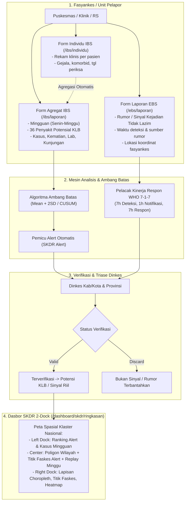
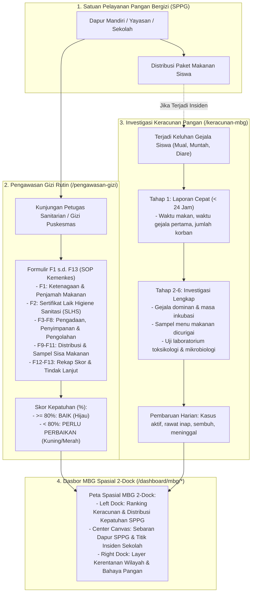
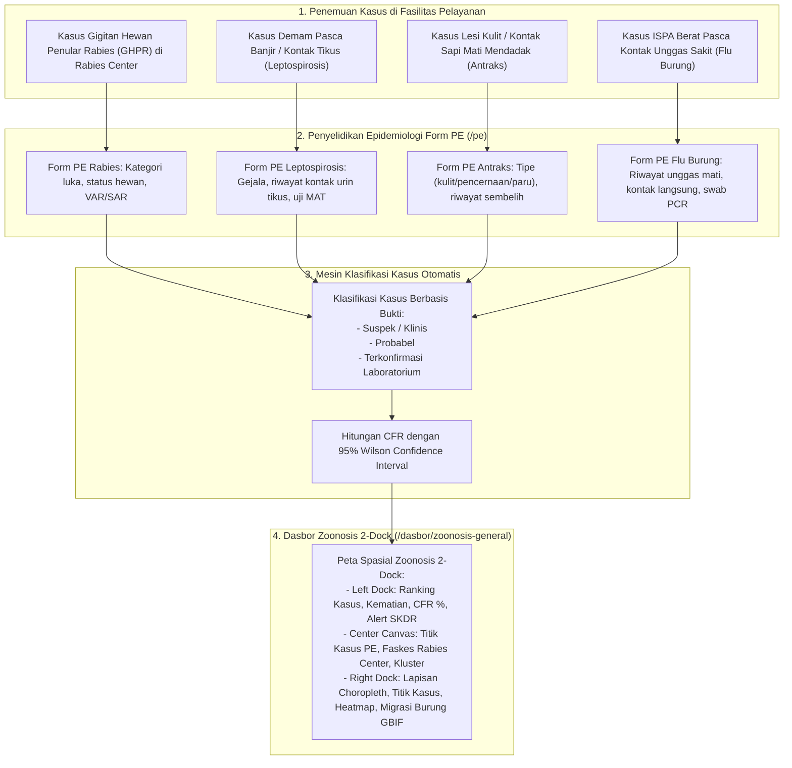

# Panduan Komprehensif Alur Kerja Sistem & Strategi Migrasi Lintas Bidang (SKDR, MBG, Zoonosis)

Dokumen ini merupakan panduan arsitektur dan operasional resmi untuk memahami alur kerja (*flow*), form transaksi, variabel data, dan strategi migrasi dari sistem eksisting Kemenkes RI (**https://skdr.kemkes.go.id**) ke sistem baru **SKDR Indonesia**.

Panduan ini menjamin **100% kelestarian variabel lama (zero data loss)** sekaligus mengintegrasikan inovasi modern: tata letak peta spasial 2-dock, validasi silang otomatis, dan pemantauan epidemiologi terpadu.

---

## 1. Prinsip Utama Migrasi & Keamanan Sistem

1. **Integritas Variabel (Zero Data Loss):**
   - Tidak ada variabel, kode penyakit SMS, kode ICD/SKDR, atau field isian investigasi dari sistem lama yang dibuang.
   - Semua kolom lama dipetakan (*mapping 1:1*) ke skema database baru dan diperluas dengan field analitis otomatis.
2. **Protokol Inspeksi Sistem Lama (Tanpa Submit ke Live Production):**
   - Penelusuran form pada `https://skdr.kemkes.go.id/` dilakukan secara *read-only* atau simulasi pengetikan tanpa menekan tombol simpan/kirim (Strictly **No Submit**).
   - Menghindari polusi data surveilans nasional dan menjaga integritas operasional PHEOC Kemenkes.
3. **Penyelarasan Desain SATUSEHAT v4 Kemenkes:**
   - Seluruh halaman mengusung kanvas *pure white* (`#FFFFFF`), tipografi Manrope resmi DTO, dan arsitektur peta 2-dock (*Left Dock Analisa Wilayah*, *Center Canvas*, *Right Dock Pengaturan Lapisan*).

---

## 2. Alur Kerja & Pemetaan Bidang 1: SKDR Terpadu (IBS & EBS)

### A. Alur Kerja End-to-End SKDR (IBS & EBS)



### B. Matriks Variabel IBS: Sistem Lama vs Sistem Baru

| No | Variabel Sistem Lama (`skdr.kemkes.go.id`) | Variabel Sistem Baru (`laporan_ibs`) | Tipe Data & Format | Peningkatan (*Improvements*) di Sistem Baru |
|---|---|---|---|---|
| 1 | `kd_puskesmas` / ID Unit | `unit_id` / `unit_name` | UUID / String | Terhubung ke master fasyankes resmi SATUSEHAT dengan kode sarana nasional. |
| 2 | `tahun` & `minggu` | `tahun`, `minggu_epidemi` | Integer (Tahun), 1–53 | Kalender epidemiologi otomatis dengan rentang tanggal hari Senin–Minggu. |
| 3 | Kode SMS (A s.d. Z, AA s.d. AC) | `penyakit_code` / `kode_sms` | String (misal: `A`, `B`, `AA`) | Pencarian cepat *SearchSelect* berdasarkan kode SMS maupun nama penyakit. |
| 4 | Jumlah Kasus (`jml_kasus`) | `jumlah_kasus` | Integer ($\ge 0$) | Validasi otomatis: jika $>0$ wajib diperiksa status ambang batas *Mean+2SD*. |
| 5 | Jumlah Kematian (`jml_mati`) | `jumlah_kematian` | Integer ($\ge 0$) | Validasi silang: angka kematian tidak boleh melebihi jumlah kasus. |
| 6 | Jumlah Lab Positif (`jml_lab`) | `jumlah_lab_positif` | Integer ($\ge 0$) | Peringatan bila lab positif tanpa jumlah kasus. |
| 7 | Total Kunjungan (`tota`) | `total_kunjungan` | Integer ($\ge 0$) | Kartu metrik mandiri; hitungan otomatis rasio morbiditas per fasyankes. |

---

## 3. Alur Kerja & Pemetaan Bidang 2: Program MBG (Makan Bergizi Gratis)

### A. Alur Kerja End-to-End Program MBG



### B. Matriks Variabel MBG: Sistem Lama vs Sistem Baru

| Modul | Variabel Sistem Lama (`skdr.kemkes.go.id/form-mbg`) | Variabel Sistem Baru (`mbg_keracunan` & `mbg_kunjungan`) | Tipe Data & Validasi | Peningkatan (*Improvements*) di Sistem Baru |
|---|---|---|---|---|
| **Keracunan** | `tgl_kejadian`, `jam_makan` | `tanggal_kejadian`, `jam_makan` | Date / Time | Otomatisasi saran masa inkubasi (jam gejala pertama dikurangi jam makan). |
| **Keracunan** | `jml_terpapar`, `jml_kasus`, `jml_meninggal` | `terpapar`, `kasus`, `meninggal` | Integer | Kalkulasi Attack Rate (AR %) dan Case Fatality Rate (CFR %) otomatis. |
| **Keracunan** | Gejala klinis (Mual, Muntah, Diare, Pusing, dll.) | `gejala` (JSON key-value) | Checkbox + Counter | Matriks persentase gejala dominan otomatis untuk petunjuk etiologi toksin. |
| **Keracunan** | Sampel Makanan & Laboratorium | `sampel_lab` (JSON list) | Array spesimen | Status penelusuran spesimen (Menunggu $\to$ Terkirim $\to$ Positif/Negatif). |
| **Pengawasan** | Kuesioner Sanitasi Dapur Manual | `mbg_form` (Form 1–13) | Skor per butir (0–100) | Validasi wajib isi alasan jika memilih "Tidak Sesuai"; auto-rekap BAIK/BELUM. |

---

## 4. Alur Kerja & Pemetaan Bidang 3: Zoonosis & One Health

### A. Alur Kerja End-to-End Dasbor Zoonosis



### B. Matriks Variabel Zoonosis: Sistem Lama vs Sistem Baru

| Penyakit | Variabel Sistem Lama | Variabel Sistem Baru (`pe_cases` & Form PE) | Validasi & Standar Medis | Peningkatan (*Improvements*) di Sistem Baru |
|---|---|---|---|---|
| **Rabies / GHPR** | `tgl_gigitan`, `lokasi_gigitan`, `hewan_penular` | `tanggal_gigitan`, `lokasi_luka`, `status_hewan` | Klasifikasi Luka Risiko Tinggi / Sedang | Rekomendasi otomatis pemberian VAR (Vaksin Anti Rabies) & SAR. |
| **Leptospirosis** | `pekerjaan`, `kontak_banjir`, `lab_microscopic` | `faktor_risiko_lingkungan`, `hasil_mat` | Titer MAT $\ge 1:400$ / RDT Lepto Positif | Deteksi kluster spasial pasca-bencana banjir secara otomatis. |
| **Antraks** | `tipe_antraks`, `kontak_daging` | `tipe_klinis`, `riwayat_hewan_sakit` | PCR B. anthracis / apusan luka Gram (+) | Isolasi dini desa terdampak untuk karantina ternak (One Health). |
| **Flu Burung (AI)** | `gejala_ispa`, `riwayat_unggas` | `riwayat_kontak_unggas`, `swab_rt_pcr` | RT-PCR H5N1 / H5N6 terkonfirmasi | Tautan spasial ke data migrasi burung liar global (lapisan GBIF). |

---

## 5. Tata Letak Peta Spasial 2-Dock Universal

Untuk menjaga konsistensi antarmuka pengguna di seluruh aplikasi, komponen peta pada **Dasbor SKDR**, **Dasbor MBG**, dan **Dasbor Zoonosis** menerapkan arsitektur **2-Dock Auto-Layout** yang identik:

```
+---------------------------------------------------------------------------------------------------------+
| [MapPin] PETA SEBARAN & ANALISA SPASIAL                                                                 |
| Judul Spesifik Domain (Misal: Distribusi Kejadian Keracunan Pangan MBG / Sebaran Zoonosis Nasional)     |
| [Pill Metrik 1] [Pill Metrik 2] [Pill Metrik 3] [Pill Metrik 4]              | [Analisa] [Lapisan Peta] |
+---------------------------------------------------------------------------------------------------------+
| +---------------------+ +---------------------------------------------+ +-----------------------------+ |
| | LEFT DOCK (340px)   | | CENTER CANVAS (Flex-1, h-[640px])           | | RIGHT DOCK (320px)          | |
| | "Analisa Wilayah"   | |                                             | | "Pengaturan Lapisan"        | |
| |                     | | - Tile Layer (Terang Satusehat / OSM)       | |                             | |
| | Tab 1: Hotspot      | | - Poligon Batas Provinsi & Kab/Kota         | | - Saklar Choropleth         | |
| |   Ranking nilai     | | - Titik Penanda (Kluster / Titik Tunggal)   | | - Mode Titik (Kluster/Off)  | |
| |   Bar persentase    | | - Heatmap Densitas Sebaran                  | | - Saklar Heatmap            | |
| |   Drilldown chevron | | - Pop-up Interaktif Klik Titik              | | - Pilihan Peta Dasar        | |
| |                     | | - Tombol Fit Extent & Layar Penuh           | | - Legenda Warna Dinamis     | |
| | Tab 2: Ringkasan    | |                                             | |                             | |
| |   4 Kartu Metrik    | |                                             | |                             | |
| |   Interpretasi teks | |                                             | |                             | |
| |                     | |                                             | |                             | |
| | Tab 3: Daftar Titik | |                                             | |                             | |
| |   Pencarian titik   | |                                             | |                             | |
| |   Klik -> Zoom peta | |                                             | |                             | |
| +---------------------+ +---------------------------------------------+ +-----------------------------+ |
+---------------------------------------------------------------------------------------------------------+
```

### Isolasi Variabel & Konteks Antar-Bidang:
* **Pada Dasbor MBG:**
  - *Left Dock*: Ranking Kasus Keracunan, Kejadian Sekolah, Kepatuhan Dapur SPPG.
  - *Peta*: Titik Dapur SPPG (Hijau/Kuning/Merah) & Titik Kejadian Keracunan Sekolah.
  - *Right Dock*: Legenda Skor Kepatuhan Sanitasi & Tingkat Bahaya.
* **Pada Dasbor Zoonosis:**
  - *Left Dock*: Ranking Kasus Zoonotik, Kematian, CFR %, Alert SKDR Zoonosis.
  - *Peta*: Titik Kasus Penyelidikan Epidemiologi (Form PE) & Faskes Rabies Center.
  - *Right Dock*: Legenda Kasus Konfirmasi & Lapisan Vektor/Satwa Liar (GBIF/iNaturalist).
* **Pada Dasbor SKDR Terpadu:**
  - *Left Dock*: Ranking Sinyal Alert SKDR & Agregat IBS 36 Penyakit.
  - *Peta*: Titik Puskesmas & Rumah Sakit pelapor dengan sinyal aktif.
  - *Right Dock*: Legenda Peringatan Dini & Lapisan Intelijen Bencana (BNPB/FIRMS/Flights).

---

## 6. Prosedur Pengujian & Validasi Migrasi Data

1. **Uji Validasi Form Tanpa Submit ke Server Produksi:**
   * Akses URL lama di lingkungan staging atau inspeksi skema field langsung via berkas spesifikasi (`docs/pe-spec/*.json`).
   * Cocokkan seluruh opsi *dropdown* (misal: jenis spesimen lab, kriteria penjamah makanan) dengan konstanta pada frontend Next.js.
2. **Prosedur Migrasi Data Historis (ETL):**
   * Ekstraksi data lama melalui dump SQL atau ekspor CSV berkala.
   * Pembersihan data (*data cleansing*) untuk fasyankes tanpa kode sarana standar.
   * Transformasi koordinat lintang/bujur (*latitude/longitude*) menggunakan tabel referensi `master_fasyankes` dan `master_kabkota`.
   * Pemuatan (*loading*) bertahap ke tabel `laporan_ibs`, `laporan_ebs`, `mbg_keracunan`, dan `pe_cases`.
3. **Pemeriksaan Konsistensi Data (Regression Testing):**
   * Verifikasi total kasus nasional sebelum dan sesudah migrasi bernilai identik ($\Delta = 0$).
   * Verifikasi filter wilayah (Provinsi $\to$ Kabupaten/Kota) menghasilkan agregasi spasial yang presisi.
