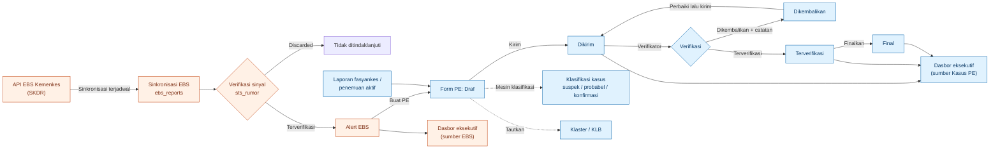
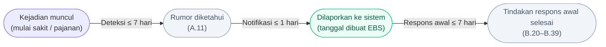

## Alur bisnis SKDR

Diagram di bawah menggambarkan alur data dari sinyal EBS sampai dasbor. Klik kotak yang bertautan untuk membuka halaman terkait.

**Warna:** oranye = sumber **EBS** (alert/sinyal), biru = **Kasus PE** (laporan individu). Kedua sumber ditampilkan terpisah dan **tidak pernah dijumlahkan**.

### Status Form PE
| Status | Arti | Siapa | Bisa diedit? | Bisa dihapus? |
|---|---|---|---|---|
| Draf | Sedang diisi, tersimpan otomatis | Petugas | Ya | Ya (soft delete) |
| Dikirim | Diajukan untuk verifikasi | Petugas | Tidak | Tidak |
| Dikembalikan | Dikembalikan verifikator dengan catatan | Verifikator | Ya | Tidak |
| Terverifikasi | Diterima verifikator kab/kota | Verifikator | Tidak | Tidak |
| Final | Dikunci untuk analisis | Verifikator/admin | Tidak | Tidak |

Dasbor eksekutif menghitung Kasus PE berstatus **Dikirim, Terverifikasi, dan Final** (pengaturan `pe_count_statuses`).

## Alur 7-1-7

Saat ini hanya **notifikasi ≤ 1 hari** yang bisa dihitung (tanggal dibuat − tanggal laporan EBS). API EBS belum mengirim tanggal rumor diketahui (A.11) dan tanggal tindakan respons (B.20–B.39), jadi deteksi dan respons ditampilkan sebagai "data belum tersedia".
